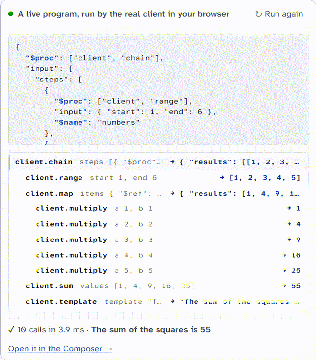

# client

[](https://www.npmjs.com/package/@procedures/client)
[](https://github.com/mark1russell7/client/actions/workflows/ci.yml)
[](LICENSE)
[](https://mark1russell7.github.io/client/)

**Procedures as data for TypeScript.** You define a procedure one time: a path, a Zod input, a Zod output and a handler. Then you use it in the same process, over HTTP or WebSocket, from the `mark` CLI, or from Claude as an MCP tool. A program is plain JSON: calls, references to earlier results, and control flow. The client gives streams, middleware, retries and a cache.

**[The site](https://mark1russell7.github.io/client/)** has the [Composer](https://mark1russell7.github.io/client/composer/) (build a program from blocks, then start it in your browser), the [middleware lab](https://mark1russell7.github.io/client/lab/), the [procedure catalog](https://mark1russell7.github.io/client/catalog/) and the [status board](https://mark1russell7.github.io/client/status/).

[](https://mark1russell7.github.io/client/composer/)

## Install

```sh
npm install @procedures/client zod
```

The packages need Node.js 22 or later. They are ES modules.

## Example

```ts
import { z } from "zod";
import { Client, LocalTransport, PROCEDURE_REGISTRY, allCoreProcedures, createProcedure, zodAdapter } from "@procedures/client";
import "@procedures/client/register"; // the control flow: client.chain and the others

// A procedure: a path, a typed input and output, and a handler
PROCEDURE_REGISTRY.register(
  createProcedure()
    .path(["greet"])
    .input(zodAdapter(z.object({ name: z.string() })))
    .output(zodAdapter(z.string()))
    .handler(async ({ name }) => `Hello, ${name}!`)
    .build(),
);
for (const p of allCoreProcedures) if (!PROCEDURE_REGISTRY.has(p.path)) PROCEDURE_REGISTRY.register(p);

const client = new Client(new LocalTransport({ registry: PROCEDURE_REGISTRY }));
console.log(await client.exec({ $proc: ["greet"], input: { name: "Ada" } }));
// Hello, Ada!

// A program is JSON: the second step reads the result of the first step
const result = await client.exec({
  $proc: ["client", "chain"],
  input: {
    steps: [
      { $proc: ["client", "add"], input: { a: 2, b: 3 } },
      { $proc: ["client", "multiply"], input: { a: { $ref: "$last" }, b: 4 } },
    ],
  },
});
console.log(result.final);
// 20
```

Replace `LocalTransport` with `HttpTransport` or `WebSocketTransport` to use the same procedures on a server. [PROGRAM-FORMAT.md](packages/documentation/PROGRAM-FORMAT.md) tells the rules of programs.

## Compared with other tools

| | client | tRPC | JSON-RPC 2.0 | MCP TypeScript SDK |
|---|---|---|---|---|
| Unit of work | A procedure: path, Zod input and output, handler | A router of queries, mutations and subscriptions | A method name and its parameters | Tools, resources and prompts |
| Transports | In the process, HTTP (JSON or NDJSON streams), WebSocket, MCP over stdio, a CLI | HTTP and WebSocket links | Not part of the specification | stdio and Streamable HTTP |
| Programs as data | JSON programs with references and control flow | No | A batch of calls | No |
| Streams | Async generators, with flow control | Subscriptions | Notifications only | Progress notifications |
| Types on the client | A typed call for each path | End-to-end inference from the router type | No | JSON Schema of the tools |
| Maturity | Version 0.x, one author | Version 11, wide use | A stable specification | The official SDK |

tRPC is the better choice for type inference from server to client in one application. This repository is for procedures that many hosts use: a program, a CLI, a server and Claude.

## Packages

All packages are in `packages/`. The public packages are in the npm scope `@procedures`, with one version together. The table gives the npm name, and the link goes to the folder.

| Group | Packages |
| --- | --- |
| Core | [`@procedures/client`](packages/client) (procedures, client, transports, middleware), [`@procedures/compiler`](packages/compiler) (the check and the compiler of programs), [`@procedures/collections`](packages/client-collections) (data structures), [`@procedures/store`](packages/client-store) (the program store), [`@procedures/dag`](packages/client-dag) (dependency graphs) |
| Commands | [`@procedures/shell`](packages/client-shell), [`@procedures/git`](packages/client-git), [`@procedures/pnpm`](packages/client-pnpm), [`@procedures/docker`](packages/client-docker), [`@procedures/node`](packages/client-node), [`@procedures/vite`](packages/client-vite), [`@procedures/vitest`](packages/client-vitest), [`@procedures/cue`](packages/client-cue), [`@procedures/cli-run`](packages/client-cli) |
| Data and services | [`@procedures/fs`](packages/client-fs), [`@procedures/s3`](packages/client-s3), [`@procedures/mongo`](packages/client-mongo), [`@procedures/sqlite`](packages/client-sqlite), [`@procedures/snapshot`](packages/client-snapshot), [`@procedures/splay`](packages/client-splay) |
| Servers and MCP | [`@procedures/peer`](packages/client-server), [`@procedures/server`](packages/server), [`@procedures/mcp`](packages/mcp), [`@procedures/mcp-server`](packages/client-mcp), [`@procedures/mcp-dev-tools`](packages/impl-mcp-dev) (an MCP server for Claude Code) |
| Tools | [`@procedures/mark`](packages/mark) (the `mark` CLI), [`@procedures/lib`](packages/client-lib), [`@procedures/procedure`](packages/client-procedure), [`@procedures/playground`](packages/client-playground) |
| Bundles | [`@procedures/bundle-dev`](packages/bundle-dev), [`@procedures/bundle-mcp`](packages/bundle-mcp) |
| Private | [`site`](packages/site) (the website), [`documentation`](packages/documentation), [`cli`](packages/cli) (the repository tool) |

Until October 2026, these packages had the scope `@mark1russell7` (for example `@mark1russell7/client-shell`). The general packages `@mark1russell7/cue`, `@mark1russell7/splay` and `@mark1russell7/docker-sqlite` keep their scope. <!-- scope-check: allow -->


## Use with Claude

`@procedures/mcp-dev-tools` is an MCP server with 62 developer tools: Docker, MongoDB, SQLite, CUE, Vitest and the workspace. Each tool call has a time limit, and a tool can use only the procedures that it declares. Add it to the MCP configuration of Claude Code:

```json
{
  "mcpServers": {
    "dev-tools": { "command": "npx", "args": ["-y", "@procedures/mcp-dev-tools"] }
  }
}
```

## Build and test

1. Install the dependencies: `pnpm install`
2. Build all packages: `pnpm build`
3. Start the tests: `pnpm test`
4. Examine the types: `pnpm typecheck`

`pnpm build` builds the packages in the sequence of their dependencies. Each package writes its output to its `dist/` folder. Git ignores `dist/`. [ONBOARDING.md](packages/documentation/ONBOARDING.md) tells more.

## Release

[RELEASE.md](packages/documentation/RELEASE.md) tells how the packages go to npm. `node scripts/check-packages.mjs` examines each package as npm gives it.

## Other repositories

Some packages use general packages from other repositories: `cue`, `splay` and `docker-sqlite`. A general package does not use a package of this repository.

## License

MIT. Refer to [LICENSE](LICENSE).
