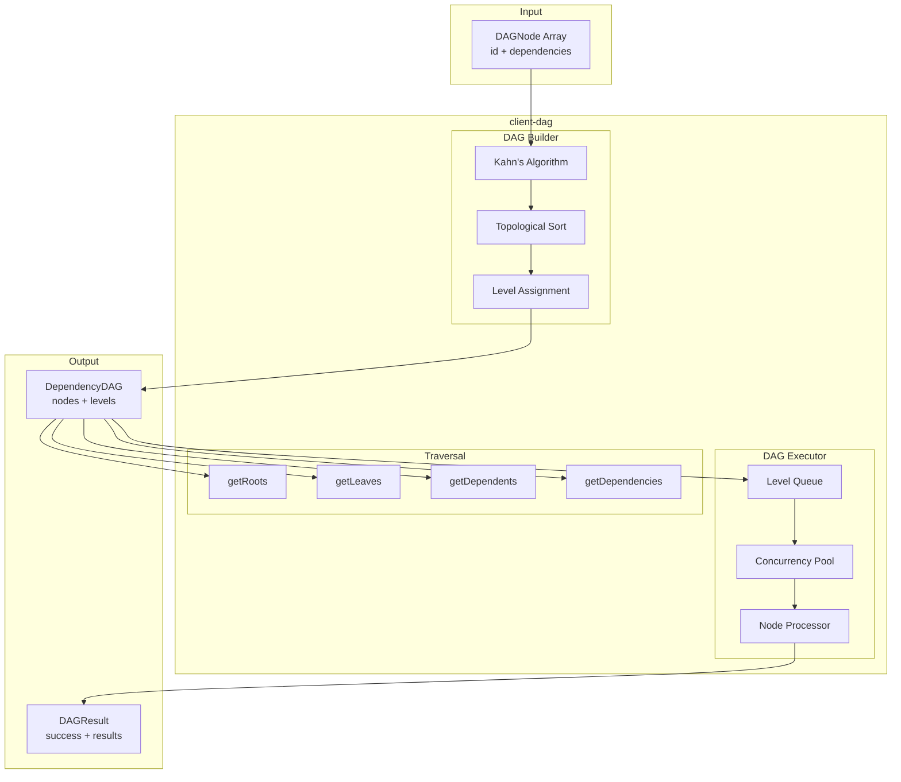
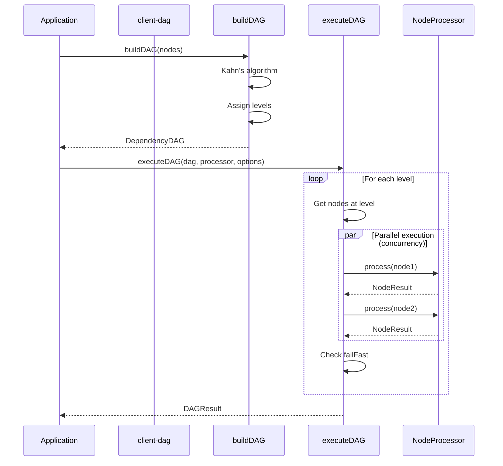
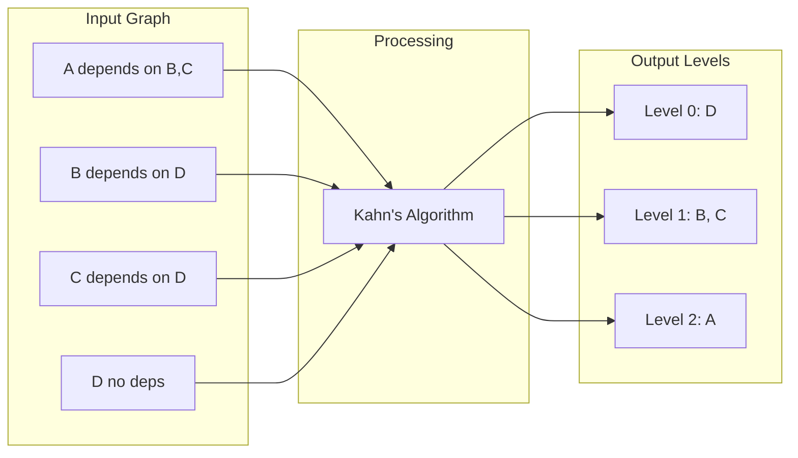
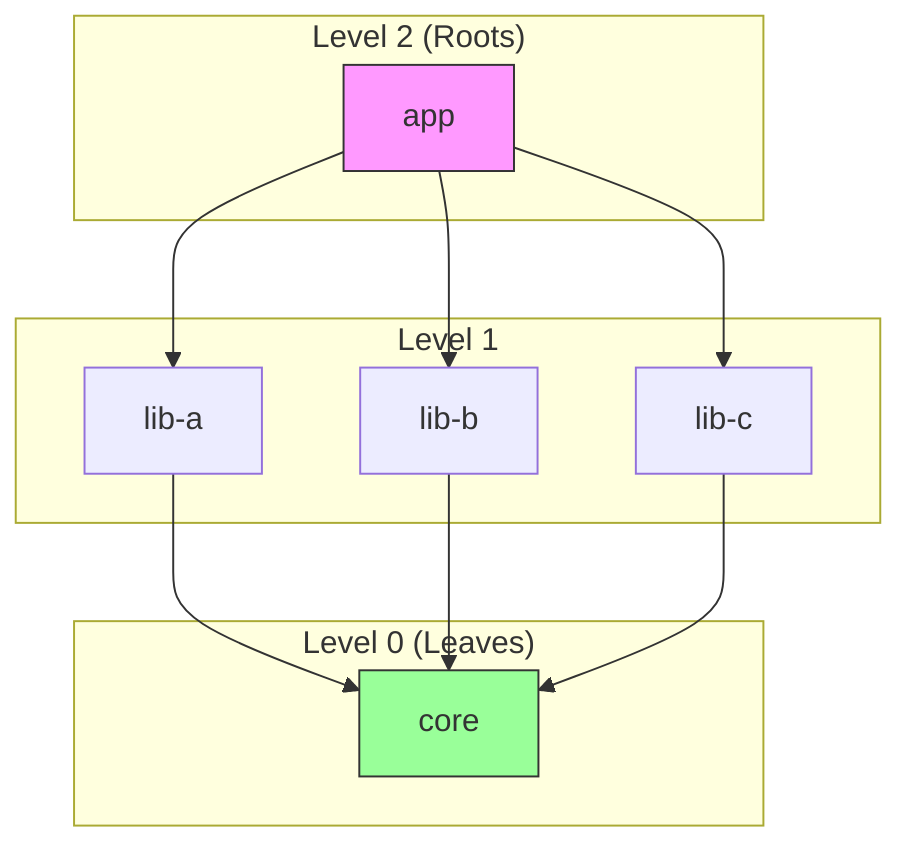
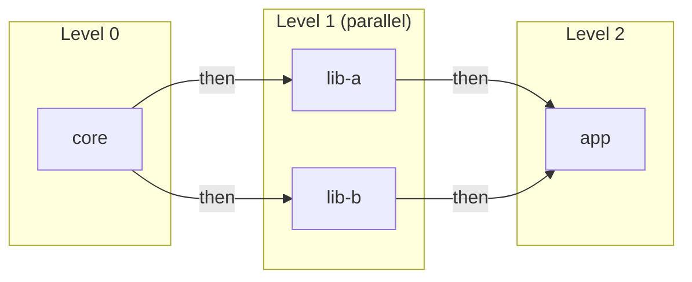
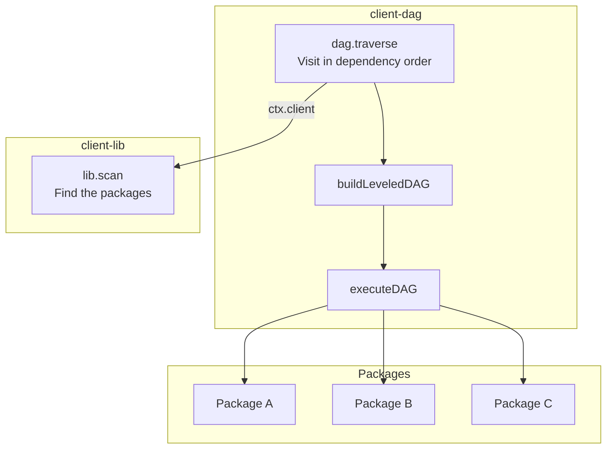

# @procedures/dag

[](https://www.npmjs.com/package/@procedures/dag)

```sh
npm install @procedures/dag
```

[](https://opensource.org/licenses/MIT)
[](https://www.typescriptlang.org/)
[](https://nodejs.org/)

> Generic DAG (Directed Acyclic Graph) utilities for dependency ordering and parallel execution. Powers the ecosystem's build system.

## Table of Contents

- [Overview](#overview)
- [Installation](#installation)
- [Architecture](#architecture)
- [Quick Start](#quick-start)
- [API Reference](#api-reference)
  - [Types](#types)
  - [Functions](#functions)
  - [buildDAG](#builddag)
  - [executeDAG](#executedag)
- [Use Cases](#use-cases)
- [Integration](#integration)
- [Requirements](#requirements)
- [License](#license)

---

## Overview

**client-dag** provides utilities for working with Directed Acyclic Graphs:

- **DAG Building** - Topological sorting using Kahn's algorithm
- **Parallel Execution** - Process nodes level-by-level with configurable concurrency
- **Traversal Utilities** - Find roots, leaves, dependents, and dependencies
- **Progress Tracking** - Callbacks for node start/complete events

---

## Installation

```bash
npm install @procedures/dag
```

---

## Architecture

### System Overview



### Execution Flow



### Topological Sorting (Kahn's Algorithm)



### DAG Structure Visualization



---

## Quick Start

```typescript
import {
  buildDAG,
  executeDAG,
  type DAGNode,
  type NodeProcessor,
} from "@procedures/dag";

// Define nodes
const nodes: DAGNode[] = [
  { id: "app", dependencies: ["lib-a", "lib-b"] },
  { id: "lib-a", dependencies: ["core"] },
  { id: "lib-b", dependencies: ["core"] },
  { id: "core", dependencies: [] },
];

// Build the DAG
const dag = buildDAG(nodes);
// Levels: [["core"], ["lib-a", "lib-b"], ["app"]]

// Define a processor
const processor: NodeProcessor = async (node) => {
  console.log(`Processing ${node.id}`);
  // Do work...
  return {
    node,
    success: true,
    duration: 100,
    logs: [`Built ${node.id}`],
  };
};

// Execute with parallel processing per level
const result = await executeDAG(dag, processor, {
  concurrency: 4,
  failFast: true,
  onNodeStart: (node) => console.log(`Starting: ${node.id}`),
  onNodeComplete: (result) => console.log(`Done: ${result.node.id}`),
});
```

---

## API Reference

### Types

```typescript
interface DAGNode<TData = unknown> {
  id: string;                    // Unique identifier
  dependencies: string[];        // IDs of dependencies
  level?: number;                // Topological level (computed)
  data?: TData;                  // Optional user data
}

interface DependencyDAG<TNode extends DAGNode = DAGNode> {
  nodes: Map<string, TNode>;     // All nodes
  levels: TNode[][];             // Nodes by level
  roots: string[];               // No dependents (end nodes)
  leaves: string[];              // No dependencies (start nodes)
}

interface DAGExecutionOptions<TNode extends DAGNode = DAGNode> {
  concurrency?: number;          // Max parallel per level (default: 4)
  failFast?: boolean;            // Stop on first error (default: true)
  onNodeStart?: (node: TNode) => void;
  onNodeComplete?: (result: NodeResult<TNode>) => void;
}

interface NodeResult<TNode extends DAGNode = DAGNode> {
  node: TNode;
  success: boolean;
  error?: Error;
  duration: number;              // ms
  logs: string[];
  output?: unknown;
}

interface DAGResult<TNode extends DAGNode = DAGNode> {
  success: boolean;
  results: Map<string, NodeResult<TNode>>;
  failedNodes: string[];
  totalDuration: number;
}

type NodeProcessor<TNode extends DAGNode = DAGNode> = (
  node: TNode
) => Promise<NodeResult<TNode>>;
```

### Functions

| Function | Description |
|----------|-------------|
| `buildDAG(nodes)` | Build a DAG from nodes with dependencies |
| `executeDAG(dag, processor, options)` | Execute DAG with parallel processing |
| `getRoots(dag)` | Get nodes with no dependents |
| `getLeaves(dag)` | Get nodes with no dependencies |
| `getDependents(dag, id)` | Get nodes that depend on this node |
| `getDependencies(dag, id)` | Get this node's dependencies |

---

### buildDAG

Build a leveled DAG using Kahn's algorithm.

```typescript
import { buildDAG } from "@procedures/dag";

const nodes = [
  { id: "a", dependencies: ["b", "c"] },
  { id: "b", dependencies: ["d"] },
  { id: "c", dependencies: ["d"] },
  { id: "d", dependencies: [] },
];

const dag = buildDAG(nodes);
// dag.levels = [
//   [{ id: "d", ... }],      // Level 0: process first
//   [{ id: "b" }, { id: "c" }], // Level 1: parallel
//   [{ id: "a", ... }],      // Level 2: process last
// ]
```

**Cycle Detection:**
```typescript
// Throws if cycles detected
const cyclic = [
  { id: "a", dependencies: ["b"] },
  { id: "b", dependencies: ["a"] }, // Cycle!
];
buildDAG(cyclic); // Error: Cycle detected
```

---

### executeDAG

Execute nodes level by level with configurable parallelism.

```typescript
import { executeDAG } from "@procedures/dag";

const result = await executeDAG(dag, processor, {
  concurrency: 4,        // Process up to 4 nodes in parallel per level
  failFast: true,        // Stop immediately on first failure
  onNodeStart: (node) => console.log(`Starting: ${node.id}`),
  onNodeComplete: (r) => console.log(`${r.node.id}: ${r.success ? "OK" : "FAIL"}`),
});

if (result.success) {
  console.log("All nodes processed successfully");
} else {
  console.log("Failed nodes:", result.failedNodes);
}
```

**Execution Order:**



---

## Use Cases

### Package Build Order

Build packages in dependency order (the procedure `dag.traverse` of this package does this):

```typescript
const packages = [
  { id: "app", dependencies: ["@org/lib-ui", "@org/lib-core"] },
  { id: "@org/lib-ui", dependencies: ["@org/lib-core"] },
  { id: "@org/lib-core", dependencies: [] },
];

const dag = buildDAG(packages);
await executeDAG(dag, async (pkg) => {
  await runBuild(pkg.id);
  return { node: pkg, success: true, duration: 0, logs: [] };
});
```

### Task Scheduling

Execute dependent tasks:

```typescript
const tasks = [
  { id: "deploy", dependencies: ["test", "build"] },
  { id: "test", dependencies: ["build"] },
  { id: "build", dependencies: [] },
];

const dag = buildDAG(tasks);
await executeDAG(dag, async (task) => {
  await runTask(task.id);
  return { node: task, success: true, duration: 0, logs: [] };
});
```

### Module Loading

Load modules respecting dependencies:

```typescript
const modules = [
  { id: "app", dependencies: ["router", "store"] },
  { id: "router", dependencies: ["utils"] },
  { id: "store", dependencies: ["utils"] },
  { id: "utils", dependencies: [] },
];

const dag = buildDAG(modules);
await executeDAG(dag, async (mod) => {
  await import(mod.id);
  return { node: mod, success: true, duration: 0, logs: [] };
});
```

---

## Integration

### The procedure `dag.traverse`

The package has one procedure, `dag.traverse`. It came from `client-lib` in version 0.4.0, and its name stays the same. The graph algorithms of the package root do not need it.

`dag.traverse` starts the `visit` procedure once for each package, with `cwd` set to the folder of the package. A package starts after the packages that it depends on.

| Field | Default | Function |
|---|---|---|
| `visit` | | A procedure path, or a call with `$when: "$parent"` (or `$never`) |
| `filter` | | Only these package names |
| `root` | | Only this package and the packages that it depends on |
| `rootPath` | the workspace | The workspace root |
| `concurrency` | 4 | The number of visits at the same time |
| `serialize` | `auto` | When the visits in one git repository start one at a time: `auto` (when the visit uses a `git` procedure), `repository` (always) or `none` |
| `continueOnError` | false | Continue after a failed visit |
| `dryRun` | false | Give the plan only |

All packages of the monorepo are in one git repository. Concurrent `git add` commands fail on `index.lock`, so `auto` starts git visits one at a time (deep dive DATA-17).

```typescript
import { Client, LocalTransport, PROCEDURE_REGISTRY } from "@procedures/client";
import "@procedures/lib/register"; // lib.scan, and the fs and git procedures that it uses
import "@procedures/dag/register"; // dag.traverse

const client = new Client(new LocalTransport({ registry: PROCEDURE_REGISTRY }));

await client.exec(["dag", "traverse"], {
  visit: { $proc: ["pnpm", "run"], input: { script: "build" }, $when: "$parent" },
  root: "@procedures/fs",
});
```

- `dag.traverse` gets the packages from `lib.scan` of `@procedures/lib`, through `ctx.client`. Its metadata declares the call (`calls: ["lib.scan"]`).
- `@procedures/lib` depends on this package. Thus this package does not import `@procedures/lib`, and the module of this package does not list the module of `@procedures/lib` as a dependency. A host registers the two modules. `bundle-dev`, `bundle-mcp` and `mark` do.
- `dag.traverse` has the tag `runs-refs`: it starts the refs of its input. Thus a server with an `expose` rule lets it use only exposed procedures, `lib.scan` too.
- A call in `visit` with `$when: "dag.traverse"` waits for this runner ([PROGRAM-FORMAT.md](../documentation/PROGRAM-FORMAT.md), section 5).
- `bundle-mcp` registers the procedure, but `dag` is not a tool namespace of the MCP server.



### With client-lib

`client-lib` uses the algorithms of this package for `lib.graph`.

---

## Requirements

- **Node.js** >= 22
- **Dependencies:** `@procedures/client` and `zod`, for the procedure. The graph algorithms use neither.

---

## License

MIT
