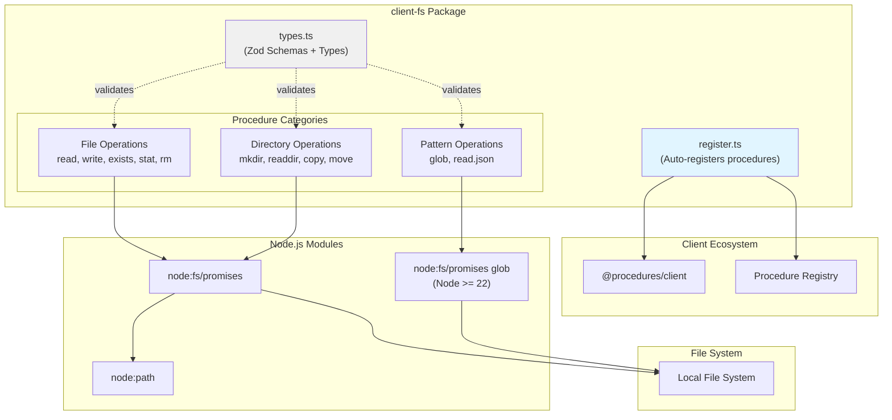

# @procedures/fs

[](https://www.npmjs.com/package/@procedures/fs)

[](https://opensource.org/licenses/MIT)
[](https://www.typescriptlang.org/)
[](https://nodejs.org/)

File system operations as RPC procedures. Read, write, copy, move, glob files and directories via `client.call()`.

## Overview

`client-fs` provides comprehensive file system access through the client procedure ecosystem with:
- **File operations**: Read, write, stat, exists, remove
- **Directory operations**: Create, list, copy, move
- **Pattern matching**: Glob file search via the Node.js `fs.glob` API (`node:fs/promises`, requires Node >= 22)
- **JSON utilities**: Read and parse JSON files
- **Zod validation**: Runtime type safety on all inputs

The package has 11 procedures. Its register entry (`import "@procedures/fs/register"`) registers them:
`fs.read`, `fs.write`, `fs.exists`, `fs.stat`, `fs.mkdir`, `fs.rm`, `fs.readdir`, `fs.copy`, `fs.move`, `fs.glob`, `fs.read.json`, `fs.write.json`, `fs.hash`, `fs.temp`, `fs.watch`

## Architecture



### Package Dependency Flow

```mermaid
graph LR
    App["Your Application"]
    ClientFs["@procedures/fs"]
    Client["@procedures/client"]
    Zod["zod"]
    NodeModules["node:fs/promises<br/>(glob: Node >= 22)"]

    App --> ClientFs
    ClientFs --> Client
    ClientFs --> Zod
    ClientFs --> NodeModules

    App -.client.call.-> Client
    Client -.executes.-> ClientFs
    ClientFs -.validates.-> Zod
    ClientFs -.file ops.-> NodeModules
```

## Installation

```bash
npm install @procedures/fs
```

Since 0.2.0, an import of the package registers nothing. To register its procedures in the global registry:

```ts
import "@procedures/fs/register";
```

## Confine the paths to a root

A host can give the file procedures a root folder. Then each path of each input must be in the root.

```ts
import { createRegistry } from "@procedures/client";
import { createFsModule } from "@procedures/fs/module";
import { bundleDevModule } from "@procedures/bundle-dev/module";

// The module with the root comes first: it replaces the fsModule that the bundle requires
const registry = createRegistry(createFsModule({ root: "/work/project" }), bundleDevModule);
```

`registerFsProcedures(registry, { root })` registers the procedures with the root in one registry.

A host that has a registry already starts `confineToRoot(registry, root)`. The function confines each procedure of the registry, and it adds no procedure:

```ts
import { confineToRoot } from "@procedures/fs/module";

const { root, fs, confined, programs, refused, unchanged } = confineToRoot(registry, "/work/project");
```

- Each `fs.*` procedure gets the handler of `createFsModule({ root })`.
- Each other procedure gets the decision of `rootDecisionOf(procedure)`. The decision reads the rules of `metadata.fsRoot`, or the effects of a procedure without rules.
- A confined procedure gets each path of its rules in the root. A procedure that the root cannot confine gives `FORBIDDEN` with the reason `outside-root`, as a path outside the root does.
- The handler of a confined procedure and of a program procedure gets the root in `ctx.fsRoot`. A procedure that starts a program uses it to keep the program in the root, as `git.*` does.
- A nested call of another procedure finds the new handler in the registry. Thus `lib.scan`, which calls `fs.readdir`, reads only the folders in the root.
- The root must be a folder that exists. Otherwise the function throws, and the host does not start.
- An `fs.*` procedure of another package is an error, because the root cannot confine it. Rules that are not correct are an error too. The function changes nothing when it throws.
- The hosts use this function: `mark --fs-root <folder>`, `procedure-server --fs-root <folder>` and `MCP_FS_ROOT` of the MCP server.

`confineFsProcedures(registry, root)` changes only the `fs.*` procedures, as before 0.8.0.

The rules, the default for a procedure without rules, and the table of the procedures of this repository are in [CAPABILITIES-2026-10.md](../documentation/CAPABILITIES-2026-10.md#the-root-of-the-files-roadmap-r33).

### The rules for other packages

The entry `@procedures/fs/root` has the rules of the root without the procedures: `inRoot()`, `resolveRoot()`, `realPathOf()`, `isInside()`, `outsideRoot()` and `isOutsideRoot()`. A package that confines its own paths imports them. `@procedures/archive` uses them for `createArchiveModule({ root })`.

### Rules

- A relative path starts at the root, not at the working folder of the process.
- An absolute path in the root is correct.
- The procedures refuse a path outside the root. The error has the code `FORBIDDEN` and the reason `outside-root`. A server sends the reason in the metadata key `reason`.
- These paths are outside the root: a path that goes up with `..`, an absolute path in another folder and a path on another drive.
- The procedures refuse a symlink or a junction that goes out of the root. The check uses the real path of the input (`fs.realpath`).
- For a path that does not exist, the check uses the real path of the nearest folder above it. Thus a write or `fs.mkdir` cannot go out of the root through a symlinked folder.
- The check follows a symlink to its target, also when the target does not exist, because a write follows the symlink too.
- Each path input of each procedure gets the check: `path`, `src`, `dest` and the `cwd` of `fs.glob`.
- `fs.glob` refuses an absolute pattern, a pattern that starts with a drive and a pattern with a `..` segment. It also removes each match whose real path is outside the root.
- `fs.readdir` with `includeStats` gives no stats for an entry that goes out of the root.
- The procedures get the absolute path, so the paths of the output are absolute.
- On Windows, the check ignores the case of the letters, and `/` and `\` are equal.
- A relative root starts at the working folder of the process when `createFsModule()` starts.
- If the root does not exist, each procedure fails with the code `ENOENT`.
- Without a root, the procedures operate on each path as before. `createFsModule()` gives `fsModule`.

### Limits

- The check and the operation are two steps. The check does not see a symlink that a process changes between the two steps.
- `createFsModule({ root })` and `confineFsProcedures()` confine only the `fs.*` procedures and their nested calls. `confineToRoot()` also confines or refuses the other procedures.
- The root does not replace the permissions of the operating system.

## File helpers

The entry `@procedures/fs/files` has helpers for the files of an app: the atomic write, the NDJSON tail heal, the keyed lock and the edit. They are not procedures, and an import of the entry registers nothing. The package root exports them too.

### `writeFileAtomic(path, data, options?)` and `writeFileAtomicSync(path, data, options?)`

The function writes a temporary file next to the target, flushes it to the disk and renames it over the target. A reader sees the old file or the whole new file.

```ts
import { writeFileAtomic, writeFileAtomicSync } from "@procedures/fs/files";

await writeFileAtomic("./state.json", JSON.stringify(state));
writeFileAtomicSync("./meta.json", JSON.stringify(meta));
```

- After a failure, the function removes the temporary file.
- The file keeps the permissions of the target. The option `mode` sets other permissions.
- When the group and the others cannot read the final file, the temporary file gets `0o600` before the data. Windows ignores most of the mode.
- On Windows, an open handle of the target blocks the rename. The function tries again for `renameRetryMs` (2000 by default).
- `writeFileAtomicSync()` does the same steps. On Windows, a locked target blocks the thread for `renameRetryMs` at most.

The temporary file is in the folder of the target. Its default name is `.<name>.<16 hex digits>.tmp`. The `<name>` is the first 32 characters of the name of the target. A crash between the write and the rename leaves this file. For a `.env` file, add the pattern `..env.*.tmp` to `.gitignore`.

The option `tempName` gives a name of your own. The function gives it the absolute path of the target. A name with `/` or `\` is a `TypeError` with the code `ERR_INVALID_ARG_VALUE`. The name of a file that exists gives the error `EEXIST`.

```ts
await writeFileAtomic("./.env", text, { tempName: (target) => `${basename(target)}.${process.pid}.tmp` });
```

### `healNdjsonTail(path, options?)` and `healNdjsonTailSync(path, options?)`

The function repairs the end of an append-only NDJSON file after a crash. Start it before the next append.

```ts
import { healNdjsonTail, healNdjsonTailSync } from "@procedures/fs/files";

const { action, bytes } = await healNdjsonTail("./events.ndjson");
// "none", "truncated" (a part of a line is cut off) or "newline" (a complete record gets its newline)

const { lastLine } = healNdjsonTailSync("./chat.ndjson", { lastLine: true });
const nextSeq = lastLine === undefined ? 0 : JSON.parse(lastLine).seq + 1;
```

- The function reads only the last line, from the end of the file, up to `maxLineBytes` (16 MiB by default).
- A missing file and an empty file get no change.
- With `lastLine: true`, the result has `lastLine`: the last complete line after the repair, without its newline. It is `undefined` when the file has no complete line.
- Without `lastLine`, the function reads one byte of a file that ends in a newline. With `lastLine`, it also reads the last line.
- `healNdjsonTailSync()` makes the same repairs, with the same options, the same result and the same errors.

A last line that is longer than `maxLineBytes` stops the function, and the file does not change. The error is a `RangeError` with the code `ERR_NDJSON_LINE_TOO_LONG`, also the export `NDJSON_LINE_TOO_LONG`. Its fields `lineBytes`, `maxLineBytes` and `path` give the length, the limit and the file.

```text
A line at the end of ./ledger.ndjson has 15728640 bytes, more than the limit maxLineBytes (1048576 bytes). Set the option maxLineBytes to 15728640 or more, or to Infinity for no limit. The file did not change.
```

The function does not cut or skip a long line, because that removes data from the file. For records of more than 16 MiB, set a larger `maxLineBytes`. The value `Infinity` turns the limit off. Then the function keeps all of the last line in memory.

### `withLock(key, fn, options?)` and `KeyedLock`

One caller at a time holds a key in the process. The other callers wait in the order of their calls. With `ifHeld: "skip"`, the call does not start `fn` when the key has a holder.

```ts
import { withLock } from "@procedures/fs/files";

const report = await withLock("morning", () => runMorning());
const outcome = await withLock("morning", () => runMorning(), { ifHeld: "skip" });
if (!outcome.ran) console.log("A morning is running.");
```

- The lock gives the key back when `fn` throws.
- The option `signal` stops a wait.
- `new KeyedLock()` has keys of its own, with `acquire()`, `tryAcquire()` and `run()`.

### `editFile(path, transform, options?)`

The function reads a file, waits for `transform` and writes the result with `writeFileAtomic()`. The edits of one path run one at a time in the process.

```ts
import { editFile } from "@procedures/fs/files";

await editFile("./.env", (text) => `${text}TOKEN=abc\n`, { initial: "" });
```

- A missing file gives `initial`, or `undefined` without it.
- A transform that gives the same text or `undefined` writes nothing.
- The options of `writeFileAtomic()` apply to the write, also `tempName`.
- On Windows, the lock ignores the case of the letters of the path.

## API Reference

### File Operations

#### `fs.read`

Read file contents as a string.

```typescript
const result = await client.exec(
  ["fs", "read"],
  {
    path: "./config.json",
    encoding: "utf8"
  }
);

console.log(result.content);
console.log(result.stats.size);
```

**Input:**
```typescript
interface ReadInput {
  path: string;              // File path (absolute or relative)
  encoding?: string;         // Default: "utf8"
}
```

**Output:**
```typescript
interface ReadOutput {
  content: string;           // File contents
  path: string;              // Resolved absolute path
  stats: StatOutput;         // File statistics
}
```

#### `fs.write`

Write content to a file.

```typescript
await client.exec(
  ["fs", "write"],
  {
    path: "./output.txt",
    content: "Hello, World!",
    mode: "write"  // or "append"
  }
);
```

**Input:**
```typescript
interface WriteInput {
  path: string;              // File path
  content: string;           // Content to write
  encoding?: string;         // Default: "utf8"
  mode?: "write" | "append"; // Default: "write"
}
```

**Output:**
```typescript
interface WriteOutput {
  path: string;              // Written file path
  bytesWritten: number;      // Number of bytes written
}
```

#### `fs.exists`

Check if a path exists and get its type.

```typescript
const result = await client.exec(
  ["fs", "exists"],
  { path: "./my-file.txt" }
);

if (result.exists) {
  console.log(`Path exists and is a ${result.stats.type}`);
}
```

**Input:**
```typescript
interface ExistsInput {
  path: string;
}
```

**Output:**
```typescript
type ExistsOutput =
  | { exists: false }
  | { exists: true; stats: StatOutput };
```

#### `fs.stat`

Get file or directory statistics.

```typescript
const result = await client.exec(
  ["fs", "stat"],
  { path: "./my-directory" }
);

console.log(result.type);  // "file" | "directory" | "other"
console.log(result.size);  // Size in bytes
```

**Input:**
```typescript
interface StatInput {
  path: string;
}
```

**Output:**
```typescript
interface StatOutput {
  path: string;
  type: FileType;            // "file" | "directory" | "other"
  size: number;              // Size in bytes
  mtime: string;             // Modified time (ISO)
  ctime: string;             // Created time (ISO)
  atime: string;             // Accessed time (ISO)
  mode: number;              // Unix permissions
}

enum FileType {
  File = "file",
  Directory = "directory",
  Other = "other"
}
```

#### `fs.rm`

Remove a file or directory.

```typescript
// Remove file
await client.exec(
  ["fs", "rm"],
  { path: "./old-file.txt" }
);

// Remove directory recursively
await client.exec(
  ["fs", "rm"],
  {
    path: "./old-directory",
    recursive: true,
    force: true
  }
);
```

**Input:**
```typescript
interface RmInput {
  path: string;
  recursive?: boolean;       // Default: false
  force?: boolean;           // Ignore if doesn't exist (default: false)
}
```

**Output:**
```typescript
interface RmOutput {
  path: string;
  removed: boolean;          // false if didn't exist with force=true
}
```

### Directory Operations

#### `fs.mkdir`

Create a directory.

```typescript
await client.exec(
  ["fs", "mkdir"],
  {
    path: "./new/nested/directory",
    recursive: true  // Create parents if needed
  }
);
```

**Input:**
```typescript
interface MkdirInput {
  path: string;
  recursive?: boolean;       // Default: true
}
```

**Output:**
```typescript
interface MkdirOutput {
  path: string;
  created: boolean;          // false if already existed
}
```

#### `fs.readdir`

List directory contents.

```typescript
const result = await client.exec(
  ["fs", "readdir"],
  {
    path: "./src",
    recursive: true,
    includeStats: true
  }
);

result.entries.forEach(entry => {
  console.log(`${entry.type}: ${entry.path}`);
  if (entry.stats) {
    console.log(`  Size: ${entry.stats.size} bytes`);
  }
});
```

**Input:**
```typescript
interface ReaddirInput {
  path: string;
  recursive?: boolean;       // Default: false
  includeStats?: boolean;    // Default: false
}
```

**Output:**
```typescript
interface ReaddirOutput {
  path: string;
  entries: ReaddirEntry[];
}

interface ReaddirEntry {
  name: string;              // Entry name
  path: string;              // Full path
  type: FileType;            // "file" | "directory" | "other"
  stats?: StatOutput;        // If includeStats=true
}
```

#### `fs.copy`

Copy a file or directory.

Without `overwrite`, an existing destination is an error with the code `EEXIST`, and the copy changes nothing. This applies to a file and to a folder. With `overwrite`, the copy replaces the files at the destination.

```typescript
// Copy file
await client.exec(
  ["fs", "copy"],
  {
    src: "./source.txt",
    dest: "./destination.txt",
    overwrite: true
  }
);

// Copy directory recursively
await client.exec(
  ["fs", "copy"],
  {
    src: "./src-dir",
    dest: "./dest-dir",
    recursive: true
  }
);
```

**Input:**
```typescript
interface CopyInput {
  src: string;
  dest: string;
  recursive?: boolean;       // Default: true
  overwrite?: boolean;       // Default: false. Without it, an existing destination is an error (EEXIST)
}
```

**Output:**
```typescript
interface CopyOutput {
  src: string;
  dest: string;
}
```

#### `fs.move`

Move or rename a file or directory.

```typescript
await client.exec(
  ["fs", "move"],
  {
    src: "./old-name.txt",
    dest: "./new-name.txt",
    overwrite: false
  }
);
```

**Input:**
```typescript
interface MoveInput {
  src: string;
  dest: string;
  overwrite?: boolean;       // Default: false
}
```

**Output:**
```typescript
interface MoveOutput {
  src: string;
  dest: string;
}
```

### Pattern Matching Operations

#### `fs.glob`

Find files matching a glob pattern using the Node.js `fs.glob` API (`node:fs/promises`, requires Node >= 22).

```typescript
const result = await client.exec(
  ["fs", "glob"],
  {
    pattern: "src/**/*.{ts,tsx}",
    cwd: "/my/project",
    absolute: true,
    dot: false
  }
);

console.log(result.matches);
// ["/my/project/src/index.ts", "/my/project/src/components/App.tsx", ...]
```

**Input:**
```typescript
interface GlobInput {
  pattern: string;           // Glob pattern (e.g., "**/*.ts")
  cwd?: string;              // Base directory (default: process.cwd())
  absolute?: boolean;        // Return absolute paths (default: false)
  dot?: boolean;             // Include dotfiles (default: false)
}
```

**Output:**
```typescript
interface GlobOutput {
  pattern: string;
  matches: string[];         // Matching file paths
}
```

**Glob Pattern Examples:**
```typescript
// All TypeScript files
"**/*.ts"

// All files in src directory
"src/**/*"

// TypeScript and JavaScript files
"**/*.{ts,js}"

// Note: node:fs/promises glob does NOT exclude node_modules by default;
// pass an `exclude` pattern or scope the pattern (e.g. "src/**/*.ts")
"src/**/*.ts"

// Include test files
"**/*.{test,spec}.ts"
```

#### `fs.read.json`

Read and parse a JSON file.

```typescript
const result = await client.exec(
  ["fs", "read.json"],
  { path: "./package.json" }
);

console.log(result.data);  // Parsed JSON object
```

**Input:**
```typescript
interface ReadJsonInput {
  path: string;
}
```

**Output:**
```typescript
interface ReadJsonOutput {
  path: string;
  data: unknown;             // Parsed JSON (cast to your type)
  stats: StatOutput;
}
```

**Type-safe example:**
```typescript
interface PackageJson {
  name: string;
  version: string;
  dependencies: Record<string, string>;
}

const result = await client.exec(
  ["fs", "read.json"],
  { path: "./package.json" }
);

const pkg = result.data as PackageJson;
console.log(pkg.name, pkg.version);
```

#### `fs.write.json`

The procedure writes a value as a JSON file, with 2 spaces of indent and a line break at the end. It writes a file next to the target first, then renames it. Thus a reader sees the old file or the whole new file.

```typescript
await client.exec(["fs", "write.json"], { path: "./data.json", value: { a: 1 }, indent: 2 });
```

#### `fs.hash`

The procedure gives the hash of a file as hexadecimal text: `sha256` (the default), `sha512`, `sha1` or `md5`. It reads the file as a stream.

```typescript
const { hash, size } = await client.exec(["fs", "hash"], { path: "./archive.tgz" });
```

#### `fs.temp`

The procedure makes a new folder in the temporary folder of the system, and gives its path. With a root, the folder is in the folder `.tmp` of the root. The `prefix` has letters, digits, dots, underscores and hyphens only.

#### `fs.watch`

The procedure gives the changes of a file or folder as a stream. Each item has the `event` (`rename` or `change`) and the `filename`. The stream has no end: it stops when the reader stops or the call aborts. The platform decides the details, so one change can give two items.

```typescript
for await (const change of client.execStream(["fs", "watch"], { path: "./src", recursive: true })) {
  console.log(change.event, change.filename);
}
```

## Usage Examples

### Basic File Operations

```typescript
import { Client, LocalTransport, PROCEDURE_REGISTRY } from "@procedures/client";
import "@procedures/fs/register"; // registers its procedures

const client = new Client(new LocalTransport({ registry: PROCEDURE_REGISTRY }));

// Read a file
const { content } = await client.exec(
  ["fs", "read"],
  { path: "./README.md" }
);

// Write to a file
await client.exec(
  ["fs", "write"],
  {
    path: "./output.txt",
    content: "Generated content\n",
    mode: "write"
  }
);

// Append to a file
await client.exec(
  ["fs", "write"],
  {
    path: "./log.txt",
    content: `[${new Date().toISOString()}] Log entry\n`,
    mode: "append"
  }
);

// Check if file exists
const exists = await client.exec(
  ["fs", "exists"],
  { path: "./config.json" }
);

if (exists.exists) {
  // Get file stats
  const stats = await client.exec(
    ["fs", "stat"],
    { path: "./config.json" }
  );
  console.log(`File size: ${stats.size} bytes`);
}
```

### Directory Operations

```typescript
// Create nested directories
await client.exec(
  ["fs", "mkdir"],
  {
    path: "./build/assets/images",
    recursive: true
  }
);

// List directory contents
const { entries } = await client.exec(
  ["fs", "readdir"],
  {
    path: "./src",
    includeStats: true
  }
);

entries.forEach(entry => {
  if (entry.type === "file") {
    console.log(`File: ${entry.name} (${entry.stats?.size} bytes)`);
  } else {
    console.log(`Directory: ${entry.name}`);
  }
});

// Recursive directory listing
const { entries: allFiles } = await client.exec(
  ["fs", "readdir"],
  {
    path: "./src",
    recursive: true
  }
);

console.log(`Total items: ${allFiles.length}`);
```

### Copy and Move Operations

```typescript
// Backup a file
await client.exec(
  ["fs", "copy"],
  {
    src: "./important-data.json",
    dest: "./backups/important-data.backup.json"
  }
);

// Copy entire directory
await client.exec(
  ["fs", "copy"],
  {
    src: "./templates",
    dest: "./build/templates",
    recursive: true,
    overwrite: true
  }
);

// Rename a file
await client.exec(
  ["fs", "move"],
  {
    src: "./old-name.txt",
    dest: "./new-name.txt"
  }
);

// Move to different directory
await client.exec(
  ["fs", "move"],
  {
    src: "./temp/file.txt",
    dest: "./archive/file.txt",
    overwrite: false
  }
);
```

### Pattern Matching with Glob

```typescript
// Find all TypeScript files
const { matches: tsFiles } = await client.exec(
  ["fs", "glob"],
  {
    pattern: "**/*.ts",
    cwd: "./src",
    absolute: true
  }
);

console.log(`Found ${tsFiles.length} TypeScript files`);

// Find test files
const { matches: testFiles } = await client.exec(
  ["fs", "glob"],
  {
    pattern: "**/*.{test,spec}.{ts,js}",
    cwd: "."
  }
);

// Find config files
const { matches: configs } = await client.exec(
  ["fs", "glob"],
  {
    pattern: "**/*.config.{js,ts,json}",
    dot: true  // Include dotfiles like .eslintrc.json
  }
);
```

### JSON File Operations

```typescript
// Read package.json
const { data: pkg } = await client.exec(
  ["fs", "read.json"],
  { path: "./package.json" }
);

console.log(`Package: ${pkg.name}@${pkg.version}`);

// Read tsconfig.json
const { data: tsconfig } = await client.exec(
  ["fs", "read.json"],
  { path: "./tsconfig.json" }
);

console.log("Compiler options:", tsconfig.compilerOptions);

// Read and modify JSON
const { data: config } = await client.exec(
  ["fs", "read.json"],
  { path: "./config.json" }
);

config.lastUpdated = new Date().toISOString();

await client.exec(
  ["fs", "write"],
  {
    path: "./config.json",
    content: JSON.stringify(config, null, 2)
  }
);
```

### Build Script Example

```typescript
// Clean build directory
await client.exec(
  ["fs", "rm"],
  {
    path: "./dist",
    recursive: true,
    force: true
  }
);

// Create build directory
await client.exec(
  ["fs", "mkdir"],
  { path: "./dist" }
);

// Find all source files
const { matches: sourceFiles } = await client.exec(
  ["fs", "glob"],
  {
    pattern: "src/**/*.ts",
    absolute: true
  }
);

// Process each file...
for (const file of sourceFiles) {
  const { content } = await client.exec(
    ["fs", "read"],
    { path: file }
  );

  // Transform content...
  const transformed = content.replace(/\.ts$/, ".js");

  await client.exec(
    ["fs", "write"],
    {
      path: file.replace("src/", "dist/").replace(".ts", ".js"),
      content: transformed
    }
  );
}

// Copy assets
await client.exec(
  ["fs", "copy"],
  {
    src: "./public",
    dest: "./dist/public",
    recursive: true
  }
);
```

## Integration with Ecosystem

### Bundle Packages

`client-fs` can be included in bundle packages:

```typescript
// In bundle-dev/src/register.ts
import "@procedures/fs/register"; // registers its procedures
import "@procedures/shell/register"; // registers its procedures
import "@procedures/cli-run/register"; // registers its procedures
```

## Dependencies

### Runtime Dependencies

- **@procedures/client** - Core client procedure system
- **zod** (^3.24.0) - Runtime type validation

### Implicit Dependencies

- **node:fs/promises** - Node.js file system promises API
- **node:path** - Node.js path utilities
- **node:fs/promises `glob`** - Glob pattern matching (used by the `fs.glob` procedure; requires Node >= 22)

### Development Dependencies

- **@mark1russell7/cue** - Configuration and type utilities
- **typescript** (^5.9.3) - TypeScript compiler
- **@types/node** (^22.0.0) - Node.js type definitions

## Package Structure

```
client-fs/
├── src/
│   ├── types.ts                  # Zod schemas + TypeScript types
│   ├── register.ts               # Auto-registration
│   ├── index.ts                  # Main entry point
│   ├── module.ts                 # fsModule, createFsModule({ root })
│   ├── root.ts                   # The check of a path against the root (the ./root entry)
│   ├── handlers.ts               # The handlers with a root
│   ├── confine.ts                # The root for the other procedures of a registry
│   ├── files/                    # The file helpers (the ./files entry): atomic write, NDJSON tail, lock, edit
│   ├── procedures/
│   │   ├── fs.ts                 # Barrel export
│   │   └── fs/
│   │       ├── index.ts          # Procedure exports
│   │       ├── read.ts           # fs.read
│   │       ├── write.ts          # fs.write
│   │       ├── exists.ts         # fs.exists
│   │       ├── stat.ts           # fs.stat
│   │       ├── mkdir.ts          # fs.mkdir
│   │       ├── rm.ts             # fs.rm
│   │       ├── readdir.ts        # fs.readdir
│   │       ├── copy.ts           # fs.copy
│   │       ├── move.ts           # fs.move
│   │       ├── glob.ts           # fs.glob
│   │       └── json.ts           # fs.read.json
├── dist/                         # Compiled output
├── package.json
├── tsconfig.json
└── README.md
```

## Development

### Build

```bash
npm run build
```

### Type Check

```bash
npm run typecheck
```

### Clean

```bash
npm run clean
```

## License

MIT

## Author

Mark Russell <marktheprogrammer17@gmail.com>
