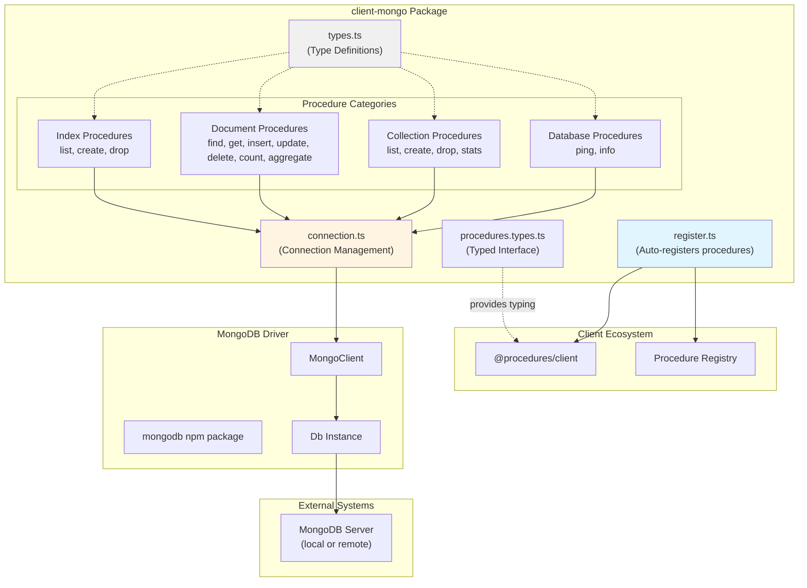
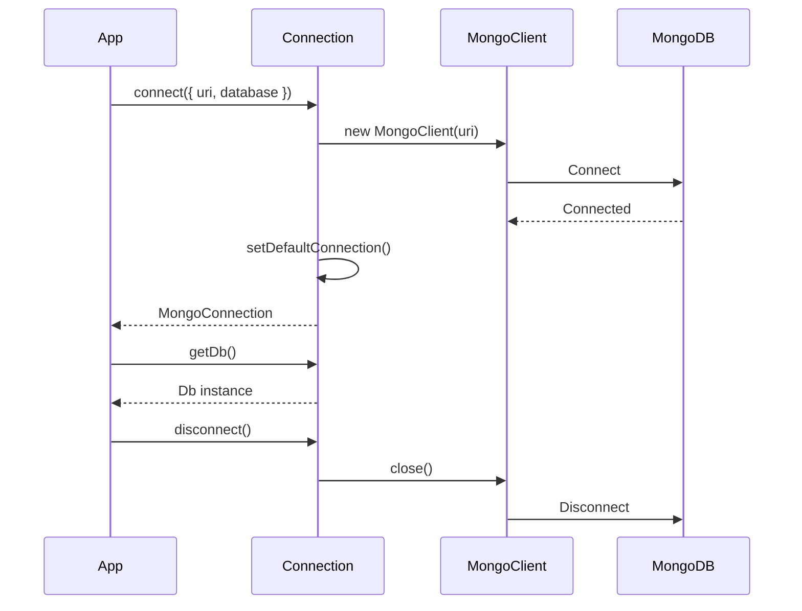

# @procedures/mongo

[](https://www.npmjs.com/package/@procedures/mongo)
[](https://opensource.org/licenses/MIT)
[](https://www.typescriptlang.org/)
[](https://nodejs.org/)

MongoDB client wrapper with client procedures for local or RPC access. Provides a comprehensive set of procedures for database operations, collection management, document CRUD, indexing, and aggregation pipeline support.

## Overview

`client-mongo` bridges MongoDB operations into the client procedure ecosystem, enabling both:
- **Local usage**: Direct MongoDB connection with native driver
- **RPC usage**: Remote procedure calls via `client.call()`

The package follows the client procedure pattern, with 20 procedures in 5 categories. Its register entry (`import "@procedures/mongo/register"`) registers them:
- **Database**: `ping`, `info`
- **Collections**: `list`, `create`, `drop`, `stats`
- **Documents**: `find`, `get`, `insert`, `update`, `delete`, `count`, `aggregate`, `distinct`, `bulk`, `explain`
- **Indexes**: `list`, `create`, `drop`
- **Change streams**: `mongo.watch`

## Architecture



### Package Dependency Flow

```mermaid
graph LR
    App["Your Application"]
    ClientMongo["@procedures/mongo"]
    Client["@procedures/client"]
    MongoDB["mongodb"]

    App --> ClientMongo
    ClientMongo --> Client
    ClientMongo --> MongoDB

    App -.client.call.-> Client
    Client -.executes.-> ClientMongo
    ClientMongo -.queries.-> MongoDB
```

### Connection Management Flow



## Installation

```bash
npm install @procedures/mongo
```

Since 0.2.0, an import of the package registers nothing. To register its procedures in the global registry:

```ts
import "@procedures/mongo/register";
```

## Configuration

### Environment Variables

```bash
# MongoDB connection URI (optional, defaults to mongodb://localhost:27017)
MONGODB_URI=mongodb://localhost:27017

# Default database name (optional, defaults to "test")
MONGODB_DATABASE=myapp
```

### Programmatic Configuration

```typescript
import { connect } from "@procedures/mongo";

// Using environment variables
await connect();

// With explicit options
await connect({
  uri: "mongodb://localhost:27017",
  database: "myapp",
  clientOptions: {
    // Any MongoDB client options
    maxPoolSize: 10,
    minPoolSize: 2,
  }
});
```

### The first call connects

A host does not have to call `connect()`. When there is no open connection, the first procedure call connects with the options of `configure()`, or with the environment variables. Concurrent first calls share one attempt.

```typescript
import { configure } from "@procedures/mongo";

configure({ uri: "mongodb://localhost:27017", database: "myapp" });
```

### The collection and the database of a call

Each procedure reads `collection` and `database` from its input. An MCP tool call can set them. The call metadata is the fallback, for the clients that set it.

```typescript
await client.exec(["mongo", "documents", "count"], { collection: "users", query: { active: true } });
```

## API Reference

### Connection Management

#### `connect(options?): Promise<MongoConnection>`

Create and connect to MongoDB. Sets the default connection used by all procedures.

```typescript
interface MongoConnectionOptions {
  uri?: string;                    // Default: MONGODB_URI or mongodb://localhost:27017
  database?: string;               // Default: MONGODB_DATABASE or "test"
  clientOptions?: MongoClientOptions;
}

interface MongoConnection {
  getDb(): Db;
  getClient(): MongoClient;
  connect(): Promise<void>;
  disconnect(): Promise<void>;
  isConnected(): boolean;
}
```

**Example:**
```typescript
const conn = await connect({
  uri: "mongodb://localhost:27017",
  database: "myapp"
});
```

#### `disconnect(): Promise<void>`

Disconnect the default connection.

```typescript
await disconnect();
```

#### `getDb(): Db`

Get the database instance from the default connection.

```typescript
const db = getDb();
const collection = db.collection("users");
```

#### `getClient(): MongoClient`

Get the MongoClient from the default connection.

```typescript
const client = getClient();
```

#### `getDefaultConnection(): MongoConnection`

Get the default connection instance. Throws if not connected.

#### `setDefaultConnection(conn: MongoConnection): void`

Set the default connection (advanced usage).

#### `hasDefaultConnection(): boolean`

Check if a default connection exists.

### Registered Procedures

All procedures are automatically registered when the package is imported. They can be called via `client.call()` or used directly.

#### Database Procedures

##### `mongo.database.ping`

Test database connectivity and measure latency.

```typescript
// Via RPC
const result = await client.exec(
  ["mongo", "database", "ping"],
  { timeout: 5000 }
);

// Direct import
import { pingProcedure } from "@procedures/mongo";
```

**Input:**
```typescript
interface PingInput {
  timeout?: number;  // Optional timeout in milliseconds
}
```

**Output:**
```typescript
interface PingOutput {
  latencyMs: number;  // Response time in milliseconds
  ok: boolean;        // Server status
}
```

##### `mongo.database.info`

Get database information and statistics.

```typescript
const result = await client.exec(
  ["mongo", "database", "info"],
  { includeStats: true }
);
```

**Input:**
```typescript
interface InfoInput {
  includeStats?: boolean;
}
```

**Output:**
```typescript
interface DatabaseInfo {
  name: string;         // Database name
  collections: number;  // Number of collections
  views: number;        // Number of views
  sizeOnDisk: number;   // Size on disk in bytes
  empty: boolean;       // Whether database is empty
}
```

#### Collection Procedures

##### `mongo.collections.list`

List all collections in the database.

```typescript
const result = await client.exec(
  ["mongo", "collections", "list"],
  { filter: "user" }
);
```

**Input:**
```typescript
interface ListCollectionsInput {
  filter?: string;  // Filter by name pattern
}
```

**Output:**
```typescript
interface ListCollectionsOutput {
  collections: string[];  // Collection names
}
```

##### `mongo.collections.create`

Create a new collection.

```typescript
const result = await client.exec(
  ["mongo", "collections", "create"],
  {
    name: "logs",
    options: {
      capped: true,
      size: 10485760,  // 10MB
      max: 1000
    }
  }
);
```

**Input:**
```typescript
interface CreateCollectionInput {
  name: string;
  options?: CollectionOptions;
}

interface CollectionOptions {
  capped?: boolean;
  size?: number;      // Max size in bytes (for capped)
  max?: number;       // Max documents (for capped)
  validator?: Document;  // JSON Schema validator
}
```

**Output:**
```typescript
interface CreateCollectionOutput {
  created: boolean;
  name: string;
}
```

##### `mongo.collections.drop`

Drop a collection.

```typescript
const result = await client.exec(
  ["mongo", "collections", "drop"],
  { name: "old_collection" }
);
```

**Input:**
```typescript
interface DropCollectionInput {
  name: string;
}
```

**Output:**
```typescript
interface DropCollectionOutput {
  dropped: boolean;
}
```

##### `mongo.collections.stats`

Get collection statistics.

```typescript
const result = await client.exec(
  ["mongo", "collections", "stats"],
  {},
  { metadata: { collection: "users" } }
);
```

**Input:**
```typescript
interface StatsInput {
  // Collection from metadata
}
```

**Output:**
```typescript
interface CollectionStats {
  count: number;           // Number of documents
  size: number;            // Size of documents in bytes
  avgObjSize: number;      // Average document size
  storageSize: number;     // Total storage size
  nindexes: number;        // Number of indexes
  totalIndexSize: number;  // Total index size
}
```

#### Document Procedures

##### `mongo.documents.find`

Find documents with pagination, filtering, sorting, and projection.

```typescript
const result = await client.exec(
  ["mongo", "documents", "find"],
  {
    query: { status: "active", age: { $gte: 18 } },
    projection: { name: 1, email: 1 },
    sort: { createdAt: -1 },
    page: 1,
    limit: 20
  },
  { metadata: { collection: "users" } }
);
```

**Input:**
```typescript
interface FindInput {
  query?: DocumentQuery;           // MongoDB filter
  projection?: Record<string, 0 | 1>;  // Field projection
  sort?: SortSpec;                 // Sort specification
  page?: number;                   // Page number (1-indexed)
  limit?: number;                  // Items per page (max 100)
}

type DocumentQuery = Filter<Document>;
type SortSpec = Record<string, 1 | -1>;
```

**Output:**
```typescript
interface FindOutput {
  documents: MongoDocument[];
  pagination: PaginationOutput;
}

interface PaginationOutput {
  page: number;
  limit: number;
  total: number;
  totalPages: number;
  hasNext: boolean;
  hasPrev: boolean;
}
```

##### `mongo.documents.get`

Get a single document by ID.

```typescript
const result = await client.exec(
  ["mongo", "documents", "get"],
  { id: "507f1f77bcf86cd799439011" },
  { metadata: { collection: "users" } }
);
```

**Input:**
```typescript
interface GetInput {
  id: string;  // Document ID (converted to ObjectId)
}
```

**Output:**
```typescript
interface GetOutput {
  document: MongoDocument | null;
}
```

##### `mongo.documents.insert`

Insert one or more documents.

```typescript
// Insert single document
const result = await client.exec(
  ["mongo", "documents", "insert"],
  {
    documents: {
      name: "John Doe",
      email: "john@example.com",
      createdAt: new Date()
    }
  },
  { metadata: { collection: "users" } }
);

// Insert multiple documents
const result = await client.exec(
  ["mongo", "documents", "insert"],
  {
    documents: [
      { name: "Alice" },
      { name: "Bob" }
    ]
  },
  { metadata: { collection: "users" } }
);
```

**Input:**
```typescript
interface InsertInput {
  documents: MongoDocument | MongoDocument[];
}
```

**Output:**
```typescript
interface InsertOutput {
  insertedCount: number;
  insertedIds: string[];
}
```

##### `mongo.documents.update`

Update one document by `id`, or the documents that match a `filter`.

A write needs exactly one of `id` or `filter`. An unknown field is an error: `query` is the field of `find` and `count`, not of `update`. An empty filter matches every document, so it needs `confirm: true`.

```typescript
// Update one document by ID
const result = await client.exec(
  ["mongo", "documents", "update"],
  {
    collection: "users",
    id: "...",
    update: { $set: { status: "inactive" } },
    upsert: false
  }
);

// Update multiple documents
const result = await client.exec(
  ["mongo", "documents", "update"],
  {
    collection: "users",
    filter: { status: "pending" },
    update: { $set: { status: "active" } },
    multi: true
  }
);
```

**Input:**
```typescript
interface UpdateInput {
  collection?: string;     // Or metadata.collection
  database?: string;       // Or metadata.database
  id?: string;             // Exactly one of id and filter
  idType?: "auto" | "objectId" | "string";
  filter?: DocumentQuery;
  update: DocumentUpdate;
  multi?: boolean;   // Update all matching documents
  upsert?: boolean;  // Insert if not found
  confirm?: boolean; // Required for an empty filter
}

type DocumentUpdate = UpdateFilter<Document>;
```

An upsert by `id` in the "auto" mode updates the document with that ID in either form. When no document matches, the new document gets the ObjectId form of the ID.

**Output:**
```typescript
interface UpdateOutput {
  acknowledged: boolean;
  matchedCount: number;
  modifiedCount: number;
  upsertedId: string | null;
  upsertedCount: number;
}
```

##### `mongo.documents.delete`

Delete one document by `id`, or the documents that match a `filter`. The rules of `update` apply: exactly one target, no unknown fields, and `confirm: true` for an empty filter.

```typescript
// Delete one document by ID
const result = await client.exec(
  ["mongo", "documents", "delete"],
  { collection: "users", id: "..." }
);

// Delete multiple documents
const result = await client.exec(
  ["mongo", "documents", "delete"],
  {
    collection: "users",
    filter: { status: "inactive" },
    multi: true
  }
);
```

**Input:**
```typescript
interface DeleteInput {
  collection?: string;     // Or metadata.collection
  database?: string;       // Or metadata.database
  id?: string;             // Exactly one of id and filter
  idType?: "auto" | "objectId" | "string";
  filter?: DocumentQuery;
  multi?: boolean;   // Delete all matching documents
  confirm?: boolean; // Required for an empty filter
}
```

**Output:**
```typescript
interface DeleteOutput {
  acknowledged: boolean;
  deletedCount: number;
}
```

##### `mongo.documents.count`

Count documents matching a query.

```typescript
const result = await client.exec(
  ["mongo", "documents", "count"],
  { query: { status: "active" } },
  { metadata: { collection: "users" } }
);
```

**Input:**
```typescript
interface CountInput {
  query?: DocumentQuery;
}
```

**Output:**
```typescript
interface CountOutput {
  count: number;
}
```

##### `mongo.documents.aggregate`

Execute an aggregation pipeline.

```typescript
const result = await client.exec(
  ["mongo", "documents", "aggregate"],
  {
    pipeline: [
      { $match: { status: "active" } },
      { $group: { _id: "$country", count: { $sum: 1 } } },
      { $sort: { count: -1 } }
    ],
    options: {
      allowDiskUse: true,
      maxTimeMS: 5000
    }
  },
  { metadata: { collection: "users" } }
);
```

**Input:**
```typescript
interface AggregateInput {
  pipeline: AggregationStage[];
  options?: AggregationOptions;
}

type AggregationStage = Document;

interface AggregationOptions {
  allowDiskUse?: boolean;
  maxTimeMS?: number;
}
```

**Output:**
```typescript
interface AggregateOutput {
  results: MongoDocument[];
}
```

##### `mongo.documents.distinct`

The procedure gives the distinct values of one field in the documents that match `query`. The default `query` matches all documents. An array field gives each of its elements. Use dots for an embedded field, for example `address.city`.

```typescript
const { values } = await client.exec(
  ["mongo", "documents", "distinct"],
  { collection: "users", field: "country", query: { status: "active" } }
);
```

##### `mongo.documents.bulk`

The procedure sends several writes in one request. The operations have the form of the `bulkWrite` of the driver: `insertOne`, `updateOne`, `updateMany`, `deleteOne` and `deleteMany`. By default, the operations run in order, and the first failure stops the rest. With `ordered: false`, the server tries each operation, and the error tells which ones failed.

The rules of `update` and `delete` apply to each operation. An empty filter of an update or a delete needs `confirm: true` on the call. An unknown operation or field is an error.

```typescript
const result = await client.exec(["mongo", "documents", "bulk"], {
  collection: "users",
  operations: [
    { insertOne: { document: { name: "Di" } } },
    { updateOne: { filter: { name: "Ann" }, update: { $set: { status: "active" } } } },
    { updateMany: { filter: { status: "new" }, update: { $set: { status: "active" } } } },
    { deleteOne: { filter: { name: "Bob" } } },
    { deleteMany: { filter: { status: "deleted" } } },
  ],
});
// result: { ok, insertedCount, matchedCount, modifiedCount, deletedCount, upsertedCount, insertedIds, upsertedIds }
```

The ids in `insertedIds` and `upsertedIds` are text, and their keys are the indexes of the operations.

##### `mongo.documents.explain`

The procedure gives the plan of a find or of an aggregation pipeline. With `pipeline`, it explains an aggregation. Without `pipeline`, it explains a find with `query`, `projection`, `sort` and `limit`. The verbosity `queryPlanner` (the default) gives the plan only. With the verbosities `executionStats` and `allPlansExecution`, the server also does the plan and gives its statistics. As `documents.aggregate` does, the procedure refuses `$out` and `$merge`.

```typescript
const { operation, plan } = await client.exec(["mongo", "documents", "explain"], {
  collection: "users",
  query: { email: "ann@example.com" },
  verbosity: "executionStats",
});
console.log(plan.queryPlanner.winningPlan);
```

#### Index Procedures

##### `mongo.indexes.list`

List all indexes on a collection.

```typescript
const result = await client.exec(
  ["mongo", "indexes", "list"],
  {},
  { metadata: { collection: "users" } }
);
```

**Input:**
```typescript
interface ListIndexesInput {
  // Collection from metadata
}
```

**Output:**
```typescript
interface ListIndexesOutput {
  indexes: IndexInfo[];
}

interface IndexInfo {
  name: string;
  key: IndexSpec;
  unique?: boolean;
  sparse?: boolean;
}

type IndexSpec = Record<string, 1 | -1 | "text" | "2dsphere">;
```

##### `mongo.indexes.create`

Create an index on a collection.

```typescript
// Simple index
const result = await client.exec(
  ["mongo", "indexes", "create"],
  {
    keys: { email: 1 },
    options: { unique: true }
  },
  { metadata: { collection: "users" } }
);

// Compound index
const result = await client.exec(
  ["mongo", "indexes", "create"],
  {
    keys: { status: 1, createdAt: -1 },
    options: { name: "status_created_idx" }
  },
  { metadata: { collection: "users" } }
);

// Text index
const result = await client.exec(
  ["mongo", "indexes", "create"],
  {
    keys: { title: "text", description: "text" }
  },
  { metadata: { collection: "articles" } }
);
```

**Input:**
```typescript
interface CreateIndexInput {
  keys: IndexSpec;
  options?: IndexOptions;
}

interface IndexOptions {
  name?: string;
  unique?: boolean;
  sparse?: boolean;
  background?: boolean;
  expireAfterSeconds?: number;  // TTL index
}
```

**Output:**
```typescript
interface CreateIndexOutput {
  name: string;  // Index name
}
```

##### `mongo.indexes.drop`

Drop an index from a collection.

```typescript
const result = await client.exec(
  ["mongo", "indexes", "drop"],
  { name: "email_1" },
  { metadata: { collection: "users" } }
);
```

**Input:**
```typescript
interface DropIndexInput {
  name: string;  // Index name to drop
}
```

**Output:**
```typescript
interface DropIndexOutput {
  dropped: boolean;
}
```

#### Change Streams

##### `mongo.watch`

The procedure gives the changes of a collection as a stream. Without `collection`, it gives the changes of each collection of the database. The stream has no end (`metadata.stream: { unbounded: true }`). It stops when the reader stops or the call aborts, and the procedure then closes the change stream.

A change stream needs a replica set or a sharded cluster. A standalone server refuses it, and the reader gets that error.

```typescript
for await (const change of client.execStream(["mongo", "watch"], {
  collection: "orders",
  pipeline: [{ $match: { operationType: { $in: ["insert", "update"] } } }],
  fullDocument: "updateLookup",
})) {
  console.log(change.operationType, change.documentKey, change.resumeToken);
}
```

Each item has the `operationType`, the namespace `ns`, the `documentKey` and the `resumeToken`. An insert gives the `fullDocument`, and an update gives the `updateDescription`. With `fullDocument: "updateLookup"`, an update also gives the current document. To continue after a stop, give the last `resumeToken` as `resumeAfter`. The `pipeline` accepts only the stages of a change stream: `$match`, `$project`, `$addFields`, `$set`, `$unset`, `$replaceRoot`, `$replaceWith` and `$redact`.

### Type Definitions

#### Core Types

```typescript
// Documents
type DocumentId = string | ObjectId;
type BaseDocument = Document;
type MongoDocument = BaseDocument;
type DocumentQuery = Filter<Document>;
type DocumentUpdate = UpdateFilter<Document>;

// Metadata
interface BaseMeta extends Record<string, unknown> {
  database?: string;  // Override database name
}

interface CollectionMeta extends BaseMeta {
  collection: string;  // Collection name (required)
}

// Pagination
interface PaginationInput {
  page?: number;   // Page number (1-indexed)
  limit?: number;  // Items per page
}

interface PaginationOutput {
  page: number;
  limit: number;
  total: number;
  totalPages: number;
  hasNext: boolean;
  hasPrev: boolean;
}

// Sorting
type SortOrder = 1 | -1;
type SortSpec = Record<string, SortOrder>;

// Indexes
type IndexSpec = Record<string, 1 | -1 | "text" | "2dsphere">;

interface IndexOptions {
  name?: string;
  unique?: boolean;
  sparse?: boolean;
  background?: boolean;
  expireAfterSeconds?: number;
}

interface IndexInfo {
  name: string;
  key: IndexSpec;
  unique?: boolean;
  sparse?: boolean;
}

// Collections
interface CollectionOptions {
  capped?: boolean;
  size?: number;
  max?: number;
  validator?: Document;
}

interface CollectionStats {
  count: number;
  size: number;
  avgObjSize: number;
  storageSize: number;
  nindexes: number;
  totalIndexSize: number;
}

// Database
interface DatabaseInfo {
  name: string;
  collections: number;
  views: number;
  sizeOnDisk: number;
  empty: boolean;
}

// Aggregation
type AggregationStage = Document;

interface AggregationOptions {
  allowDiskUse?: boolean;
  maxTimeMS?: number;
}

// Bulk Operations
interface BulkInsertOne {
  insertOne: { document: Document };
}

interface BulkUpdateOne {
  updateOne: {
    filter: DocumentQuery;
    update: DocumentUpdate;
    upsert?: boolean;
  };
}

interface BulkDeleteOne {
  deleteOne: { filter: DocumentQuery };
}

type BulkOperation = BulkInsertOne | BulkUpdateOne | BulkDeleteOne;

interface BulkWriteResult {
  acknowledged: boolean;
  insertedCount: number;
  matchedCount: number;
  modifiedCount: number;
  deletedCount: number;
  upsertedCount: number;
}
```

#### Typed Procedures Interface

For compile-time autocomplete, use the `MongoProcedures` type:

```typescript
import type { MongoProcedures } from "@procedures/mongo";
import { createTypedCaller } from "@procedures/client";

const call = createTypedCaller<MongoProcedures>(client.call);

// Full autocomplete on path and input!
const result = await call(
  ["mongo", "documents", "find"],
  { query: { status: "active" } },
  { metadata: { collection: "users" } }
);
// result is typed as FindOutput
```

### Type Guards and Utilities

```typescript
// Check if metadata has collection
function hasCollection(metadata: Record<string, unknown>): metadata is CollectionMeta;

// Get collection metadata, throws if missing
function requireCollection(metadata: Record<string, unknown>): CollectionMeta;

// Get base metadata (database override)
function getBaseMeta(metadata: Record<string, unknown>): BaseMeta;
```

## Usage Examples

### Basic CRUD Operations

```typescript
import { Client, LocalTransport, PROCEDURE_REGISTRY } from "@procedures/client";
import { connect } from "@procedures/mongo";

// Connect to MongoDB
await connect({
  uri: "mongodb://localhost:27017",
  database: "myapp"
});

const client = new Client(new LocalTransport({ registry: PROCEDURE_REGISTRY }));

// Create a user
const insertResult = await client.exec(
  ["mongo", "documents", "insert"],
  {
    documents: {
      name: "Alice Johnson",
      email: "alice@example.com",
      age: 28,
      status: "active",
      createdAt: new Date()
    }
  },
  { metadata: { collection: "users" } }
);

// Find active users
const findResult = await client.exec(
  ["mongo", "documents", "find"],
  {
    query: { status: "active" },
    sort: { createdAt: -1 },
    limit: 10
  },
  { metadata: { collection: "users" } }
);

console.log(findResult.documents);
console.log(findResult.pagination);

// Update a user
await client.exec(
  ["mongo", "documents", "update"],
  {
    filter: { email: "alice@example.com" },
    update: { $set: { status: "inactive" } }
  },
  { metadata: { collection: "users" } }
);

// Delete inactive users
await client.exec(
  ["mongo", "documents", "delete"],
  {
    filter: { status: "inactive" },
    multi: true
  },
  { metadata: { collection: "users" } }
);
```

### Aggregation Pipeline

```typescript
// Group users by country and count
const result = await client.exec(
  ["mongo", "documents", "aggregate"],
  {
    pipeline: [
      { $match: { status: "active" } },
      { $group: {
          _id: "$country",
          count: { $sum: 1 },
          avgAge: { $avg: "$age" }
        }
      },
      { $sort: { count: -1 } },
      { $limit: 10 }
    ]
  },
  { metadata: { collection: "users" } }
);

console.log(result.results);
```

### Index Management

```typescript
// Create unique email index
await client.exec(
  ["mongo", "indexes", "create"],
  {
    keys: { email: 1 },
    options: { unique: true, name: "email_unique_idx" }
  },
  { metadata: { collection: "users" } }
);

// Create compound index
await client.exec(
  ["mongo", "indexes", "create"],
  {
    keys: { status: 1, createdAt: -1 },
    options: { name: "status_created_idx" }
  },
  { metadata: { collection: "users" } }
);

// List all indexes
const indexes = await client.exec(
  ["mongo", "indexes", "list"],
  {},
  { metadata: { collection: "users" } }
);

console.log(indexes.indexes);

// Drop an index
await client.exec(
  ["mongo", "indexes", "drop"],
  { name: "status_created_idx" },
  { metadata: { collection: "users" } }
);
```

### Collection Management

```typescript
// Create capped collection for logs
await client.exec(
  ["mongo", "collections", "create"],
  {
    name: "logs",
    options: {
      capped: true,
      size: 10485760,  // 10MB
      max: 1000
    }
  }
);

// List all collections
const collections = await client.exec(
  ["mongo", "collections", "list"],
  { filter: "user" }  // Filter collections containing "user"
);

console.log(collections.collections);

// Get collection stats
const stats = await client.exec(
  ["mongo", "collections", "stats"],
  {},
  { metadata: { collection: "users" } }
);

console.log(stats);
```

### Direct Usage (Without RPC)

```typescript
import {
  connect,
  findProcedure,
  insertProcedure,
  requireCollection
} from "@procedures/mongo";

await connect({ database: "myapp" });

// Use procedures directly
const findResult = await findProcedure.handler(
  { query: { status: "active" }, limit: 10 },
  { metadata: { collection: "users" } }
);

const insertResult = await insertProcedure.handler(
  { documents: { name: "Bob", email: "bob@example.com" } },
  { metadata: { collection: "users" } }
);
```

### Multi-Database Support

```typescript
// Default database
await client.exec(
  ["mongo", "documents", "find"],
  { query: {} },
  { metadata: { collection: "users" } }
);

// Override database in metadata
await client.exec(
  ["mongo", "documents", "find"],
  { query: {} },
  { metadata: { database: "analytics", collection: "events" } }
);
```

## Document storage: `MongoDocumentStorage`

`MongoDocumentStorage` is a `CollectionStorage` of `@procedures/collections` over MongoDB (roadmap CLI-24). It has flat documents, a change log, versions, queries in the database and partitions. `MongoStorage` keeps its `{ _id, data }` documents.

```ts
import { MongoDocumentStorage } from "@procedures/mongo";

const notes = new MongoDocumentStorage<Note>({ collection: "notes" });
await notes.set("n1", { title: "Plan", done: false });
await notes.query({ done: false }, { sort: { title: 1 }, limit: 20 });

// One storage for each tenant, on one collection (roadmap CLI-17)
server.usePartitions("notes", { storageOf: (partition) => notes.forPartition(partition), resolve });
```

| Option | Use |
| --- | --- |
| `collection` | The MongoDB collection |
| `db` | The database. The default is the database of the default connection. |
| `partition` | The partition of the storage. `forPartition(partition)` gives the storage of a partition, the same one each time. |
| `maxTombstones` | The most deletes that the change log keeps in each partition (default 10000) |
| `queryPolicy` | The query policy of `query()` without a policy of the call |
| `counters` | The collection of the sequence counters (default `__storage_counters`) |
| `writeLeaseMs` | The time after which a pending number of a write that stopped no longer holds the readers (default 60000) |
| `client` | The client of the database, for the transactions. The default is the client of the default connection when `db` is absent. |
| `transactions` | `auto` (the default): a transaction for each write on a replica set or a sharded cluster. `never`: the watermark only. |

- **The documents.** A plain object with safe keys is stored flat: its fields beside the fields of the storage (`_key`, `_part`, `_seq`, `_ord`, `_tomb`). Another item is stored as JSON text in `_json`. Both ways give the item back as it was. An item whose `_id` is its id keeps it.
- **The change log.** Each write gets the next number of the sequence of the collection, and a delete leaves a tombstone. `getChangesSince()` thus gives the exact changes and deletes. A version of another epoch, or a version before the oldest dropped tombstone, gives a full result.
- **The versions.** `versionOf(id)` gives the number of the last write of an item.
- **The queries.** `query()` sends the equality of a string, a number or a boolean, and `$in` of them, to MongoDB as a filter. `queryEntries()` of the core then gives the exact result, so a query gives the result of the reference.
- **Several writers.** On a replica set, a write takes its numbers and writes in one transaction. On a single server, a watermark keeps the log exact. Each write keeps its numbers pending until it ends, and a version stops below the lowest pending number. A write that ends after its lease moves its documents to new numbers.
- **The case that stays on a single server.** A process that stops between a late write and the move of its documents leaves that change below the watermark. A reader that passed those numbers does not get the change. On a replica set, this case does not occur.
- **The partitions.** An id cannot have the character U+001F, and each write filter has the partition. A write cannot change a document of another partition.
- **The tests.** The storage passes the `CollectionStorage` contract on MongoDB 7 in CI. Set `MONGO_TEST_URL` to start them locally.

### The guard of a pipeline: `scopePipeline`

`scopePipeline(pipeline, scope)` gives a pipeline that reads only the documents of a filter, on each collection that it reads. `MongoDocumentStorage.aggregate()` uses it with the filter of its partition. An app can use it for its own aggregations over shared collections:

```ts
import { boundPipeline, scopePipeline } from "@procedures/mongo";

const scoped = scopePipeline(pipeline, { match: { tenant: "t1" } });
const { pipeline: bounded, limited } = boundPipeline(scoped, 5000);
```

- The filter goes before the first stage, into the stages that must be first (`$geoNear`, `$search`, `$vectorSearch`), into a `$match` with `$text`, and into each sub-pipeline (`$lookup`, `$graphLookup`, `$unionWith`, `$facet`).
- A `$lookup` with `localField` and `foreignField` becomes the form with a pipeline, so the filter applies to the other collection too.
- `$out` is refused. `$merge` is refused unless the scope has a `stamp`. Then each written document gets the stamp, and the match key of `$merge` gets its fields.
- The stages of the server (for example `$currentOp`) and the JavaScript operators of the server (`$function`, `$accumulator`, `$where`) are refused at each depth.
- A stage must have exactly one key, and a `$unset` of a field of the scope is refused.
- The function does not change the pipeline of the caller.
- `MongoDocumentStorage.aggregate(pipeline, { maxTimeMS, maxResults })` is read-only, and keeps the tombstones out. It gives `{ docs, truncated }`. The defaults are 10000 ms and 5000 documents.

## Integration with Ecosystem

### Bundle Packages

`client-mongo` can be included in bundle packages:

```typescript
// In bundle-data/src/register.ts
import "@procedures/mongo/register"; // registers its procedures
import "@procedures/sqlite/register"; // registers its procedures
import "@procedures/s3/register.js";
```

### Type-Safe Calling

```typescript
import type { MongoProcedures } from "@procedures/mongo";

type AllProcedures = MongoProcedures & OtherProcedures;

const call = createTypedCaller<AllProcedures>(client.call);
```

## Dependencies

### Runtime Dependencies

- **@procedures/client** - Core client procedure system
- **mongodb** (^7.0.0) - Official MongoDB Node.js driver

### Development Dependencies

- **@mark1russell7/cue** - Configuration and type utilities
- **typescript** (^5.9.3) - TypeScript compiler
- **@types/node** (^22.0.0) - Node.js type definitions

## Package Structure

```
client-mongo/
├── src/
│   ├── connection.ts           # Connection management
│   ├── types.ts                # Core type definitions
│   ├── procedures.types.ts     # Typed procedures interface
│   ├── register.ts             # Auto-registration
│   ├── index.ts                # Main entry point
│   ├── procedures/
│   │   ├── schema.ts           # Minimal schema helpers
│   │   ├── index.ts            # Procedure barrel export
│   │   ├── database.ping.ts
│   │   ├── database.info.ts
│   │   ├── collections.list.ts
│   │   ├── collections.create.ts
│   │   ├── collections.drop.ts
│   │   ├── collections.stats.ts
│   │   ├── documents.find.ts
│   │   ├── documents.get.ts
│   │   ├── documents.insert.ts
│   │   ├── documents.update.ts
│   │   ├── documents.delete.ts
│   │   ├── documents.count.ts
│   │   ├── documents.aggregate.ts
│   │   ├── documents.distinct.ts
│   │   ├── documents.bulk.ts
│   │   ├── documents.explain.ts
│   │   ├── indexes.list.ts
│   │   ├── indexes.create.ts
│   │   ├── indexes.drop.ts
│   │   └── watch.ts            # mongo.watch
├── dist/                       # Compiled output
├── package.json
├── tsconfig.json
└── README.md
```

## Development

### Build

```bash
npm run build
```

### Type Check

```bash
npm run typecheck
```

### Clean

```bash
npm run clean
```

## License

MIT

## Author

Mark Russell <marktheprogrammer17@gmail.com>

## Repository

https://github.com/mark1russell7/client-mongo
