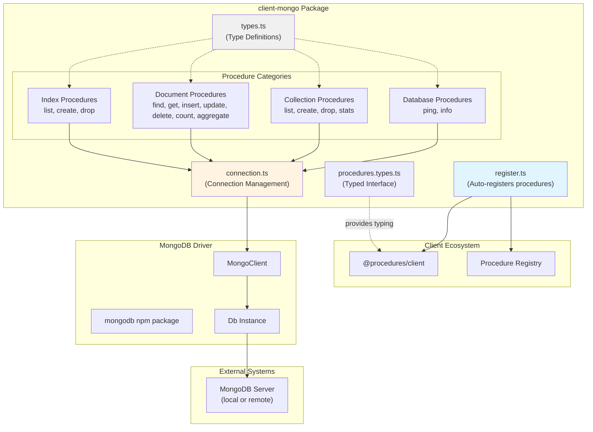
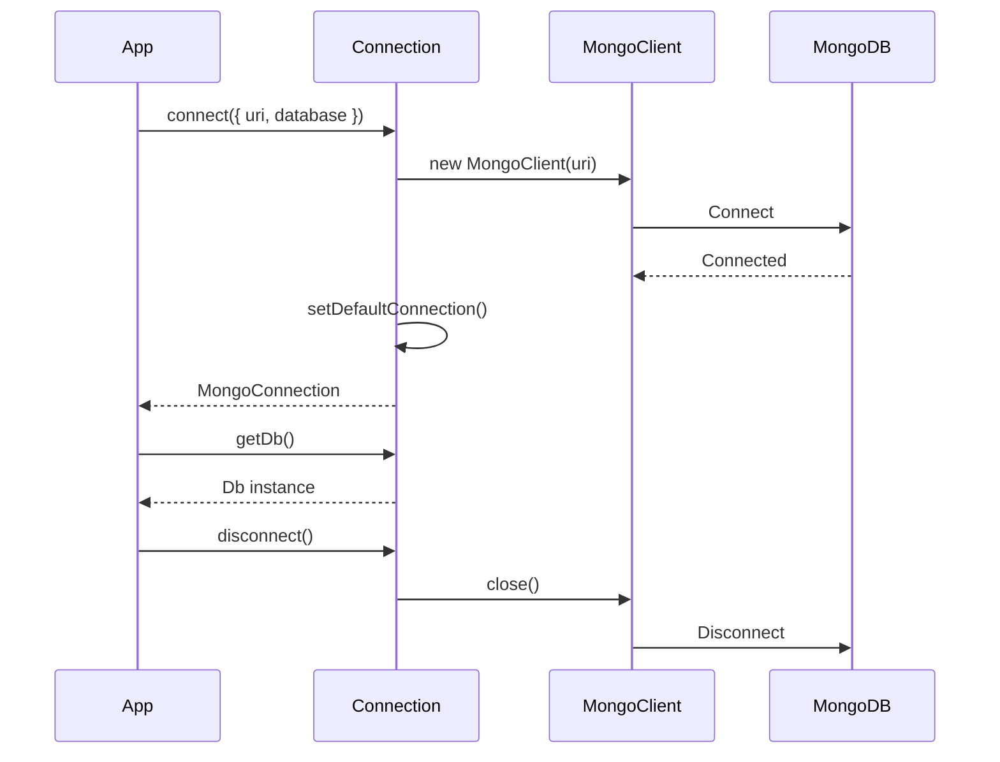

# @procedures/mongo

[](https://www.npmjs.com/package/@procedures/mongo)
[](https://opensource.org/licenses/MIT)
[](https://www.typescriptlang.org/)
[](https://nodejs.org/)

MongoDB client wrapper with client procedures for local or RPC access. Provides a comprehensive set of procedures for database operations, collection management, document CRUD, indexing, and aggregation pipeline support.

## Overview

`client-mongo` bridges MongoDB operations into the client procedure ecosystem, enabling both:
- **Local usage**: Direct MongoDB connection with native driver
- **RPC usage**: Remote procedure calls via `client.call()`

The package follows the client procedure pattern, with 20 procedures in 5 categories. Its register entry (`import "@procedures/mongo/register"`) registers them:
- **Database**: `ping`, `info`
- **Collections**: `list`, `create`, `drop`, `stats`
- **Documents**: `find`, `get`, `insert`, `update`, `delete`, `count`, `aggregate`, `distinct`, `bulk`, `explain`
- **Indexes**: `list`, `create`, `drop`
- **Change streams**: `mongo.watch`

## Architecture



### Package Dependency Flow

```mermaid
graph LR
    App["Your Application"]
    ClientMongo["@procedures/mongo"]
    Client["@procedures/client"]
    MongoDB["mongodb"]

    App --> ClientMongo
    ClientMongo --> Client
    ClientMongo --> MongoDB

    App -.client.call.-> Client
    Client -.executes.-> ClientMongo
    ClientMongo -.queries.-> MongoDB
```

### Connection Management Flow



## Installation

```bash
npm install @procedures/mongo
```

Since 0.2.0, an import of the package registers nothing. To register its procedures in the global registry:

```ts
import "@procedures/mongo/register";
```

## Configuration

### Environment Variables

```bash
# MongoDB connection URI (optional, defaults to mongodb://localhost:27017)
MONGODB_URI=mongodb://localhost:27017

# Default database name (optional, defaults to "test")
MONGODB_DATABASE=myapp
```

### Programmatic Configuration

```typescript
import { connect } from "@procedures/mongo";

// Using environment variables
await connect();

// With explicit options
await connect({
  uri: "mongodb://localhost:27017",
  database: "myapp",
  clientOptions: {
    // Any MongoDB client options
    maxPoolSize: 10,
    minPoolSize: 2,
  }
});
```

### The first call connects

A host does not have to call `connect()`. When there is no open connection, the first procedure call connects with the options of `configure()`, or with the environment variables. Concurrent first calls share one attempt.

```typescript
import { configure } from "@procedures/mongo";

configure({ uri: "mongodb://localhost:27017", database: "myapp" });
```

### The collection and the database of a call

Each procedure reads `collection` and `database` from its input. An MCP tool call can set them. The call metadata is the fallback, for the clients that set it.

```typescript
await client.exec(["mongo", "documents", "count"], { collection: "users", query: { active: true } });
```

## API Reference

### Connection Management

#### `connect(options?): Promise<MongoConnection>`

Create and connect to MongoDB. Sets the default connection used by all procedures.

```typescript
interface MongoConnectionOptions {
  uri?: string;                    // Default: MONGODB_URI or mongodb://localhost:27017
  database?: string;               // Default: MONGODB_DATABASE or "test"
  clientOptions?: MongoClientOptions;
}

interface MongoConnection {
  getDb(): Db;
  getClient(): MongoClient;
  connect(): Promise<void>;
  disconnect(): Promise<void>;
  isConnected(): boolean;
}
```

**Example:**
```typescript
const conn = await connect({
  uri: "mongodb://localhost:27017",
  database: "myapp"
});
```

#### `disconnect(): Promise<void>`

Disconnect the default connection.

```typescript
await disconnect();
```

#### `getDb(): Db`

Get the database instance from the default connection.

```typescript
const db = getDb();
const collection = db.collection("users");
```

#### `getClient(): MongoClient`

Get the MongoClient from the default connection.

```typescript
const client = getClient();
```

#### `getDefaultConnection(): MongoConnection`

Get the default connection instance. Throws if not connected.

#### `setDefaultConnection(conn: MongoConnection): void`

Set the default connection (advanced usage).

#### `hasDefaultConnection(): boolean`

Check if a default connection exists.

### Registered Procedures

`import "@procedures/mongo/register"` registers the procedures in the global registry. The package root registers nothing: a host gives `mongoModule` to `createRegistry`. Each procedure of a collection takes `collection`, and each procedure takes an optional `database`. The catalog of the site shows the input and the output schema of each procedure.

| Procedure | What it does | Main input |
|---|---|---|
| `mongo.database.ping` | Tests the connection and gives the latency. | `timeout` |
| `mongo.database.info` | Gives the name, the counts and the size of the database. | `includeStats` |
| `mongo.collections.list` | Lists the collections of the database. | `filter` |
| `mongo.collections.create` | Makes a collection, capped or with a validator. | `name`, `options` |
| `mongo.collections.drop` | Removes a collection. | `name` |
| `mongo.collections.stats` | Gives the count, the sizes and the indexes of a collection. | |
| `mongo.documents.find` | Finds documents, with a projection, a sort and pages. | `query`, `projection`, `sort`, `page`, `limit` |
| `mongo.documents.get` | Gives one document by its id. | `id` |
| `mongo.documents.insert` | Inserts one document or more. | `documents` |
| `mongo.documents.update` | Updates the document of `id`, or the documents that match `filter`. | `id` or `filter`, `update`, `multi`, `upsert`, `confirm` |
| `mongo.documents.delete` | Deletes the document of `id`, or the documents that match `filter`. | `id` or `filter`, `multi`, `confirm` |
| `mongo.documents.count` | Counts the documents that match a query. | `query` |
| `mongo.documents.aggregate` | Runs an aggregation pipeline. It refuses `$out` and `$merge`. | `pipeline`, `allowDiskUse`, `maxTimeMS` |
| `mongo.documents.distinct` | Gives the distinct values of a field. An array field gives each of its elements. | `field` (dots for an embedded field), `query` |
| `mongo.documents.bulk` | Sends several writes in one request, in the form of the `bulkWrite` of the driver. | `operations`, `ordered`, `confirm` |
| `mongo.documents.explain` | Gives the plan of a find, or of a pipeline. It refuses `$out` and `$merge`. | `query` or `pipeline`, `verbosity` |
| `mongo.indexes.list` | Lists the indexes of a collection. | |
| `mongo.indexes.create` | Makes an index. | `keys`, `options` |
| `mongo.indexes.drop` | Removes an index. | `name` |
| `mongo.watch` | Gives the changes of a collection as a stream, or of each collection without `collection`. | `collection`, `pipeline`, `fullDocument`, `resumeAfter` |

- `update` and `delete` need exactly one target (`id` or `filter`), and refuse unknown fields. An empty filter needs `confirm: true`.
- The operations of `bulk` are `insertOne`, `updateOne`, `updateMany`, `deleteOne` and `deleteMany`. By default the server does them in order, and the first failure stops the rest. With `ordered: false`, the server tries each operation, and the error tells which ones failed.
- The verbosity `queryPlanner` of `explain` (the default) gives the plan only. With `executionStats` and `allPlansExecution`, the server also does the plan and gives its statistics.
- The stream of `watch` has no end (`metadata.stream: { unbounded: true }`). It stops when the reader stops or the call aborts, and the procedure then closes the change stream.

### Type Definitions

#### Core Types

```typescript
// Documents
type DocumentId = string | ObjectId;
type BaseDocument = Document;
type MongoDocument = BaseDocument;
type DocumentQuery = Filter<Document>;
type DocumentUpdate = UpdateFilter<Document>;

// Metadata
interface BaseMeta extends Record<string, unknown> {
  database?: string;  // Override database name
}

interface CollectionMeta extends BaseMeta {
  collection: string;  // Collection name (required)
}

// Pagination
interface PaginationInput {
  page?: number;   // Page number (1-indexed)
  limit?: number;  // Items per page
}

interface PaginationOutput {
  page: number;
  limit: number;
  total: number;
  totalPages: number;
  hasNext: boolean;
  hasPrev: boolean;
}

// Sorting
type SortOrder = 1 | -1;
type SortSpec = Record<string, SortOrder>;

// Indexes
type IndexSpec = Record<string, 1 | -1 | "text" | "2dsphere">;

interface IndexOptions {
  name?: string;
  unique?: boolean;
  sparse?: boolean;
  background?: boolean;
  expireAfterSeconds?: number;
}

interface IndexInfo {
  name: string;
  key: IndexSpec;
  unique?: boolean;
  sparse?: boolean;
}

// Collections
interface CollectionOptions {
  capped?: boolean;
  size?: number;
  max?: number;
  validator?: Document;
}

interface CollectionStats {
  count: number;
  size: number;
  avgObjSize: number;
  storageSize: number;
  nindexes: number;
  totalIndexSize: number;
}

// Database
interface DatabaseInfo {
  name: string;
  collections: number;
  views: number;
  sizeOnDisk: number;
  empty: boolean;
}

// Aggregation
type AggregationStage = Document;

interface AggregationOptions {
  allowDiskUse?: boolean;
  maxTimeMS?: number;
}

// Bulk Operations
interface BulkInsertOne {
  insertOne: { document: Document };
}

interface BulkUpdateOne {
  updateOne: {
    filter: DocumentQuery;
    update: DocumentUpdate;
    upsert?: boolean;
  };
}

interface BulkDeleteOne {
  deleteOne: { filter: DocumentQuery };
}

type BulkOperation = BulkInsertOne | BulkUpdateOne | BulkDeleteOne;

interface BulkWriteResult {
  acknowledged: boolean;
  insertedCount: number;
  matchedCount: number;
  modifiedCount: number;
  deletedCount: number;
  upsertedCount: number;
}
```

#### Typed Procedures Interface

For compile-time autocomplete, use the `MongoProcedures` type:

```typescript
import type { MongoProcedures } from "@procedures/mongo";
import { createTypedCaller } from "@procedures/client";

const call = createTypedCaller<MongoProcedures>(client.call);

// Full autocomplete on path and input!
const result = await call(
  ["mongo", "documents", "find"],
  { query: { status: "active" } },
  { metadata: { collection: "users" } }
);
// result is typed as FindOutput
```

### Type Guards and Utilities

```typescript
// Check if metadata has collection
function hasCollection(metadata: Record<string, unknown>): metadata is CollectionMeta;

// Get collection metadata, throws if missing
function requireCollection(metadata: Record<string, unknown>): CollectionMeta;

// Get base metadata (database override)
function getBaseMeta(metadata: Record<string, unknown>): BaseMeta;
```

## Usage Examples

### Basic CRUD Operations

```typescript
import { Client, LocalTransport, PROCEDURE_REGISTRY } from "@procedures/client";
import { connect } from "@procedures/mongo";

// Connect to MongoDB
await connect({
  uri: "mongodb://localhost:27017",
  database: "myapp"
});

const client = new Client(new LocalTransport({ registry: PROCEDURE_REGISTRY }));

// Create a user
const insertResult = await client.exec(
  ["mongo", "documents", "insert"],
  {
    documents: {
      name: "Alice Johnson",
      email: "alice@example.com",
      age: 28,
      status: "active",
      createdAt: new Date()
    }
  },
  { metadata: { collection: "users" } }
);

// Find active users
const findResult = await client.exec(
  ["mongo", "documents", "find"],
  {
    query: { status: "active" },
    sort: { createdAt: -1 },
    limit: 10
  },
  { metadata: { collection: "users" } }
);

console.log(findResult.documents);
console.log(findResult.pagination);

// Update a user
await client.exec(
  ["mongo", "documents", "update"],
  {
    filter: { email: "alice@example.com" },
    update: { $set: { status: "inactive" } }
  },
  { metadata: { collection: "users" } }
);

// Delete inactive users
await client.exec(
  ["mongo", "documents", "delete"],
  {
    filter: { status: "inactive" },
    multi: true
  },
  { metadata: { collection: "users" } }
);
```

### Aggregation Pipeline

```typescript
// Group users by country and count
const result = await client.exec(
  ["mongo", "documents", "aggregate"],
  {
    pipeline: [
      { $match: { status: "active" } },
      { $group: {
          _id: "$country",
          count: { $sum: 1 },
          avgAge: { $avg: "$age" }
        }
      },
      { $sort: { count: -1 } },
      { $limit: 10 }
    ]
  },
  { metadata: { collection: "users" } }
);

console.log(result.results);
```

### Index Management

```typescript
// Create unique email index
await client.exec(
  ["mongo", "indexes", "create"],
  {
    keys: { email: 1 },
    options: { unique: true, name: "email_unique_idx" }
  },
  { metadata: { collection: "users" } }
);

// Create compound index
await client.exec(
  ["mongo", "indexes", "create"],
  {
    keys: { status: 1, createdAt: -1 },
    options: { name: "status_created_idx" }
  },
  { metadata: { collection: "users" } }
);

// List all indexes
const indexes = await client.exec(
  ["mongo", "indexes", "list"],
  {},
  { metadata: { collection: "users" } }
);

console.log(indexes.indexes);

// Drop an index
await client.exec(
  ["mongo", "indexes", "drop"],
  { name: "status_created_idx" },
  { metadata: { collection: "users" } }
);
```

### Collection Management

```typescript
// Create capped collection for logs
await client.exec(
  ["mongo", "collections", "create"],
  {
    name: "logs",
    options: {
      capped: true,
      size: 10485760,  // 10MB
      max: 1000
    }
  }
);

// List all collections
const collections = await client.exec(
  ["mongo", "collections", "list"],
  { filter: "user" }  // Filter collections containing "user"
);

console.log(collections.collections);

// Get collection stats
const stats = await client.exec(
  ["mongo", "collections", "stats"],
  {},
  { metadata: { collection: "users" } }
);

console.log(stats);
```

### Direct Usage (Without RPC)

```typescript
import {
  connect,
  findProcedure,
  insertProcedure,
  requireCollection
} from "@procedures/mongo";

await connect({ database: "myapp" });

// Use procedures directly
const findResult = await findProcedure.handler(
  { query: { status: "active" }, limit: 10 },
  { metadata: { collection: "users" } }
);

const insertResult = await insertProcedure.handler(
  { documents: { name: "Bob", email: "bob@example.com" } },
  { metadata: { collection: "users" } }
);
```

### Multi-Database Support

```typescript
// Default database
await client.exec(
  ["mongo", "documents", "find"],
  { query: {} },
  { metadata: { collection: "users" } }
);

// Override database in metadata
await client.exec(
  ["mongo", "documents", "find"],
  { query: {} },
  { metadata: { database: "analytics", collection: "events" } }
);
```

## Document storage: `MongoDocumentStorage`

`MongoDocumentStorage` is a `CollectionStorage` of `@procedures/collections` over MongoDB (roadmap CLI-24). It has flat documents, a change log, versions, queries in the database and partitions. `MongoStorage` keeps its `{ _id, data }` documents.

```ts
import { MongoDocumentStorage } from "@procedures/mongo";

const notes = new MongoDocumentStorage<Note>({ collection: "notes" });
await notes.set("n1", { title: "Plan", done: false });
await notes.query({ done: false }, { sort: { title: 1 }, limit: 20 });

// One storage for each tenant, on one collection (roadmap CLI-17)
server.usePartitions("notes", { storageOf: (partition) => notes.forPartition(partition), resolve });
```

| Option | Use |
| --- | --- |
| `collection` | The MongoDB collection |
| `db` | The database. The default is the database of the default connection. |
| `partition` | The partition of the storage. `forPartition(partition)` gives the storage of a partition, the same one each time. |
| `maxTombstones` | The most deletes that the change log keeps in each partition (default 10000) |
| `queryPolicy` | The query policy of `query()` without a policy of the call |
| `counters` | The collection of the sequence counters (default `__storage_counters`) |
| `writeLease` | The time after which a pending number of a write that stopped no longer holds the readers (default `seconds(60)`). A plain number is a `TypeError`. |
| `client` | The client of the database, for the transactions. The default is the client of the default connection when `db` is absent. |
| `transactions` | `auto` (the default): a transaction for each write on a replica set or a sharded cluster. `never`: the watermark only. |
| `versionOf` | The version of an item, for the expected versions of `set`, `delete` and `setBatch` (roadmap CLI-16) |
| `storedId`, `idOf` | The stored `_id` of an id in a partition, and its inverse (roadmap CLI-76). The defaults are `defaultStoredId` and `defaultIdOf`: `<partition>` + U+001F + `<id>`. Give the two together. |
| `partitionFields` | The fields that name a partition (roadmap CLI-76). The default is `defaultPartitionFields`: `{ _part: partition }`. A field with the value `undefined` is absent. |

- **The documents.** A plain object with safe keys is stored flat: its fields beside the fields of the storage (`_key`, `_part`, `_seq`, `_ord`, `_tomb`). Another item is stored as JSON text in `_json`. Both ways give the item back as it was. An item whose `_id` is its id keeps it.
- **The change log.** Each write gets the next number of the sequence of the collection, and a delete leaves a tombstone. `getChangesSince()` thus gives the exact changes and deletes. A version of another epoch, or a version before the oldest dropped tombstone, gives a full result.
- **The versions.** `versionOf(id)` gives the number of the last write of an item.
- **The queries.** `query()` sends the equality of a string, a number or a boolean, and `$in` of them, to MongoDB as a filter. `queryEntries()` of the core then gives the exact result, so a query gives the result of the reference.
- **Several writers.** On a replica set, a write takes its numbers and writes in one transaction. On a single server, a watermark keeps the log exact. Each write keeps its numbers pending until it ends, and a version stops below the lowest pending number. A write that ends after its lease moves its documents to new numbers.
- **The case that stays on a single server.** A process that stops between a late write and the move of its documents leaves that change below the watermark. A reader that passed those numbers does not get the change. On a replica set, this case does not occur.
- **The partitions.** An id cannot have the character U+001F, and each write filter has the partition. A write cannot change a document of another partition.
- **The stored form** (roadmap CLI-76). An app that has its own form of documents keeps it, with no migration. The defaults write the documents of 0.34.0, byte for byte.
  - `storedId(partition, id)` gives the stored `_id`, for example `tenant:key`. It can be a value that is not a text. `idOf(storedId, partition)` gives the id back.
  - `partitionFields(partition)` gives the fields that name the partition, for example `{ tenant: "acme", scope: undefined }`. Each document of the partition has them, and they are the filter of the reads, the change log and the aggregations. A field with the value `undefined` is absent: the document does not have it, and the filter is `{ $exists: false }`.
  - The storage adds its fields in each form: `_key`, `_seq`, `_ord`, `_tomb`, and `_kid` or `_json` when an item needs them. `DOCUMENT_STORAGE_FIELDS` names them, so a reader of the raw documents can leave them out. A delete leaves a tombstone (`TOMBSTONE_FIELD` is `true`): a reader of the raw documents must leave it out. `ViewMaterializer` does.
  - A document without the fields of the storage (for example a document from before the app used the storage) is an item. Its id comes from `idOf`, its version is `0`, and it comes before the other items. A full result of the change log has it. Its first write through the storage gives it a version, keeps its place, and is in the next delta.
  - An item with a field of a partition field name is stored as JSON text in `_json`, so it comes back as it was.

```ts
const notes = new MongoDocumentStorage<Note>({
  collection: "notes",
  // The stored _id is `tenant:key`, and the field `tenant` names the partition
  storedId: (partition, id) => `${partition ?? "main"}:${id}`,
  idOf: (stored, partition) => {
    const prefix = `${partition ?? "main"}:`;
    return typeof stored === "string" && stored.startsWith(prefix) ? stored.slice(prefix.length) : undefined;
  },
  partitionFields: (partition) => ({ tenant: partition ?? "main" }),
});
```
- **The tests.** The storage passes the `CollectionStorage` contract on MongoDB 7 in CI. Set `MONGO_TEST_URL` to start them locally.

### The guard of a pipeline: `scopePipeline`

`scopePipeline(pipeline, scope)` gives a pipeline that reads only the documents of a filter, on each collection that it reads. `MongoDocumentStorage.aggregate()` uses it with the filter of its partition. An app can use it for its own aggregations over shared collections:

```ts
import { boundPipeline, scopePipeline } from "@procedures/mongo";

const scoped = scopePipeline(pipeline, { match: { tenant: "t1" }, collections: ["orders", "customers"] });
const { pipeline: bounded, limited } = boundPipeline(scoped, 5000);
```

- The filter goes before the first stage, into the stages that must be first (`$geoNear`, `$search`, `$vectorSearch`), into a `$match` with `$text`, and into each sub-pipeline (`$lookup`, `$graphLookup`, `$unionWith`, `$facet`).
- A `$lookup` with `localField` and `foreignField` becomes the form with a pipeline, so the filter applies to the other collection too.
- The pipeline reads and writes only the collections of the scope (`from`, `coll`, `into`). Give only the collections that the caller can read: a pipeline needs the same right as a direct read.
- `$out` is refused. `$merge` is refused unless the scope has a `stamp`. Then each written document gets the stamp, and the match key of `$merge` gets its fields.
- Only the stages of `ALLOWED_PIPELINE_STAGES` pass, so a stage of the server is refused, also a stage that a later MongoDB adds. `$documents` is refused. The JavaScript operators of the server (`$function`, `$accumulator`, `$where`) are refused at each depth.
- A stage must have exactly one key, and a `$unset` of a field of the scope is refused.
- The function does not change the pipeline of the caller.
- `MongoDocumentStorage.aggregate(pipeline, { maxTime, maxResults })` is read-only, reads only its own collection, and keeps the tombstones out. It gives `{ docs, truncated }`. The defaults are `seconds(10)` and 5000 documents. `maxTime` is a duration of `@procedures/client`.

### Materialized views: `ViewMaterializer`

A view is a document of a views collection: a pipeline over source collections, whose result goes into a target collection, for one partition. `ViewMaterializer` keeps each target equal to the result of its pipeline, with change streams. Change streams need a replica set.

```ts
import { ViewMaterializer, viewFilter } from "@procedures/mongo";

await db.collection("_aggregations").insertOne({
  _id: "totals",
  _part: "tenant-1",
  collections: ["orders"],
  pipeline: [{ $group: { _id: "$status", count: { $sum: 1 } } }],
  targetCollection: "orderTotals",
});
const views = new ViewMaterializer({ db: () => db });
await views.start();

// A reader of the target reads the current generation of the view
const view = await db.collection("_aggregations").findOne({ _id: "totals" });
const totals = await db.collection("orderTotals").find(viewFilter(view)).toArray();
```

- A change of a source starts a pass of its partition after the burst (`debounce`). A pass computes only the views whose sources changed, in the order of their dependencies. A view whose result changed makes its target dirty, so the views that read it are in the same pass.
- A run reads the result in groups of 1000. Each stored row keeps the hash of its content (`_viewHash`), so a row that did not change writes nothing.
- The rows of a view are a generation (`_viewGen`), and the status of the view names the current one. A reader of a target filters with `viewFilter(view)`, so it reads one whole generation. A plain query can see two generations.
- A run writes in one transaction: the changed rows of the current generation, and the removal of the rows that the result does not have. A reader does not see a part of a run.
- A view with more rows than `maxTransactionRows` (default 10000), or whose transaction fails, writes a whole new generation in groups. Then its status names the new generation. The previous one stays for `generationGrace` (default 60 s, on the time of the server), so a reader of it can finish. Then it goes.
- A pass in groups holds a lease on its view (`passLease`, default 60 s, on the time of the server), and renews it after each group. Another process leaves the view and the rows of the lease alone. The change of generation needs the lease and the generation of the start of the pass. A pass that loses either one gives way, and the view runs again later.
- A view in a cycle of views stays idle. Its status is `cycle` until the cycle ends.
- The status of each view (`ok`, `errored` with `lastError`, `cycle`) goes into the field `_materializerStatus` of its document.
- Each pipeline goes through `scopePipeline` by default. It reads only the documents of the partition, in its sources, and only the current generation of the target of another view. The tombstones of a `MongoDocumentStorage` (`_tomb` is `true`) stay out (roadmap CLI-79). It cannot have `$merge` or `$out`. The option `scope` gives another guard, with the same filter.
- A stream that ends opens again after `rewatch`, and a pass catches up. The times of the options are durations (`ms(100)`, `seconds(60)`) of `@procedures/client`.
- A delete has no document in its change event. It reaches only the views of its partition when its pre-image tells the partition (a collection with `changeStreamPreAndPostImages`). Without a pre-image, a delete, a replace and an update of the partition field reach the views of each partition.
- In a source of `storageSources`, the id of a `MongoDocumentStorage` document tells the storage partition of such a change. The function of that source gives the partition of the views (`identityPartition` when the two are the same). Else the delete reaches the views of each partition.
- With pre-images, an update that moves a document to another partition also reaches the views of its old partition.
- `sourceFields` gives the fields of each source, as paths with dots. An update starts a pass when it changes one of them (at the field, under it or above it), or the partition field. The positions in arrays do not count: `lines.0.price` is `lines.price`. The partition field is a top-level field.
- The stop has the parts of a transport of a service: `stopIntake()`, `drain(deadline, signal)`, `inFlight()` and `close()`. `stop()` does the four. A host composes them with no adapter.
- The option `clock` gives the clock of the timers, for example a fake clock in a test. The timers do not keep a process alive.
- The target is a plain collection that only the materializer writes. Two views of one partition do not share a target. The stored `_id` of a row carries its partition and its generation: by default `{ partition, generation, id }` (`partitionTargetId`), where `id` is the `_id` of the row. Thus two partitions with the same keys share a target.
- The option `targetId` gives another form of the stored `_id`. Two partitions, or two generations, must not give the same `_id`. The write of a row checks the partition, so the view of the second partition fails, and the row of the first one stays. A form without the generation works only in one transaction.
- A pass keeps in memory the key of each row of the result (at most `maxRows`) and one group of rows. It keeps nothing between passes.
- An app with targets from an older materializer (the plain key as `_id`, no generation) needs no migration step. The first pass of each view writes its rows in a generation, and removes the rows of its partition with no generation. A row without the partition field stays.

To serve a view through the collection procedures, give its storage `new MongoViewStorage({ view: "totals", db })` (roadmap CLI-38):

- Each read finds the current generation of the view one time, and reads only its rows. A reader of `get`, `getAll`, `find` or `changes` thus gets one generation only.
- A read that starts before a change of generation ends on the previous generation. The materializer keeps its rows for `generationGrace`, so a read must end in that time.
- The key of a row is its `_id` in the result, a text. The value has that `_id` and the fields of the row.
- The storage is read-only: a write rejects with `FORBIDDEN`. It has no change log.
- Give it the same `views`, `partitionField`, `statusField` and `targetId` as the materializer.

## Integration with Ecosystem

### Bundle Packages

`client-mongo` can be included in bundle packages:

```typescript
// In bundle-data/src/register.ts
import "@procedures/mongo/register"; // registers its procedures
import "@procedures/sqlite/register"; // registers its procedures
import "@procedures/s3/register.js";
```

### Type-Safe Calling

```typescript
import type { MongoProcedures } from "@procedures/mongo";

type AllProcedures = MongoProcedures & OtherProcedures;

const call = createTypedCaller<AllProcedures>(client.call);
```

## Dependencies

### Runtime Dependencies

- **@procedures/client** - Core client procedure system
- **mongodb** (^7.0.0) - Official MongoDB Node.js driver

### Development Dependencies

- **@mark1russell7/cue** - Configuration and type utilities
- **typescript** (^5.9.3) - TypeScript compiler
- **@types/node** (^22.0.0) - Node.js type definitions

## Package Structure

- `src/index.ts`: the entry. It registers nothing.
- `src/module.ts`: `mongoModule`, the procedures as data. `src/register.ts` registers them in the global registry.
- `src/connection.ts`: the connection and its management.
- `src/scope.ts`: the database and the collection of a call.
- `src/procedures/`: one file for each procedure, with the schemas of the inputs.
- `src/storage/`: `MongoStorage`, `MongoDocumentStorage`, `scopePipeline` and `ViewMaterializer`.

## Development

### Build

```bash
npm run build
```

### Type Check

```bash
npm run typecheck
```

### Clean

```bash
npm run clean
```

## License

MIT

## Author

Mark Russell <marktheprogrammer17@gmail.com>

## Repository

https://github.com/mark1russell7/client-mongo
