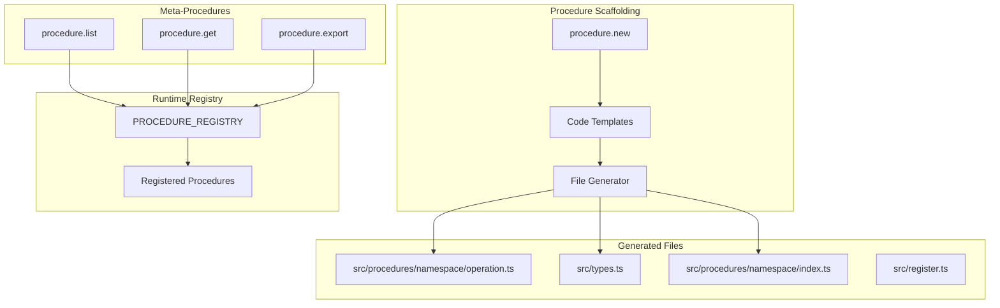
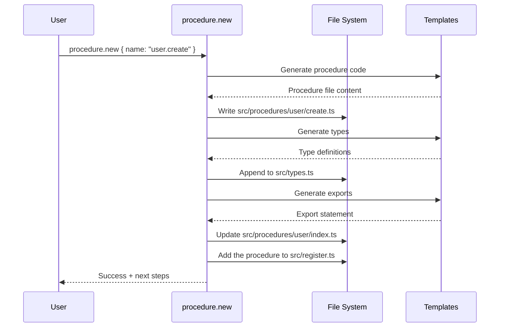

# @procedures/procedure

[](https://www.npmjs.com/package/@procedures/procedure)
[](https://opensource.org/licenses/MIT)
[](https://www.typescriptlang.org/)

**Procedure scaffolding and meta-procedures for runtime procedure management.**

## Table of Contents

- [Overview](#overview)
- [Installation](#installation)
- [Architecture](#architecture)
- [Quick Start](#quick-start)
- [API Reference](#api-reference)
- [Examples](#examples)
- [Integration](#integration)

## Overview

`@procedures/procedure` provides utilities for creating and managing procedures:

- **procedure.new**: Scaffold new procedures with types and registration boilerplate
- **procedure.list**: List all registered procedures in the runtime registry
- **procedure.get**: Get metadata for a specific procedure
- **procedure.export**: Export procedure definitions as JSON

This package simplifies procedure development by automating the creation of procedure files, type definitions, and registration code.

## Installation

```bash
npm install github:mark1russell7/client-procedure#main
```

**Dependencies:**
- `@procedures/client` (peer dependency)
- `zod` ^3.24.0

## Architecture



### Scaffolding Flow



The scaffolded code compiles with the strict options of the workspace. A name whose path, file, type names or registration exists already is an error, and then nothing is written.

## Quick Start

```typescript
import { Client, LocalTransport, PROCEDURE_REGISTRY } from "@procedures/client";
import "@procedures/procedure"; // registers its procedures

const client = new Client(new LocalTransport({ registry: PROCEDURE_REGISTRY }));

// Scaffold a new procedure
const result = await client.exec(["procedure", "new"], {
  name: "user.create",
  description: "Create a new user account",
});

console.log(result.operations);
// [
//   "Creating directory: /project/src/procedures/user",
//   "Creating procedure file: /project/src/procedures/user/create.ts",
//   "Creating index: /project/src/procedures/user/index.ts",
//   "Appending types to: /project/src/types.ts",
//   "Next steps: ..."
// ]
```

## API Reference

### Procedures

#### `procedure.new`

Scaffold a new procedure with type definitions and boilerplate.

```typescript
interface ProcedureNewInput {
  name: string;              // Dot-notation name (e.g., "user.create" or "fs.readJson")
  namespace?: string;        // Namespace override: the folder under src/procedures (defaults to first segment)
  description?: string;      // Procedure description
  path?: string;             // Project path (defaults to cwd)
  dryRun?: boolean;          // Preview without creating files
}

interface ProcedureNewOutput {
  success: boolean;
  procedurePath: string[];   // e.g., ["user", "create"]
  created: string[];         // Files created
  modified: string[];        // Files modified
  operations: string[];      // Operations performed
  errors: string[];          // Any errors
}
```

**Example:**
```typescript
const result = await client.exec(["procedure", "new"], {
  name: "user.create",
  description: "Create a new user",
  path: "/path/to/package",
});
```

**Generated Files:**

The file of a procedure is `src/procedures/<first segment>/<middle segments>/<last segment>.ts`: `api.v2.users.create` gives `src/procedures/api/v2/users/create.ts`.

1. **Procedure File** (`src/procedures/user/create.ts`):
```typescript
/**
 * user.create procedure
 *
 * Create a new user
 */

import type { UserCreateInput, UserCreateOutput } from "../../types.js";

/**
 * Create a new user
 */
export async function userCreate(_input: UserCreateInput): Promise<UserCreateOutput> {
  // TODO: Implement user.create (rename _input to input when the code uses it)
  return {
    success: true,
    message: "Hello from user.create",
  };
}
```

2. **Type Definitions** (appended to `src/types.ts`, which gets `import { z } from "zod"` if it has none, or is created):
```typescript
// =============================================================================
// user.create Types - Create a new user
// =============================================================================

export const UserCreateInputSchema: z.ZodObject<{
  // TODO: Add input fields
}> = z.object({
  // TODO: Add input fields
});

export type UserCreateInput = z.infer<typeof UserCreateInputSchema>;

export interface UserCreateOutput {
  /** Whether the operation succeeded */
  success: boolean;
  /** Response message */
  message: string;
}
```

3. **Index Export** (appended to `src/procedures/user/index.ts`):
```typescript
export { userCreate } from "./create.js";
```

4. **Registration** (added to `src/register.ts`: the imports, the definition, and the item of the `registerProcedures([...])` array):
```typescript
import { createProcedure, outputSchema, registerProcedures, zodAdapter } from "@procedures/client";
import { userCreate } from "./procedures/user/create.js";
import { UserCreateInputSchema, type UserCreateInput, type UserCreateOutput } from "./types.js";

const userCreateProcedure = createProcedure()
  .path(["user", "create"])
  .input(zodAdapter<UserCreateInput>(UserCreateInputSchema))
  .output(outputSchema<UserCreateOutput>())
  .meta({
    description: "Create a new user",
    args: [],
    shorts: {},
    output: "text",
  })
  .handler(async (input: UserCreateInput): Promise<UserCreateOutput> => userCreate(input))
  .build();

export function register(): void {
  registerProcedures([userCreateProcedure]);
}
```

If `src/register.ts` has no `registerProcedures([...])` or `registerAll([...])` call, the operations say what to add.

#### `procedure.list`

List the procedures of the registry, with an optional namespace filter.

```typescript
interface ProcedureListInput {
  namespace?: string;         // Only the procedures of this first path segment
  includeMetadata?: boolean;  // Default: false
}

interface ProcedureListOutput {
  procedures: Array<{
    path: string[];
    key: string;              // "git.commit"
    description?: string;
    tags?: string[];
    hasHandler: boolean;
  }>;
  count: number;
}
```

```typescript
const { procedures, count } = await client.exec(["procedure", "list"], { namespace: "git" });
```

#### `procedure.get`

Get the metadata of one procedure.

```typescript
interface ProcedureGetInput {
  path: string[] | string;    // ["git", "commit"] or "git.commit"
}

interface ProcedureGetOutput {
  found: boolean;
  path?: string[];
  metadata?: Record<string, unknown>;
  hasHandler?: boolean;
  hasInputSchema?: boolean;
  hasOutputSchema?: boolean;
}
```

#### `procedure.export`

Export the path and the metadata of one procedure as a call (`$proc`).

```typescript
interface ProcedureExportInput {
  path: string[] | string;
}

interface ProcedureExportOutput {
  success: boolean;
  definition?: { $proc: string[]; metadata?: Record<string, unknown> };
  error?: string;             // When the procedure does not exist
}
```

> [!NOTE]
> The core package `client` also has `procedure.list` and `procedure.get`, for the procedures that `procedure.define` made. `client-procedure` registers its own versions with `override: true`. Thus the result depends on whether the host imports `client-procedure`: `mark` and the MCP server do.

## Examples

### Scaffold a Nested Procedure

```typescript
const result = await client.exec(["procedure", "new"], {
  name: "api.users.permissions.grant",
  description: "Grant permission to a user",
});

// Generated path: ["api", "users", "permissions", "grant"]
// File: src/procedures/api/users/permissions/grant.ts
```

### Dry Run Mode

```typescript
// The plan of the scaffold, without a change of a file
const preview = await client.exec(["procedure", "new"], {
  name: "product.update",
  dryRun: true,
});

console.log(preview.operations);
```

## Integration

### Use with CLI

The `procedure.new` command is also available via the Mark CLI:

```bash
# Scaffold a new procedure
node packages/mark/dist/cli.js procedure new user.create --path packages/my-package

# With options
node packages/mark/dist/cli.js procedure new user.update \
  --description "Update user information" \
  --path packages/my-package \
  --dry-run
```

### Use in Package Development

1. **Create package structure**:
```bash
node packages/mark/dist/cli.js lib new my-client-package
pnpm install
```

2. **Scaffold procedures**:
```bash
node packages/mark/dist/cli.js procedure new myapp.start --path packages/myapp
node packages/mark/dist/cli.js procedure new myapp.stop --path packages/myapp
node packages/mark/dist/cli.js procedure new myapp.status --path packages/myapp
```

3. **Implement handlers**:
Edit the generated files in `src/procedures/myapp/*.ts`. `procedure new` registered each procedure in `src/register.ts`.

4. **Build and test**:
```bash
pnpm build
pnpm test
```

## Naming Conventions

Procedure names follow dot-notation:
- **Single segment**: `greet` → `["greet"]`
- **Two segments**: `user.create` → `["user", "create"]`
- **Nested**: `api.users.permissions.grant` → `["api", "users", "permissions", "grant"]`
- **camelCase segments**: `fs.readJson` → `["fs", "readJson"]`

Generated identifiers:
- **camelCase** for function names: `user.create` → `userCreate`
- **PascalCase** for types: `user.create` → `UserCreate`
- **Files**: the last segment, in the folders of the other segments: `user.create` → `user/create.ts`, `api.users.permissions.grant` → `api/users/permissions/grant.ts`

Two names can give the same identifiers (`a.b.c` and `a.bC` both give `aBC`). The second one is an error.

## Requirements

- **Node.js**: >= 22
- **TypeScript**: >= 5.0
- **Dependencies**:
  - `@procedures/client` (`workspace:*`)
  - `zod` ^3.24.0

## License

MIT

## See Also

- `@procedures/client` - Core client/procedure system
- `@procedures/mark` - CLI that uses procedure.new for scaffolding
- Package scaffolding guide in ecosystem documentation
