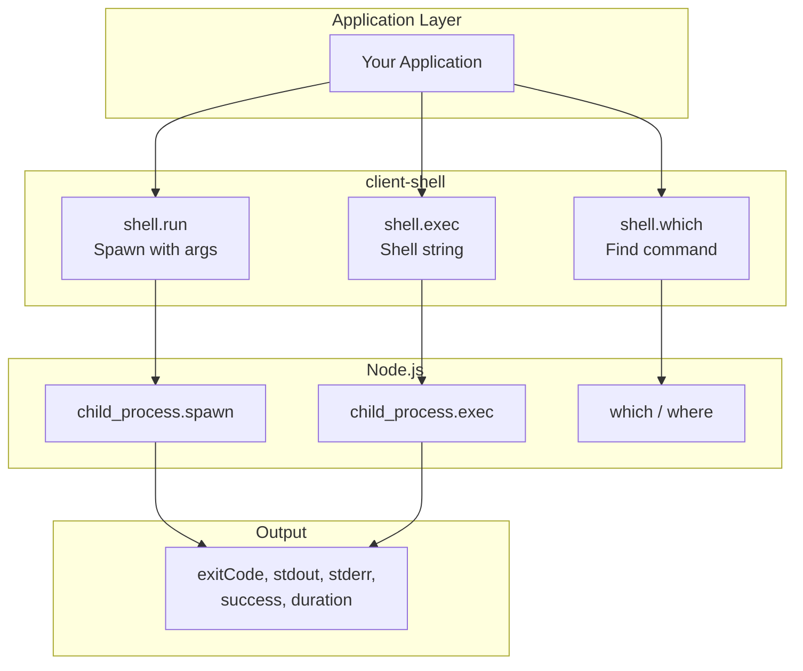
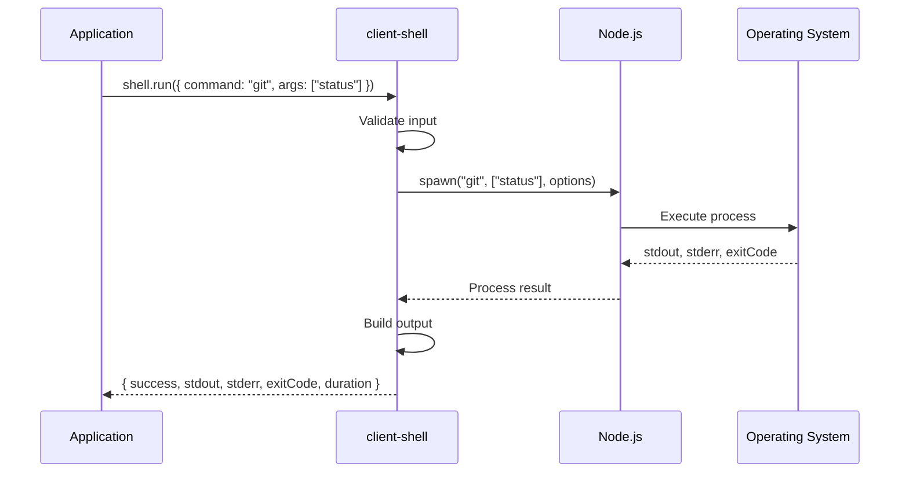
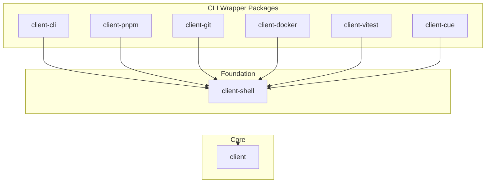
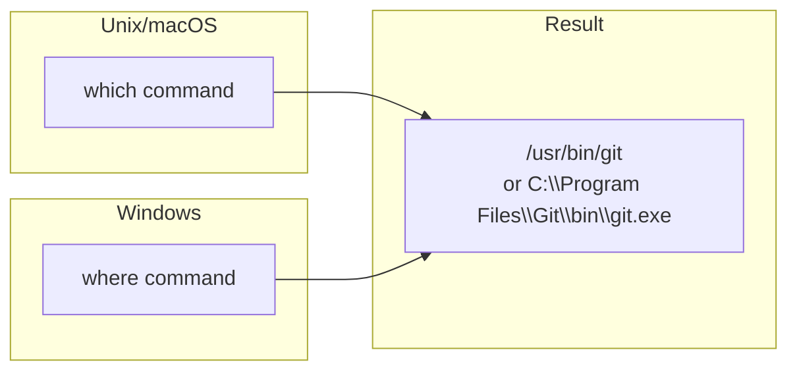
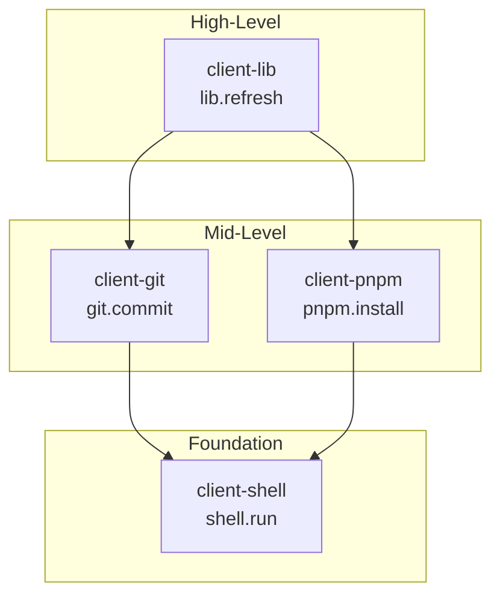

# @procedures/shell

[](https://www.npmjs.com/package/@procedures/shell)

```sh
npm install @procedures/shell
```

[](https://opensource.org/licenses/MIT)
[](https://www.typescriptlang.org/)
[](https://nodejs.org/)

> Generic shell command execution procedures - the foundation layer for all CLI wrapper packages in the Mark ecosystem.

## Table of Contents

- [Overview](#overview)
- [Installation](#installation)
- [Architecture](#architecture)
- [Quick Start](#quick-start)
- [API Reference](#api-reference)
  - [shell.run](#shellrun)
  - [shell.exec](#shellexec)
  - [shell.which](#shellwhich)
- [Use Cases](#use-cases)
- [Cross-Platform Notes](#cross-platform-notes)
- [Integration](#integration)
- [Requirements](#requirements)
- [License](#license)

---

## Overview

**client-shell** provides low-level shell command execution as RPC procedures:

- **shell.run** - Spawn processes with arguments (no shell interpretation, safer)
- **shell.exec** - Execute command strings via shell (supports pipes, redirects)
- **shell.which** - Find command paths cross-platform
- **shell.stream** - Run a command with arguments, and give each output line while it runs

This package is the **foundation** for all CLI wrapper packages.

### Command helpers

The wrapper packages start their programs with the helpers of `@procedures/shell/command`. This entry point registers no procedures.

| Helper | What it does |
|---|---|
| `runCommand(command, options)` | It runs a program to its end and gives `exitCode`, `stdout`, `stderr` and `duration`. It does not throw. |
| `streamCommand(command, options)` | It gives each output line while the program runs, then an `exit` item. |
| `processes` | It records a long-running program: `start`, `list`, `waitFor`, `output`, `subscribe`, `follow`, `stop`. |
| `killTree(child)` | It kills a child process and all the processes that it started. |

The rules of the helpers:

- A helper passes the arguments as a list. No shell reads them.
- The `timeout` and the `signal` kill the whole process tree. Windows uses `taskkill /T /F`. The other systems use a process group.
- Each output stream has a limit (`maxOutputBytes`, 64 MiB by default). The helper keeps the first bytes, or the last bytes with `keep: "tail"`.
- A program without an `input` gets an empty stdin.
- When the reader of `streamCommand` is slow, the helper stops reading the pipes, so the program waits.
- When the host ends, the helpers kill each child that still runs.

```typescript
import { runCommand } from "@procedures/shell/command";

const result = await runCommand("git", { args: ["status", "--porcelain"], cwd, signal: ctx.signal });
```

#### The output of a recorded process

`processes.output(id)` gives the end of the output that the registry keeps: the last 64 KiB. Two functions give the output that comes later:

| Function | What it does |
|---|---|
| `subscribe(id, { output, end })` | `output` gets each new piece with its stream (`stdout` or `stderr`) and its bytes. `end` gets the record at the end of the process. The result removes the subscriber. |
| `follow(id, { backlog, signal, maxBufferedBytes })` | It gives an async stream of items: `backlog`, `output`, `dropped` and the last item `end`. |

- The end of the process removes each subscriber, so a subscriber of an ended process does not stay.
- `follow` subscribes when the reader asks for the first item. The end of the process, an abort of `signal` and a reader that stops end the stream and remove its subscriber.
- With `backlog: true`, the first item has the kept output. The kept output and the new output have no gap between them.
- `follow` decodes UTF-8 for each stream, so a character in two pieces stays whole.
- The registry cannot slow the process. When more than `maxBufferedBytes` (1 MiB by default) wait for a slow reader, `follow` drops the oldest pieces and gives a `dropped` item with the number of bytes.

```typescript
import { processes } from "@procedures/shell/command";

for await (const item of processes.follow(id, { backlog: true, signal: ctx.signal })) {
  if (item.type === "output") process.stdout.write(item.text);
}
```

---

## Installation

```bash
npm install @procedures/shell
```

Since 0.2.0, an import of the package registers nothing. To register its procedures in the global registry:

```ts
import "@procedures/shell/register";
```

---

## Architecture

### System Overview



### Command Execution Flow



### Dependency Tree



---

## Quick Start

```typescript
import { Client, LocalTransport, PROCEDURE_REGISTRY } from "@procedures/client";
import "@procedures/shell/register"; // registers its procedures

const client = new Client(new LocalTransport({ registry: PROCEDURE_REGISTRY }));

// Run a command with arguments
const result = await client.exec(["shell", "run"], {
  command: "git",
  args: ["status", "--short"],
  cwd: "/path/to/repo",
});

console.log(result.stdout);
// M  src/index.ts
// ?? new-file.ts
```

---

## API Reference

### Procedures Summary

| Path | Description |
|------|-------------|
| `shell.run` | Spawn process with arguments (no shell) |
| `shell.exec` | Execute command string through shell |
| `shell.which` | Find full path to a command |

---

### shell.run

Spawn a process directly without shell interpretation. **Safer for untrusted input.**

```typescript
interface ShellRunInput {
  command: string;              // Command to run
  args?: string[];              // Arguments (default: [])
  cwd?: string;                 // Working directory
  env?: Record<string, string>; // Environment variables
  timeout?: number;             // Timeout in ms
  encoding?: string;            // Output encoding (default: "utf8")
}

interface ShellRunOutput {
  exitCode: number;
  stdout: string;
  stderr: string;
  success: boolean;  // true if exitCode === 0
  duration: number;  // ms
}
```

**Example:**
```typescript
await client.exec(["shell", "run"], {
  command: "npm",
  args: ["install", "--save-dev", "typescript"],
  cwd: "/my/project",
  timeout: 60000,
});
```

---

### shell.exec

Execute a command string through the system shell. Supports pipes, redirects, etc.

```typescript
interface ShellExecInput {
  command: string;              // Full command string
  cwd?: string;                 // Working directory
  env?: Record<string, string>; // Environment variables
  timeout?: number;             // Timeout in ms
  shell?: boolean | string;     // Shell to use (default: true)
  maxBuffer?: number;           // Max stdout/stderr buffer
  stdin?: string;               // Input to pipe to stdin
}

interface ShellExecOutput {
  exitCode: number;
  stdout: string;
  stderr: string;
  success: boolean;
  duration: number;
  signal?: string;  // Signal that terminated process
}
```

**Example:**
```typescript
await client.exec(["shell", "exec"], {
  command: "git log --oneline | head -5",
  cwd: "/my/repo",
});
```

---

### shell.which

Find the full path to a command. Uses `where` on Windows, `which` on Unix.

```typescript
interface ShellWhichInput {
  command: string;  // Command to find
}

interface ShellWhichOutput {
  path: string | null;  // Full path or null if not found
  found: boolean;
}
```

**Example:**
```typescript
const { path, found } = await client.exec(["shell", "which"], {
  command: "node",
});
// { path: "/usr/local/bin/node", found: true }
```

---

## Use Cases

### Building CLI Wrappers

A CLI wrapper package (gh, npm, pnpm, docker, `cli.run`) defines its runner with `defineCliTool()` of `@procedures/shell/cli`. Each command goes as an argument list to `shell.run`, through `ctx.client`, so the host applies its rules to the nested call. `packages/documentation/SERVER-LAYERS.md` ("The run path of a CLI wrapper") gives the reasons.

```typescript
import { cliToolOutputSchema, defineCliTool } from "@procedures/shell/cli";

const docker = defineCliTool({ name: "docker" });

// In a handler: a value that starts with "-" is refused, and no shell runs
const result = await docker.run(["ps", "--filter", docker.arg("filter", input.filter)], { cwd: input.cwd }, ctx);
// result: { exitCode, stdout, stderr, success, duration }, the shape of cliToolOutputSchema("docker")
```

- `run` and `runJson` give a failed result and do not throw. `output` and `json` throw the error of the tool.
- `resolve` finds the program at each command. `nodeScript()`, `execPathProgram()` and `findInPath()` help to find a script of a `.cmd` file.
- `buildArgv()`, `parseJsonDocument()` and `parseJsonOutput()` build an argv and read JSON output.

The tests of a wrapper use `fakeShell(results)` of `@procedures/shell/testing`:

```typescript
import { fakeShell } from "@procedures/shell/testing";

const shell = fakeShell([{ stdout: "[]" }, { exitCode: 1, stderr: "not found" }]);
const registry = createRegistry(shell.module, dockerModule); // the first module of a name counts
// or, for a handler that a test calls directly: { client: shell.client }
expect(shell.args()).toEqual(["ps"]);
```

### Checking Command Availability

```typescript
async function ensureGitAvailable() {
  const { found } = await client.exec(["shell", "which"], { command: "git" });
  if (!found) {
    throw new Error("Git is not installed or not in PATH");
  }
}
```

### Piping Commands

```typescript
// Using shell.exec for pipes
const result = await client.exec(["shell", "exec"], {
  command: "cat package.json | jq '.dependencies'",
  cwd: "/my/project",
});
```

---

## Cross-Platform Notes

### shell.which Behavior



### shell.run vs shell.exec

| Feature | shell.run | shell.exec |
|---------|-----------|------------|
| Shell interpretation | No | Yes |
| Pipes & redirects | No | Yes |
| Argument safety | Safer | Less safe |
| Use case | Known commands | Shell scripts |
| Platform quoting | Handled | Manual |

---

## Integration

### With Other Packages



### With MCP (Claude)

When using the MCP server with bundle-dev, Claude has access to shell.* procedures:

```
User: "Run npm install in /my/project"
Claude: [Uses shell.run with command: "npm", args: ["install"]]
```

---

## Requirements

- **Node.js** >= 22
- **Dependencies:**
  - `@procedures/client` (peer dependency)
  - `zod` ^3.24.0

---

## License

MIT
