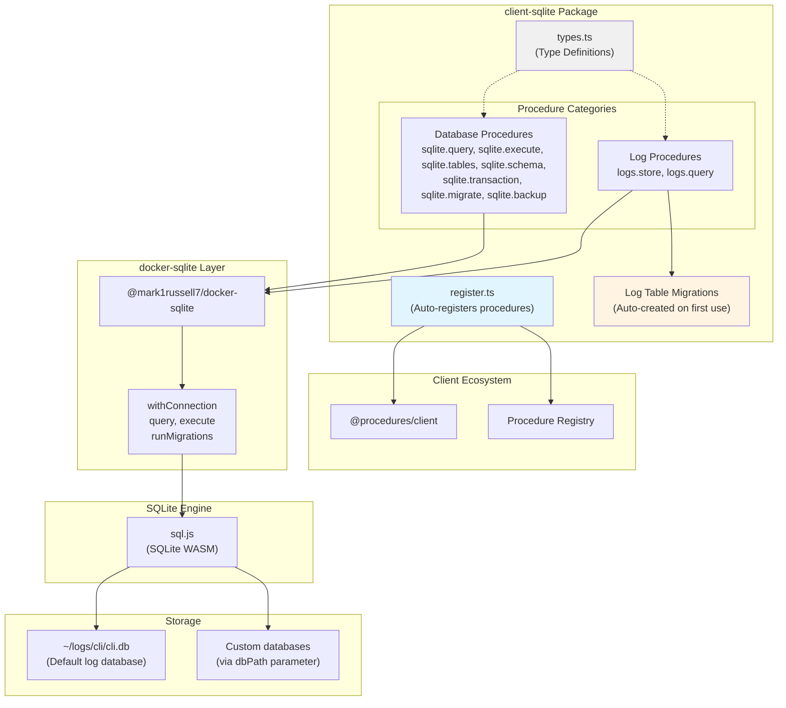
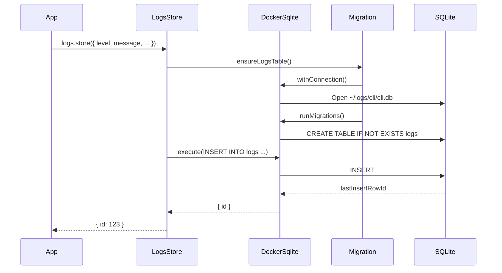

# @procedures/sqlite

[](https://www.npmjs.com/package/@procedures/sqlite)

[](https://opensource.org/licenses/MIT)
[](https://www.typescriptlang.org/)
[](https://nodejs.org/)

SQLite database operations via client procedures. Execute queries and store structured logs via `client.call()`.

## Overview

`client-sqlite` provides SQLite database access through the client procedure ecosystem, with:
- **Database procedures**: Execute SQL queries and mutations
- **Logging procedures**: Store and query structured application logs
- **Migration support**: Schema versioning and migration utilities
- **Default log database**: Pre-configured logging at `~/logs/cli/cli.db`
- **A collection storage**: `SqliteStorage` keeps a collection in a SQLite table, with a change log

The package has 9 procedures. Its register entry (`import "@procedures/sqlite/register"`) registers them:
- **Database**: `sqlite.query`, `sqlite.execute`, `sqlite.tables`, `sqlite.schema`, `sqlite.transaction`, `sqlite.migrate`, `sqlite.backup`
- **Logs**: `logs.store`, `logs.query`

### The old names `db.*`

In version 0.3.0 and before, the database procedures had the namespace `db`. The general name `db` did not tell the database. Since version 0.4.0, the namespace is `sqlite`.

The old names stay for one release as deprecated aliases: `db.query`, `db.execute`, `db.tables`, `db.schema`, `db.transaction`, `db.migrate` and `db.backup`. Each alias has the same handler, the same schemas and the same effects as its new procedure. Its description starts with `Deprecated: use sqlite.<name>`. The next release removes the aliases.

The MCP server (`bundle-mcp`) does not expose the aliases. Its tools are `sqlite.query`, `sqlite.execute`, `sqlite.tables` and `sqlite.schema`. The `logs.*` procedures keep their names.

## Architecture



### Package Dependency Flow

```mermaid
graph LR
    App["Your Application"]
    ClientSqlite["@procedures/sqlite"]
    Client["@procedures/client"]
    DockerSqlite["@mark1russell7/docker-sqlite"]
    SqlJs["sql.js"]

    App --> ClientSqlite
    ClientSqlite --> Client
    ClientSqlite --> DockerSqlite
    DockerSqlite --> SqlJs

    App -.client.call.-> Client
    Client -.executes.-> ClientSqlite
    ClientSqlite -.queries.-> DockerSqlite
    DockerSqlite -.uses.-> SqlJs
```

### Log Storage Flow



## Installation

```bash
npm install @procedures/sqlite
```

Since 0.2.0, an import of the package registers nothing. To register its procedures in the global registry:

```ts
import "@procedures/sqlite/register";
```

## Configuration

### Default Database Path

The package uses a default database path for CLI logs:

```typescript
// Default: ~/logs/cli/cli.db
const DEFAULT_DB_PATH = join(homedir(), "logs", "cli", "cli.db");
```

You can override this path in each procedure call:

```typescript
await client.exec(
  ["sqlite", "query"],
  {
    sql: "SELECT * FROM logs",
    dbPath: "./custom/path/database.db"
  }
);
```

## API Reference

### Database Procedures

#### `sqlite.query`

Execute a SQL SELECT query and return rows.

```typescript
const result = await client.exec(
  ["sqlite", "query"],
  {
    sql: "SELECT * FROM logs WHERE level = ? ORDER BY timestamp DESC",
    params: ["error"]
  }
);

console.log(result.rows);
console.log(result.columns);
```

**Input:**
```typescript
interface DbQueryInput {
  sql: string;              // SQL SELECT query
  params?: unknown[];       // Query parameters (uses ? placeholders)
  dbPath?: string;          // Database path (default: ~/logs/cli/cli.db)
}
```

**Output:**
```typescript
interface DbQueryOutput<T = Record<string, unknown>> {
  columns: string[];        // Column names
  rows: T[];                // Query results
}
```

**Example:**
```typescript
const result = await client.exec(
  ["sqlite", "query"],
  {
    sql: `
      SELECT level, COUNT(*) as count
      FROM logs
      WHERE session_id = ?
      GROUP BY level
    `,
    params: ["session-123"]
  }
);

// result.rows = [{ level: "info", count: 45 }, { level: "error", count: 2 }]
```

#### `sqlite.execute`

Execute a SQL statement (INSERT, UPDATE, DELETE) and return the number of affected rows.

```typescript
const result = await client.exec(
  ["sqlite", "execute"],
  {
    sql: "DELETE FROM logs WHERE timestamp < ?",
    params: ["2024-01-01"]
  }
);

console.log(`Deleted ${result.changes} rows`);
```

**Input:**
```typescript
interface DbExecuteInput {
  sql: string;              // SQL statement (INSERT, UPDATE, DELETE, etc.)
  params?: unknown[];       // Statement parameters
  dbPath?: string;          // Database path (default: ~/logs/cli/cli.db)
}
```

**Output:**
```typescript
interface DbExecuteOutput {
  changes: number;          // Number of rows affected
}
```

**Examples:**
```typescript
// INSERT
await client.exec(
  ["sqlite", "execute"],
  {
    sql: "INSERT INTO users (name, email) VALUES (?, ?)",
    params: ["Alice", "alice@example.com"]
  }
);

// UPDATE
await client.exec(
  ["sqlite", "execute"],
  {
    sql: "UPDATE users SET active = ? WHERE id = ?",
    params: [true, 123]
  }
);

// DELETE
await client.exec(
  ["sqlite", "execute"],
  {
    sql: "DELETE FROM users WHERE active = ?",
    params: [false]
  }
);
```

#### `sqlite.tables`

The procedure lists the tables and the views of a database, without the internal `sqlite_` tables. Each item has the `name`, the `type` and the `sql` that made it. With `views: false`, it gives only the tables. The procedure only reads. A missing file is an error (`ENOENT`), and the procedure does not make it.

```typescript
const { tables } = await client.exec(["sqlite", "tables"], { dbPath: "./app.db" });
```

#### `sqlite.schema`

The procedure gives the `columns`, the `indexes` and the `foreignKeys` of a table, or the columns of a view. The name of the table goes to SQLite as a bound value, not as SQL text. The procedure only reads.

```typescript
const schema = await client.exec(["sqlite", "schema"], { dbPath: "./app.db", table: "users" });
// schema.columns: [{ name: "id", type: "INTEGER", notNull: false, defaultValue: null, primaryKey: 1 }, ...]
```

#### `sqlite.transaction`

The procedure puts a list of statements in one transaction. When one statement fails, it rolls back the transaction, and the file stays as it was. The `params` of a statement bind to one statement. Without `params`, one `sql` can hold several statements. A statement that gives rows (`SELECT`, or `RETURNING`) gives its `rows` in its result. The procedure refuses `BEGIN`, `COMMIT`, `ROLLBACK`, `SAVEPOINT` and `RELEASE`, because it controls the transaction itself.

```typescript
const { results, changes } = await client.exec(["sqlite", "transaction"], {
  dbPath: "./app.db",
  statements: [
    { sql: "UPDATE accounts SET balance = balance - ? WHERE id = ?", params: [10, 1] },
    { sql: "UPDATE accounts SET balance = balance + ? WHERE id = ?", params: [10, 2] },
    { sql: "SELECT id, balance FROM accounts" },
  ],
});
```

#### `sqlite.migrate`

The procedure applies the numbered migrations that the database does not have, in the order of their numbers. The migrations come from a `folder` or from a list (`migrations`). In a folder, each migration is a file `<number>_<name>.sql`, for example `001_create_users.sql`. The procedure ignores the files that do not end in `.sql`.

- The table `schema_migrations` (or the `table` of the input) records each applied migration and the sha256 of its SQL.
- The pending migrations are in one transaction. When one fails, the procedure applies none of them.
- A second call applies nothing, and does not write the file.
- When the SQL of an applied migration changes, the procedure refuses the call. The sha256 reads CRLF line ends as LF.
- A migration must not hold `BEGIN`, `COMMIT` or `ROLLBACK`.

```typescript
const { applied, skipped, version } = await client.exec(["sqlite", "migrate"], {
  dbPath: "./app.db",
  folder: "./migrations",
});
```

#### `sqlite.backup`

The procedure copies a database to a new file (`to`). It does not replace a file, and it does not write the source. With `vacuum: true`, it compacts the copy.

This package uses SQLite in WebAssembly (sql.js). The database is in the memory of the module. `VACUUM INTO` and the backup API of SQLite write into the file system of the module, not to the disk. Thus the procedure writes the image of the database (its `export()`). It takes the image in the file queue of the database, where no other call of the process changes it. It writes the image to a file next to the target, checks it with `PRAGMA integrity_check`, and then renames it.

```typescript
const { path, bytes } = await client.exec(["sqlite", "backup"], { dbPath: "./app.db", to: "./backups/app-2026-10-16.db" });
```

### Log Procedures

#### `logs.store`

Store a structured log entry in the database. Automatically creates the logs table on first use.

```typescript
await client.exec(
  ["logs", "store"],
  {
    level: "error",
    message: "Failed to connect to database",
    sessionId: "session-123",
    command: "db.connect",
    context: "user-service",
    data: {
      host: "localhost",
      port: 5432
    },
    errorStack: new Error().stack
  }
);
```

**Input:**
```typescript
interface LogsStoreInput {
  level: LogLevel;                    // Log level
  message: string;                    // Log message
  sessionId?: string;                 // Session ID for grouping logs
  command?: string;                   // Command that generated this log
  context?: string;                   // Additional context (e.g., package name)
  data?: Record<string, unknown>;     // Structured data (stored as JSON)
  errorStack?: string;                // Error stack trace
  dbPath?: string;                    // Database path (default: ~/logs/cli/cli.db)
}

type LogLevel = "trace" | "debug" | "info" | "warn" | "error";
```

**Output:**
```typescript
interface LogsStoreOutput {
  id: number;               // ID of the inserted log row
}
```

**Log Table Schema:**
```sql
CREATE TABLE logs (
  id INTEGER PRIMARY KEY AUTOINCREMENT,
  timestamp TEXT NOT NULL DEFAULT (datetime('now')),
  level TEXT NOT NULL CHECK (level IN ('trace', 'debug', 'info', 'warn', 'error')),
  message TEXT NOT NULL,
  data TEXT,                    -- JSON string
  session_id TEXT,
  command TEXT,
  context TEXT,
  error_stack TEXT,
  created_at TEXT NOT NULL DEFAULT (datetime('now'))
);

-- Indexes for fast queries
CREATE INDEX idx_logs_session ON logs(session_id);
CREATE INDEX idx_logs_level ON logs(level);
CREATE INDEX idx_logs_timestamp ON logs(timestamp);
CREATE INDEX idx_logs_command ON logs(command);
```

#### `logs.query`

Query log entries with filtering, pagination, and sorting.

```typescript
const result = await client.exec(
  ["logs", "query"],
  {
    sessionId: "session-123",
    level: ["error", "warn"],
    limit: 100,
    orderBy: "desc"
  }
);

console.log(result.logs);
```

**Input:**
```typescript
interface LogsQueryInput {
  sessionId?: string;           // Filter by session ID
  command?: string;             // Filter by command
  level?: LogLevel | LogLevel[]; // Filter by log level(s)
  limit?: number;               // Maximum number of logs to return
  offset?: number;              // Offset for pagination
  orderBy?: "asc" | "desc";     // Order by timestamp (default: desc)
  dbPath?: string;              // Database path (default: ~/logs/cli/cli.db)
}
```

**Output:**
```typescript
interface LogsQueryOutput {
  logs: LogEntry[];
  total?: number;               // Total count (if limit was applied)
}

interface LogEntry {
  id: number;
  timestamp: string;            // ISO timestamp
  level: LogLevel;
  message: string;
  data: Record<string, unknown> | null;
  sessionId: string | null;
  command: string | null;
  context: string | null;
  errorStack: string | null;
}
```

**Examples:**
```typescript
// Get all errors from a session
const { logs } = await client.exec(
  ["logs", "query"],
  {
    sessionId: "session-123",
    level: "error"
  }
);

// Get recent warnings and errors
const { logs } = await client.exec(
  ["logs", "query"],
  {
    level: ["warn", "error"],
    limit: 50,
    orderBy: "desc"
  }
);

// Paginated query
const { logs } = await client.exec(
  ["logs", "query"],
  {
    command: "lib.build",
    limit: 20,
    offset: 40  // Page 3 (0-indexed)
  }
);
```

## The collection storage

`SqliteStorage` keeps the items of one collection in one table of a SQLite database. It implements `CollectionStorage` of `@procedures/client`. A `ProcedureServer`, an `ApiStorage` server and a `HybridStorage` use it as they use `InMemoryStorage`.

```ts
import { SqliteStorage } from "@procedures/sqlite/storage";

const users = new SqliteStorage<User>({ path: "./data/app.db", table: "users" });
await users.set("u1", { name: "Ada" });
await users.setBatch([["u2", { name: "Bob" }], ["u3", { name: "Cy" }]]);
const changes = await users.getChangesSince(); // { version, full: true, changed, deleted: [] }
await users.getEngine(); // "node" on Node.js 22.13 or later
await users.close();
```

The entry `@procedures/sqlite/storage` has the storage alone. The package root exports it too.

### The engines

The storage has two SQLite engines. The option `engine` selects one.

| `engine` | The engine | The file write |
|---|---|---|
| `node` | `node:sqlite` of Node.js, without a native build | SQLite writes only the changed pages. The file is in WAL mode. |
| `sqljs` | sql.js (SQLite in WebAssembly), through `@mark1russell7/docker-sqlite` | The storage keeps the database in memory, and it writes the whole file after a write. |
| `auto` (the default) | `node` when Node.js has `node:sqlite`, and else `sqljs` | |

- Node.js 22.13 and later have `node:sqlite` without a flag. Node.js 22.5 to 22.12 have it only with the flag `--experimental-sqlite`. Node.js 22.0 to 22.4 do not have it.
- Node.js 22 shows the warning `ExperimentalWarning: SQLite is an experimental feature` at the first open of the engine `node`. Node.js 24 and 26 do not show it.
- Node.js 26.11 renamed the class `DatabaseSync` to `Database`. The storage uses `Database` when the module has it, and else `DatabaseSync`.
- With `auto`, the storage uses `sqljs` when the import of `node:sqlite` fails. With `node`, the open fails then, and each operation gives the error.
- The two engines use the same file format. A file that one engine writes opens with the other engine, with its items and its versions.
- `getEngine()` gives the engine of the storage. `getMetadata()` gives it in `stats.engine`. `isNodeSqliteAvailable()` tells if this Node.js has `node:sqlite`.

The nightly benchmarks (`bench/storage.bench.ts`) measure the two engines in a file. These are the mean times of one CI run with Node.js 26 on Linux:

| The benchmark | `node` | `sqljs` |
|---|---|---|
| 1,000 calls of `set()`, one after the other, in a table of 1,000 items | 141 ms | 1,246 ms |
| One `getAll()` of a table of 10,000 items | 20 ms | 28 ms |

The engine `sqljs` writes the whole file at each write, so its write time grows with the size of the file.

### The table and the values

- The option `path` is a database file, or `:memory:` for a database that lives as long as the storage.
- The option `table` is the name of the table. It starts with a letter, and it has only letters, digits and underscores. The prefix `sqlite_` is not permitted.
- The table has the columns `id` and `value`. The value is the JSON text of the item.
- A value without JSON text, for example `undefined` or a `BigInt`, is a `TypeError`. The storage writes nothing then.
- A read gives a new copy of the item.
- `getIds()` gives the ids in the order of the items, and it does not read the values. A full sync of `HybridStorage` uses it.
- The order of the items is the order of the first write of each id, as in a `Map`.

### The change log and the versions

- `getChangesSince(version)` gives the items that changed and the ids that were deleted after a version. `HybridStorage` uses it for a delta sync.
- A version is `<epoch>:<seq>`, as in `InMemoryStorage`. The table `_storage_versions` keeps the epoch, so a version stays valid after a restart.
- The table `_storage_log` keeps the last change of each id. The option `maxTombstones` (10000 by default) limits the deletes that it keeps.
- A version that is older than the dropped deletes gives all items (`full: true`).
- A delta follows the order of the last change of each id, as in each other storage. A full result follows the order of the items.
- Write the table only through the storage. A change from other SQL is not in the change log.

### The transactions and the file

- Each write runs in a transaction with the change log. A batch that fails changes nothing.
- A write ends after its change is in the file.
- A storage that only reads does not make the file. The storage makes the file, and its folder, at the first write that changes an item.
- `close()` writes the file and releases the database. After it, each operation rejects, also `flush()` and an empty batch. A second `close()` does nothing.
- The storages of one file in one process share one database. Thus the storages of two tables in one file keep their items.
- The first storage of a file sets the engine of the shared database. A later storage with the engine `auto` uses it. A later storage with the other engine refuses it.

The engine `node`:

- The commit of a transaction writes the change to the file. `flush()` has nothing to write.
- The file is in WAL mode, with `synchronous = NORMAL`. After a crash, the file stays consistent. A power loss can lose the last commits.
- A write that cannot make the file fails, and it changes nothing.
- A read-only file opens. The reads work, and each write fails.

The engine `sqljs`:

- The storage keeps the database in memory, and it writes the whole file after each write. When several writes wait, one file write holds their changes.
- A failed file write fails the write. The change stays in memory, and `flush()` or the next write writes it.
- The storage refuses a file with a write-ahead log (`<file>-wal`) of the engine `node`. The log can hold changes that are not in the file. Open the file with the engine `node` one time, or close the process that has it open.

### Two processes on one file

- With the engine `node` in each process, two processes can use one file at the same time.
- SQLite locks the file for each write. A write waits for the lock of another process for `busyTimeout` (5 seconds by default). After it, the write fails with `database is locked`.
- In WAL mode, a read does not wait for a write of another process.
- Each write reads the version counter in its transaction, so the versions of the two processes agree. `getChangesSince()` reads in one read transaction.
- A storage that opened before the file existed opens the file when another process makes it.
- The engine `sqljs` does not coordinate with another process. Its whole-file write replaces the writes of the other process. Do not use it on a file that another process writes.
- The procedures `sqlite.query` and `sqlite.execute` use sql.js, and they do not share the database of the storages. Do not write the file from them while a storage has it open.

### The durable local copy of `HybridStorage`

`HybridStorage` of `@procedures/store` takes the storage of its local copy in the option `local`. With a `SqliteStorage`, the local copy stays after a restart. A new storage in `local-only` mode then reads the items of the last run, without the remote.

```ts
import { HybridStorage } from "@procedures/store";
import { FileQueueStore } from "@procedures/store/file-queue";
import { SqliteStorage } from "@procedures/sqlite/storage";

const users = new HybridStorage(remote, {
  mode: "write-back",
  local: new SqliteStorage({ path: "./users.db", table: "users" }),
  queueStore: new FileQueueStore("./users.queue.jsonl"),
});
```

## Usage Examples

### Basic Database Operations

```typescript
import { Client, LocalTransport, PROCEDURE_REGISTRY } from "@procedures/client";
import "@procedures/sqlite/register"; // registers its procedures

const client = new Client(new LocalTransport({ registry: PROCEDURE_REGISTRY }));

// Create a table
await client.exec(
  ["sqlite", "execute"],
  {
    sql: `
      CREATE TABLE IF NOT EXISTS users (
        id INTEGER PRIMARY KEY AUTOINCREMENT,
        name TEXT NOT NULL,
        email TEXT UNIQUE NOT NULL,
        active BOOLEAN DEFAULT 1,
        created_at TEXT DEFAULT (datetime('now'))
      )
    `,
    dbPath: "./app.db"
  }
);

// Insert data
await client.exec(
  ["sqlite", "execute"],
  {
    sql: "INSERT INTO users (name, email) VALUES (?, ?)",
    params: ["Alice Johnson", "alice@example.com"],
    dbPath: "./app.db"
  }
);

// Query data
const result = await client.exec(
  ["sqlite", "query"],
  {
    sql: "SELECT * FROM users WHERE active = ? ORDER BY created_at DESC",
    params: [1],
    dbPath: "./app.db"
  }
);

console.log(result.rows);
```

### Structured Logging

```typescript
// Log an info message
await client.exec(
  ["logs", "store"],
  {
    level: "info",
    message: "Starting build process",
    sessionId: "build-2024-03-15",
    command: "lib.build",
    context: "@myorg/package-name"
  }
);

// Log an error with stack trace
try {
  // Some operation
  throw new Error("Connection timeout");
} catch (error) {
  await client.exec(
    ["logs", "store"],
    {
      level: "error",
      message: error.message,
      sessionId: "build-2024-03-15",
      command: "lib.build",
      context: "@myorg/package-name",
      data: {
        host: "api.example.com",
        timeout: 5000
      },
      errorStack: error.stack
    }
  );
}

// Query logs by session
const { logs } = await client.exec(
  ["logs", "query"],
  {
    sessionId: "build-2024-03-15",
    orderBy: "asc"
  }
);

logs.forEach(log => {
  console.log(`[${log.level}] ${log.message}`);
  if (log.data) {
    console.log("  Data:", log.data);
  }
});
```

### Direct Database Access (Without RPC)

For lower-level access, use re-exported utilities from `docker-sqlite`:

```typescript
import {
  withConnection,
  query,
  execute,
  lastInsertRowId,
  runMigrations,
  createMigration
} from "@procedures/sqlite";

// Managed connection with automatic cleanup
await withConnection({ dbPath: "./data/app.db" }, (db) => {
  // Execute mutations
  execute(db, "INSERT INTO users (name, email) VALUES (?, ?)", [
    "Bob Smith",
    "bob@example.com"
  ]);

  const userId = lastInsertRowId(db);
  console.log("Inserted user ID:", userId);

  // Query data
  const result = query<{ id: number; name: string; email: string }>(
    db,
    "SELECT * FROM users WHERE id = ?",
    [userId]
  );

  console.log(result.rows);
});

// Connection is automatically closed after callback
```

### Database Migrations

```typescript
import {
  withConnection,
  runMigrations,
  getMigrationStatus,
  rollbackMigration,
  type Migration
} from "@procedures/sqlite";

const migrations: Migration[] = [
  {
    version: 1,
    description: "Create users table",
    up: `
      CREATE TABLE users (
        id INTEGER PRIMARY KEY AUTOINCREMENT,
        name TEXT NOT NULL,
        email TEXT UNIQUE NOT NULL,
        created_at TEXT DEFAULT (datetime('now'))
      );
      CREATE INDEX idx_users_email ON users(email);
    `,
    down: "DROP TABLE users;"
  },
  {
    version: 2,
    description: "Add users.active column",
    up: "ALTER TABLE users ADD COLUMN active BOOLEAN DEFAULT 1;",
    down: "ALTER TABLE users DROP COLUMN active;"
  }
];

await withConnection({ dbPath: "./app.db" }, (db) => {
  // Run migrations
  runMigrations(db, migrations);

  // Check migration status
  const status = getMigrationStatus(db);
  console.log("Current version:", status.currentVersion);
  console.log("Applied migrations:", status.appliedMigrations);

  // Rollback last migration if needed
  // rollbackMigration(db, migrations);
});
```

### Type-Safe Queries

```typescript
// Define result types for type safety
interface User {
  id: number;
  name: string;
  email: string;
  active: boolean;
  created_at: string;
}

const result = await client.call<DbQueryOutput<User>>(
  ["sqlite", "query"],
  {
    sql: "SELECT * FROM users WHERE active = ?",
    params: [true],
    dbPath: "./app.db"
  }
);

// result.rows is typed as User[]
result.rows.forEach(user => {
  console.log(`${user.name} <${user.email}>`);
});
```

## Integration with Ecosystem

### Bundle Packages

`client-sqlite` can be included in bundle packages:

```typescript
// In bundle-data/src/register.ts
import "@procedures/sqlite/register"; // registers its procedures
import "@procedures/mongo/register"; // registers its procedures
import "@procedures/s3/register.js";
```

## Dependencies

### Runtime Dependencies

- **@procedures/client** - Core client procedure system
- **@mark1russell7/docker-sqlite** - SQLite connection and query utilities

### Development Dependencies

- **@mark1russell7/cue** - Configuration and type utilities
- **typescript** (^5.9.3) - TypeScript compiler
- **@types/node** (^22.0.0) - Node.js type definitions

## Re-exported docker-sqlite Utilities

`client-sqlite` re-exports all utilities from `docker-sqlite` for direct use:

```typescript
// Connection management
export { withConnection, createConnection } from "@mark1russell7/docker-sqlite";

// Query execution
export { query, execute, execMultiple, lastInsertRowId } from "@mark1russell7/docker-sqlite";

// Table utilities
export { tableExists } from "@mark1russell7/docker-sqlite";

// Migration utilities
export {
  getMigrationStatus,
  runMigrations,
  rollbackMigration,
  createMigration
} from "@mark1russell7/docker-sqlite";

// Types
export type {
  ConnectionConfig,
  ConnectionCallback,
  QueryResult,
  ExecuteResult,
  Migration,
  MigrationStatus,
  Database
} from "@mark1russell7/docker-sqlite";
```

## Package Structure

```
client-sqlite/
├── src/
│   ├── types.ts              # Type definitions
│   ├── module.ts             # The procedures as data, and the sqlite.query, sqlite.execute and logs.* handlers
│   ├── register.ts           # The ./register entry: registers the module
│   ├── storage.ts            # SqliteStorage, the collection storage (the ./storage entry)
│   ├── engines.ts            # The engines of SqliteStorage: node:sqlite and sql.js
│   ├── procedures/db/        # sqlite.tables, sqlite.schema, sqlite.transaction, sqlite.migrate, sqlite.backup
│   └── index.ts              # Main entry point
├── bench/                    # The benchmarks of the engines (the nightly workflow runs them)
├── dist/                     # Compiled output
├── package.json
├── tsconfig.json
└── README.md
```

## Development

### Build

```bash
npm run build
```

### Type Check

```bash
npm run typecheck
```

### Clean

```bash
npm run clean
```

## License

MIT

## Author

Mark Russell <marktheprogrammer17@gmail.com>
