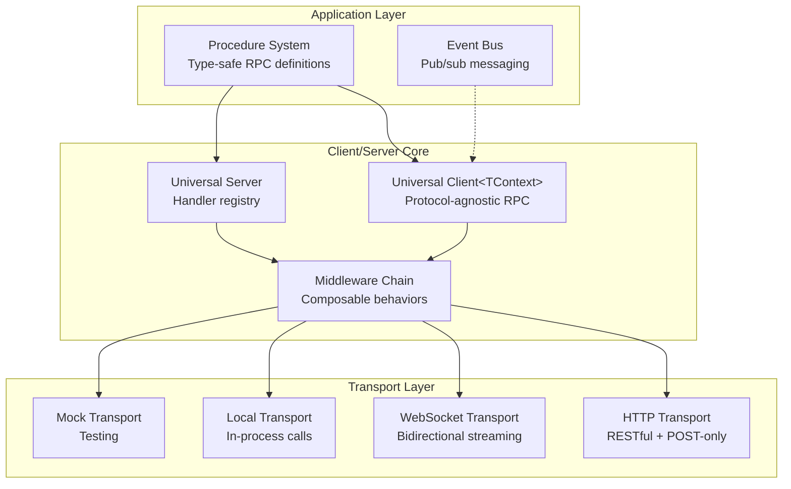
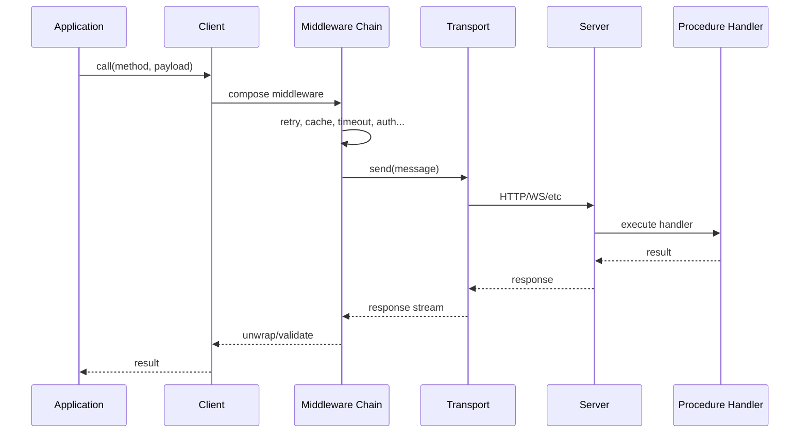

# @procedures/client

[](https://www.npmjs.com/package/@procedures/client)
[](https://opensource.org/licenses/MIT)
[](https://www.typescriptlang.org/)
[](https://nodejs.org/)

**Universal protocol-agnostic RPC client/server with middleware composition, type-safe procedures, streaming and procedure-as-data.**

The core depends on no other package of the repository. The procedure components are in [`@procedures/splay`](../client-splay), the data structures in [`@procedures/collections`](../client-collections), and the program store with the storage layer in [`@procedures/store`](../client-store).

## Table of Contents

- [Overview](#overview)
- [Installation](#installation)
- [Architecture](#architecture)
- [Core Concepts](#core-concepts)
- [API Reference](#api-reference)
- [Examples](#examples)
- [Integration](#integration)

## Overview

`@procedures/client` is the foundational package of the Mark ecosystem, providing a complete RPC framework with:

- **Universal Client/Server**: Protocol-agnostic RPC supporting HTTP, WebSocket, gRPC, and local transports
- **Type-Safe Procedures**: Schema-validated procedures with auto-discovery and registry management
- **Middleware System**: Composable middleware for retry, cache, timeout, circuit breaker, rate limiting, auth, tracing, and validation
- **Procedure-as-Data**: JSON programs of calls, references and control flow ([PROGRAM-FORMAT.md](../documentation/PROGRAM-FORMAT.md))
- **Event Bus**: Pub/sub messaging with async iteration support
- **Error System**: 70+ error codes with rich metadata and recovery suggestions

## Installation

```bash
npm install @procedures/client
```

npm installs `zod` and `ws` with it. The HTTP server transport needs `express` 4 or 5 (an optional peer dependency).

`import "@procedures/client/register"` registers the control flow (`client.chain` and the others) and `procedure.define`, `get`, `list` and `delete` in the global registry. `createRegistry()` adds them to each new registry.

## Architecture



### Data Flow



## Core Concepts

### 1. Universal Client

The `Client` class provides protocol-agnostic RPC with type-safe middleware composition:

- Generic over accumulated context type `Client<TContext>`
- Middleware chain builds type information through `.use()`
- Context inheritance via `.withContext()`
- Supports streaming and single request/response

### 2. Procedure System

Type-safe RPC procedure definitions with:
- Schema validation (Zod)
- Auto-discovery via package.json
- Handler execution (local or remote)
- Procedure-as-data (procedure references)

### 3. Middleware Composition

Onion-model middleware with:
- Type accumulation (`Client<BaseContext & RetryContext & ...>`)
- Context propagation (parent → client → per-call)
- Built-in middleware for common patterns

### 4. Call Policy and Interceptors

A host controls which procedures its callers reach, also through nested calls. See [docs/POLICY.md](docs/POLICY.md).
- `expose`: the procedures that the callers of a server can reach.
- A data-driven procedure (`client.chain`) calls only exposed procedures.
- A procedure of code declares its nested calls in `metadata.calls`. With `strictCalls`, a procedure that declares nothing calls only exposed procedures.
- Interceptors run around each invocation and its nested calls: `timeoutInterceptor`, `tracingInterceptor`, `metricsInterceptor`.

### 5. Related Packages

- `@procedures/collections`: data structures (`List`, `Map`, `Set`, `Queue`) and composable behaviors (LRU, TTL, bounded, evented).
- `@procedures/splay`: the procedure components, serializable UI descriptors (`defineComponent`, `simpleComponent`, `streamingComponent`).
- `@procedures/store`: the program store (`procedure.store`, `load`, `sync`), `ApiStorage`, `HybridStorage` and the synced registry.

## Quick Start

### Client

```typescript
import { Client, HttpTransport } from "@procedures/client";

const client = new Client({
  transport: new HttpTransport({ baseUrl: "https://api.example.com" })
})
  .use(createRetryMiddleware({ maxRetries: 3 }))
  .use(createAuthMiddleware({ token: "abc123" }));

// RPC call
const user = await client.call({ service: "users", operation: "get" }, { id: "123" });

// Streaming
for await (const event of client.stream({ service: "events", operation: "watch" }, {})) {
  console.log(event);
}
```

### Procedures

```typescript
import { defineProcedure, registerProcedures } from "client";
import { z } from "zod";

const getUserProcedure = defineProcedure({
  path: ["users", "get"],
  input: z.object({ id: z.string() }),
  output: z.object({ id: z.string(), name: z.string() }),
  handler: async ({ id }, ctx) => {
    return await db.users.findById(id);
  },
});

registerProcedures([getUserProcedure]);
```

## API Reference

### Client

#### `class Client<TContext = {}>`

Universal RPC client with type-safe middleware composition.

**Constructor:**
```typescript
new Client(options: ClientOptions | Transport)

interface ClientOptions {
  transport: Transport;
  defaultMetadata?: Metadata;
  throwOnError?: boolean;  // default: true
}
```

**Methods:**
```typescript
// Add middleware (returns new typed client)
use<TProvides>(middleware: ClientMiddleware): Client<TContext & TProvides>

// Create child client with additional context
withContext<TAdditional>(context: TAdditional): Client<TContext & TAdditional>

// Make RPC call (request/response)
call<TReq, TRes>(method: Method, payload: TReq, options?: CallOptions): Promise<TRes>

// Make streaming RPC call
stream<TReq, TRes>(method: Method, payload: TReq, options?: CallOptions): AsyncIterable<TRes>

// Execute procedure by path or reference
exec<TOutput>(refOrPath: ProcedureRef | ProcedurePath, input?: unknown): Promise<TOutput>

// Nested route API (batch calls with middleware overrides)
route<TRoute>(request: CallRequest<TRoute>): Promise<CallResponse<TRoute>>
routeStream<TRoute>(request: CallRequest<TRoute>): StreamingCallResponse<TRoute>

// Register validation schema (requires Zod middleware)
schema(method: Method, schemas: { input?: ZodSchema; output?: ZodSchema }): this

// Set custom procedure registry
useRegistry(registry: ProcedureRegistry): this

// Close transport
close(): Promise<void>
```

### Transports

#### `HttpTransport`
```typescript
new HttpTransport(options: HttpTransportOptions)

interface HttpTransportOptions {
  baseUrl: string;
  urlStrategy?: UrlStrategy;           // default: defaultUrlPattern
  httpMethodStrategy?: HttpMethodStrategy;  // default: restfulHttpMethodStrategy
  headers?: Record<string, string>;
  fetch?: typeof fetch;
}
```

#### `WebSocketTransport`
```typescript
new WebSocketTransport(options: WebSocketTransportOptions)

interface WebSocketTransportOptions {
  url: string;
  connectionTimeout?: number;  // default: 10000ms; a handshake that takes longer closes the socket
  requestTimeout?: number;     // default: 30000ms
  streamWindow?: number;       // default: 64 items
  reconnect?: {
    enabled?: boolean;            // default: true
    maxAttempts?: number;         // default: Infinity
    initialDelay?: number;        // default: 1000ms
    maxDelay?: number;            // default: 30000ms
    backoffMultiplier?: number;   // default: 1.5
    jitter?: number;              // default: 1 (full jitter: a random delay from 0 to the backoff)
  };
  heartbeat?: {
    enabled?: boolean;   // default: true
    interval?: number;   // default: 30000ms
    timeout?: number;    // default: 5000ms
    misses?: number;     // default: 1; pings without a pong that drop the connection
  };
}

// The server pings each connection, and closes one that misses 2 pongs (option heartbeat)
new WebSocketServerTransport(server, { server: http, heartbeat: { interval: seconds(30), misses: 2 } });
```

#### `LocalTransport`
```typescript
new LocalTransport(options: LocalTransportOptions)

interface LocalTransportOptions {
  handlers: Map<string, Handler>;
}
```

#### `MockTransport`
```typescript
new MockTransport(options?: MockTransportOptions)

// Use builder for mocking
mockBuilder()
  .method({ service: "users", operation: "get" })
  .response({ id: "123", name: "Alice" })
  .times(3)
  .delay(100)
  .build()
```

### Middleware

#### Retry Middleware
```typescript
createRetryMiddleware(options?: RetryOptions)

interface RetryOptions {
  maxRetries?: number;          // default: 3
  retryDelay?: number;          // default: 1000ms (the base delay)
  backoffMultiplier?: number;   // default: 2
  maxDelay?: number;            // default: no limit
  jitter?: number;              // default: 1 (full jitter: a random delay from 0 to the backoff)
  budget?: { ratio?: number; minPerSecond?: number } | false;  // default: 0.2 of the calls, at least 10 a second
  // After a try with an indeterminate outcome (a reset, the timeout of one try), only an
  // idempotent call goes again: true, or a function such as idempotentIn(registry)
  idempotent?: boolean | ((method: Method) => boolean | undefined);
  shouldRetry?: (item: ResponseItem<unknown>, attempt: number) => boolean;
}

// A Retry-After of the server makes the delay at least that long.
// The overrides of one call, in its context or as route() overrides (maxAttempts counts the tries)
client.withContext({ retry: { maxAttempts: 5, delay: ms(200), backoffMultiplier: 3, maxDelay: seconds(2), idempotent: true } });
```

#### Cache Middleware
```typescript
createCacheMiddleware(options: CacheOptions)

interface CacheOptions {
  methods: string[] | ((method: Method) => boolean); // required: the cached calls
  capacity?: number;         // default: 100
  ttl?: number;              // default: 60000ms
  keyGenerator?: (method: Method, payload: unknown, metadata: Metadata) => string;
  shouldCache?: (item: ResponseItem<unknown>) => boolean;
}

// The overrides of one call, in its context or as route() overrides
client.withContext({ cache: { ttl: seconds(5) } });      // the life of the stored entry
client.withContext({ cache: { bypass: true } });   // no read, no write
client.withContext({ cache: { refresh: true } });  // fetch, then replace the stored entry
```

#### Timeout Middleware and the resilience preset
```typescript
createOverallTimeoutMiddleware({ overall: seconds(10) })   // the whole call, retries included
createTimeoutMiddleware({ perAttempt: seconds(2) })        // each try
resilience({ overall, perAttempt, retry, breaker, cache, rateLimit })  // the layers in the correct order

// Each time is a Duration of @mark1russell7/quantity: ms(500), seconds(2), minutes(1), hours(1).
// A plain number is a type error (roadmap R11). The wire keeps milliseconds (procedure-timeout).
```

#### Auth Middleware
```typescript
createAuthMiddleware(options: AuthOptions)
createBearerAuthMiddleware(token: string | (() => string))
createApiKeyAuthMiddleware(apiKey: string, headerName?: string)

interface AuthOptions {
  token?: string | (() => string | Promise<string>);
  apiKey?: string;
  headerName?: string;
  scheme?: "Bearer" | "Basic" | string;
}
```

#### Circuit Breaker Middleware
```typescript
createCircuitBreakerMiddleware(options?: CircuitBreakerOptions)

interface CircuitBreakerOptions {
  failureThreshold?: number;   // default: 5 failures
  failureWindow?: Duration;    // default: seconds(10)
  resetTimeout?: Duration;     // default: seconds(30)
  successThreshold?: number;   // default: 2
  halfOpenMaxRequests?: number;
  isFailure?: (error: Error) => boolean;
}
```

#### Rate Limit Middleware
```typescript
createRateLimitMiddleware(options?: RateLimitOptions)

interface RateLimitOptions {
  maxRequests?: number;          // default: 100
  window?: Duration;             // default: minutes(1)
  strategy?: "reject" | "queue"; // default: "reject"
  maxQueueSize?: number;         // default: 100
}
```

#### Tracing Middleware
```typescript
createTracingMiddleware(options?: TracingOptions)

interface TracingOptions {
  generateTraceId?: () => string;
  generateSpanId?: () => string;
  onSpanStart?: (span: Span) => void;
  onSpanEnd?: (span: Span) => void;
}
```

#### Validation Middleware (Zod)
```typescript
createZodMiddleware(options?: ZodMiddlewareOptions)

interface ZodMiddlewareOptions {
  mode?: "input" | "output" | "both";  // default: "both"
  throwOnError?: boolean;              // default: true
}
```

### Procedures

#### Define Procedure
```typescript
defineProcedure<TInput, TOutput, TMeta>(def: ProcedureDefinition): Procedure

interface ProcedureDefinition<TInput, TOutput, TMeta> {
  path: ProcedurePath;           // e.g., ["users", "get"]
  input: ZodSchema<TInput>;
  output: ZodSchema<TOutput>;
  handler?: ProcedureHandler<TInput, TOutput, TMeta>;
  metadata?: TMeta;
}

// Fluent builder
createProcedure()
  .path(["users", "get"])
  .input(z.object({ id: z.string() }))
  .output(z.object({ id: z.string(), name: z.string() }))
  .meta({ description: "Get user by ID" })
  .handler(async (input, ctx) => {
    return await db.users.findById(input.id);
  })
  .build()
```

#### Procedure Registry
```typescript
PROCEDURE_REGISTRY.register(procedure: Procedure)
PROCEDURE_REGISTRY.get(path: ProcedurePath): Procedure | undefined
PROCEDURE_REGISTRY.has(path: ProcedurePath): boolean
PROCEDURE_REGISTRY.delete(path: ProcedurePath): boolean
PROCEDURE_REGISTRY.list(): Procedure[]
PROCEDURE_REGISTRY.on(event: RegistryEventType, listener: RegistryListener)
```

#### Procedure References (Procedure-as-Data)
```typescript
// Build procedure reference
proc(["users", "get"])
  .input({ id: "123" })
  .when("immediate")  // "immediate" | "never" | "parent"
  .name("getUser")
  .build()

// Execute reference
const result = await client.exec(procedureRef)

// Hydrate nested references
const hydrated = await hydrateInput(input, executor)
```

### Components, Collections and the Program Store

They are not in the core. See the README of `@procedures/splay` (components), `@procedures/collections` (data structures) and `@procedures/store` (the program store and the storage layer).

### Event Bus

```typescript
const bus = createEventBus()

// Subscribe
bus.on("user:created", (user) => console.log(user))
bus.once("app:ready", () => console.log("Ready"))

// Publish
bus.emit("user:created", { id: "123", name: "Alice" })

// Async iteration
for await (const event of bus.stream("user:*")) {
  console.log(event)
}

// Unsubscribe
const unsubscribe = bus.on("event", handler)
unsubscribe()
```

### Server

```typescript
const server = new Server(options?: ServerOptions)

// Register handler
server.register(method: Method, handler: ServerHandler)

// Add middleware
server.use(middleware: ServerMiddleware)

// Start server
await server.start()

// Stop server
await server.stop()
```

#### HTTP Server Transport
```typescript
new HttpServerTransport(server: Server, options: HttpServerTransportOptions)

interface HttpServerTransportOptions {
  port: number;
  hostname?: string;
  urlStrategy?: HttpUrlStrategy;
  cors?: boolean | CorsOptions;
}
```

#### WebSocket Server Transport
```typescript
new WebSocketServerTransport(server: Server, options: WebSocketServerTransportOptions)

interface WebSocketServerTransportOptions {
  port: number;
  path?: string;
  auth?: WebSocketAuthHandler;
  onConnection?: WebSocketConnectionHandler;
}
```

#### Procedure Server
```typescript
const server = createProcedureServer(options?: ProcedureServerOptions)

interface ProcedureServerOptions {
  registry?: ProcedureRegistry;
  storage?: StorageConfig;
  transports?: ServerTransport[];
}
```

### Error System

```typescript
// Create error
createError(code: string, context?: ErrorContext): RichError

// From HTTP status
createErrorFromHTTPStatus(status: number, context?: ErrorContext): RichError

// From exception
createErrorFromException(error: unknown, context?: ErrorContext): RichError

// Format error
formatError(error: RichError): string

// Check if known error
isKnownError(code: string): boolean

// Get error metadata
getErrorMetadata(code: string): ErrorMetadata | undefined

// Error registry
ERROR_REGISTRY.get(code: string): ErrorMetadata
ERROR_REGISTRY.has(code: string): boolean
ERROR_REGISTRY.list(): string[]
```

## Subpath Exports

```typescript
import { Client, HttpTransport, ... } from "@procedures/client";
import { defineProcedure, PROCEDURE_REGISTRY, ... } from "@procedures/client";
import { EventBus, createEventBus, ... } from "@procedures/client";

// OR use subpath exports
import { Client } from "@procedures/client/client";
import { ... } from "@procedures/client/procedures";
import { ... } from "@procedures/client/events";
```

## Procedure Auto-Discovery

Packages can declare procedures in `package.json`:

```json
{
  "client": {
    "procedures": "./dist/register.js"
  },
  "scripts": {
    "postinstall": "client-registry announce"
  }
}
```

When installed, the package announces its procedures in `.client-registry.json`. Run `client-registry discover` to generate a file that imports the register entry of each announced package.

## Type-Safe Middleware

Middleware context types accumulate through the chain:

```typescript
const client = new Client(transport)
  .use(createRetryMiddleware())     // Client<RetryContext>
  .use(createCacheMiddleware({ methods: ["users.get"] })) // Client<RetryContext & CacheContext>
  .use(createAuthMiddleware());     // Client<... & AuthContext>
```

### Available Middleware

| Middleware | Purpose |
|------------|---------|
| `createRetryMiddleware` | Exponential backoff with jitter |
| `createCacheMiddleware` | LRU + TTL caching |
| `createTimeoutMiddleware` | Request timeout |
| `createAuthMiddleware` | Bearer token / API key |
| `createTracingMiddleware` | W3C Trace Context |
| `createCircuitBreakerMiddleware` | Fault tolerance |
| `createRateLimitMiddleware` | Token bucket throttling |
| `createBatchingMiddleware` | Request aggregation |

## EventBus

```typescript
import { createEventBus } from "client";

const bus = createEventBus();

// Subscribe
bus.on("user:created", (user) => console.log(user));

// Publish
bus.emit("user:created", { id: "123", name: "Alice" });

// Async iteration
for await (const event of bus.stream("user:*")) {
  console.log(event);
}
```

## Server

```typescript
import { Server, HttpServerTransport } from "client";

const server = new Server({
  transports: [new HttpServerTransport({ port: 3000 })],
});

server.register(
  { service: "users", operation: "get" },
  async (request) => ({
    id: request.id,
    status: { type: "success", code: 200 },
    payload: await db.users.findById(request.payload.id),
    metadata: {},
  })
);

await server.start();
```

## Error System

70+ error codes with metadata:

```typescript
import { createError, ERROR_REGISTRY, ErrorCategory, ErrorSeverity } from "client";

const error = createError("E_TIMEOUT", {
  service: "users",
  operation: "get",
});
// { code: "E_TIMEOUT", message: "...", severity: "error", category: "timeout", ... }
```

## Examples

### Advanced Middleware Composition
```typescript
// The first use() is the outermost layer. The overall timeout covers the retries, and the
// timeout of each try sits inside the retry, so the retry can start the next try.
const client = new Client({ transport: new HttpTransport({ baseUrl: "/api" }) })
  .use(createTracingMiddleware())
  .use(createOverallTimeoutMiddleware({ overall: seconds(10) }))
  .use(createCacheMiddleware({ methods: ["users.get"], capacity: 100, ttl: minutes(1) }))
  .use(createRetryMiddleware({ maxRetries: 3, retryDelay: seconds(1), idempotent: (method) => method.operation === "get" }))
  .use(createCircuitBreakerMiddleware({ failureThreshold: 5, resetTimeout: minutes(1) }))
  .use(createRateLimitMiddleware({ maxRequests: 10, window: seconds(1) }))
  .use(createTimeoutMiddleware({ perAttempt: seconds(5) }))
  .use(createZodMiddleware());

// Context inheritance
const authedClient = client.withContext({ auth: { token: "user-token" } });
const adminClient = authedClient.withContext({ auth: { token: "admin-token" } });
```

### Procedure-as-Data (Declarative Composition)
```typescript
// Define procedures
const addProcedure = defineProcedure({
  path: ["git", "add"],
  input: z.object({ all: z.boolean() }),
  output: z.object({ success: z.boolean() }),
  handler: async ({ all }) => {
    // ... git add logic
    return { success: true };
  },
});

// Compose via procedure references
const deployPipeline = proc(["chain"]).input({
  steps: [
    proc(["git", "add"]).input({ all: true }).ref,
    proc(["git", "commit"]).input({ message: "deploy" }).ref,
    proc(["git", "push"]).ref,
  ],
}).build();

// Execute
const result = await client.exec(deployPipeline);
```

### Nested Route API (Batch Execution)
```typescript
const result = await client.route({
  batch: { strategy: "all", maxConcurrency: 5 },
  middlewares: {
    retry: { attempts: 3 },
    timeout: { overall: seconds(10) },
  },
  route: {
    users: {
      get: { id: "123" },          // users.get({ id: "123" })
      list: { limit: 10 },         // users.list({ limit: 10 })
    },
    orders: {
      list: { userId: "123" },     // orders.list({ userId: "123" })
    },
  },
});

// Access results
console.log(result.users.get.data);   // { id: "123", name: "Alice" }
console.log(result.users.list.data);  // [{ id: "1", ... }, ...]
console.log(result.orders.list.data); // [{ id: "ord_1", ... }, ...]
```

### WebSocket Bidirectional RPC
```typescript
// Client
const client = new Client({
  transport: new WebSocketTransport({ url: "ws://localhost:3000" })
});

for await (const event of client.stream({ service: "events", operation: "watch" }, {})) {
  console.log("Received:", event);
}

// Server
const server = new Server();
const wsTransport = new WebSocketServerTransport(server, {
  port: 3000,
  onConnection: (connectionId) => {
    console.log("Client connected:", connectionId);
  },
});

server.register({ service: "events", operation: "watch" }, async function* (request) {
  // Stream events to client
  while (true) {
    const event = await eventSource.next();
    yield {
      id: request.id,
      status: { type: "success", code: 200 },
      payload: event,
      metadata: {},
    };
  }
});

await server.start();
```

## Integration with Ecosystem

### Connection Management
Use with `@mark1russell7/client-connection` for bidirectional RPC:
```typescript
import "@mark1russell7/client-connection/register";

// List connected clients
const { connections } = await client.call(["connection", "list"], {});

// Call procedure on specific client
const result = await client.call(["connection", "call"], {
  clientId: "abc123",
  path: ["render"],
  input: { template: "home" },
});
```

### Shell Execution
Use with `@procedures/shell`:
```typescript
import "@procedures/shell/register";

const result = await client.call(["shell", "run"], {
  command: "git",
  args: ["status"],
  cwd: "/path/to/repo",
});
console.log(result.stdout);
```

### Procedure Scaffolding
Use with `@procedures/procedure`:
```typescript
import "@procedures/procedure/register";

const result = await client.call(["procedure", "new"], {
  name: "user.create",
  description: "Create a new user",
});
```

## Requirements

- **Node.js**: >= 22
- **Dependencies**: `ws` ^8.18.3, `zod` ^4
- **Peer Dependencies** (optional):
  - `express` ^4.0.0 || ^5.0.0 (for HTTP server)

## License

MIT

## Contributing

This package is part of the Mark ecosystem. See the main repository for contribution guidelines.

## See Also

- `@mark1russell7/client-connection` - Connection management for bidirectional RPC
- `@procedures/shell` - Shell command execution procedures
- `@procedures/procedure` - Procedure scaffolding utilities
- `@procedures/bundle-dev` - Development bundle with all client packages
