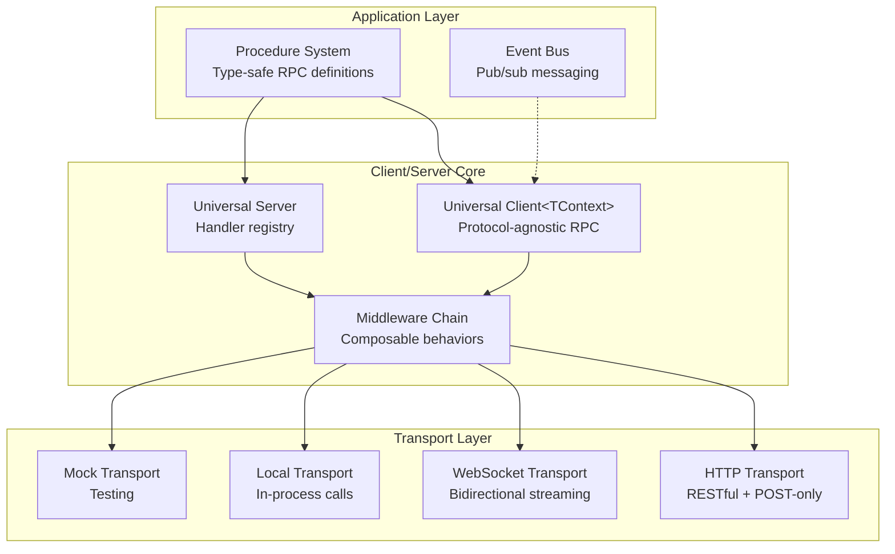
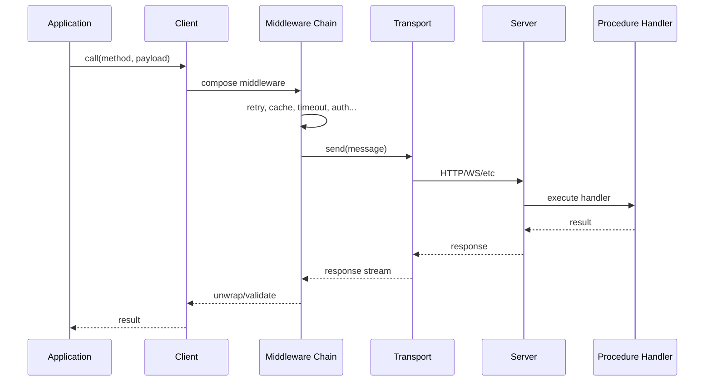

# @procedures/client

[](https://www.npmjs.com/package/@procedures/client)
[](https://opensource.org/licenses/MIT)
[](https://www.typescriptlang.org/)
[](https://nodejs.org/)

**Universal protocol-agnostic RPC client/server with middleware composition, type-safe procedures, streaming and procedure-as-data.**

The core depends on no other package of the repository. The procedure components are in [`@procedures/splay`](../client-splay), the data structures in [`@procedures/collections`](../client-collections), and the program store with the storage layer in [`@procedures/store`](../client-store).

## Table of Contents

- [Overview](#overview)
- [Installation](#installation)
- [Architecture](#architecture)
- [Core Concepts](#core-concepts)
- [API Reference](#api-reference)
- [Examples](#examples)
- [Integration](#integration)

## Overview

`@procedures/client` is the foundational package of the Mark ecosystem, providing a complete RPC framework with:

- **Universal Client/Server**: Protocol-agnostic RPC supporting HTTP, WebSocket, gRPC, and local transports
- **Type-Safe Procedures**: Schema-validated procedures with auto-discovery and registry management
- **Middleware System**: Composable middleware for retry, cache, timeout, circuit breaker, rate limiting, auth, tracing, and validation
- **Procedure-as-Data**: JSON programs of calls, references and control flow ([PROGRAM-FORMAT.md](../documentation/PROGRAM-FORMAT.md))
- **Event Bus**: Pub/sub messaging with async iteration support. A peer subscribes to the bus of another peer over each transport ([EVENTS.md](../documentation/EVENTS.md))
- **Error System**: 70+ error codes with rich metadata and recovery suggestions

## Installation

```bash
npm install @procedures/client
```

npm installs `zod` and `ws` with it. The HTTP server transport needs `express` 4 or 5 (an optional peer dependency).

`import "@procedures/client/register"` registers the control flow (`client.chain` and the others) and `procedure.define`, `get`, `list` and `delete` in the global registry. `createRegistry()` adds them to each new registry.

## Architecture



### Data Flow



## Core Concepts

### 1. Universal Client

The `Client` class provides protocol-agnostic RPC with type-safe middleware composition:

- Generic over accumulated context type `Client<TContext>`
- Middleware chain builds type information through `.use()`
- Context inheritance via `.withContext()`
- Supports streaming and single request/response

### 2. Procedure System

Type-safe RPC procedure definitions with:
- Schema validation (Zod)
- Auto-discovery via package.json
- Handler execution (local or remote)
- Procedure-as-data (procedure references)

### 3. Middleware Composition

Onion-model middleware with:
- Type accumulation (`Client<BaseContext & RetryContext & ...>`)
- Context propagation (parent → client → per-call)
- Built-in middleware for common patterns

### 4. Call Policy and Interceptors

A host controls which procedures its callers reach, also through nested calls. See [docs/POLICY.md](docs/POLICY.md).
- `expose`: the procedures that the callers of a server can reach.
- A data-driven procedure (`client.chain`) calls only exposed procedures.
- A procedure of code declares its nested calls in `metadata.calls`. With `strictCalls`, a procedure that declares nothing calls only exposed procedures.
- Interceptors run around each invocation and its nested calls: `timeoutInterceptor`, `tracingInterceptor`, `metricsInterceptor`.

### 5. Related Packages

- `@procedures/collections`: data structures (`List`, `Map`, `Set`, `Queue`) and composable behaviors (LRU, TTL, bounded, evented).
- `@procedures/splay`: the procedure components, serializable UI descriptors (`defineComponent`, `simpleComponent`, `streamingComponent`).
- `@procedures/store`: the program store (`procedure.store`, `load`, `sync`), `ApiStorage`, `HybridStorage` and the synced registry.

## Quick Start

### Client

```typescript
import { Client, HttpTransport } from "@procedures/client";

const client = new Client({
  transport: new HttpTransport({ baseUrl: "https://api.example.com" })
})
  .use(createRetryMiddleware({ maxRetries: 3 }))
  .use(createAuthMiddleware({ token: "abc123" }));

// RPC call
const user = await client.call({ service: "users", operation: "get" }, { id: "123" });

// Streaming
for await (const event of client.stream({ service: "events", operation: "watch" }, {})) {
  console.log(event);
}
```

### Procedures

```typescript
import { defineProcedure, registerProcedures } from "client";
import { z } from "zod";

const getUserProcedure = defineProcedure({
  path: ["users", "get"],
  input: z.object({ id: z.string() }),
  output: z.object({ id: z.string(), name: z.string() }),
  handler: async ({ id }, ctx) => {
    return await db.users.findById(id);
  },
});

registerProcedures([getUserProcedure]);
```

### Procedures of a package in the same process

`callerOf(...modules)` gives a function that runs the procedures of the modules. It makes the registry of the modules at the first call, and it does not use the global registry. Each call gives one value: the output, or the last item of a stream.

```typescript
import { callerOf } from "@procedures/client";
import { ghModule } from "@procedures/gh";

const gh = callerOf(ghModule);
const runs = await gh<RunList>(["gh", "run", "list"], { repo: "owner/name" });
```

## API Reference

### Client

#### `class Client<TContext = {}>`

Universal RPC client with type-safe middleware composition.

**Constructor:**
```typescript
new Client(options: ClientOptions | Transport)

interface ClientOptions {
  transport: Transport;
  defaultMetadata?: Metadata;
  throwOnError?: boolean;  // default: true
}
```

**Methods:**
```typescript
// Add middleware (returns new typed client)
use<TProvides>(middleware: ClientMiddleware): Client<TContext & TProvides>

// Create child client with additional context
withContext<TAdditional>(context: TAdditional): Client<TContext & TAdditional>

// Make RPC call (request/response)
call<TReq, TRes>(method: Method, payload: TReq, options?: CallOptions): Promise<TRes>

// Make streaming RPC call
stream<TReq, TRes>(method: Method, payload: TReq, options?: CallOptions): AsyncIterable<TRes>

// Execute procedure by path or reference
exec<TOutput>(refOrPath: ProcedureRef | ProcedurePath, input?: unknown): Promise<TOutput>

// Nested route API (batch calls with middleware overrides)
route<TRoute>(request: CallRequest<TRoute>): Promise<CallResponse<TRoute>>
routeStream<TRoute>(request: CallRequest<TRoute>): StreamingCallResponse<TRoute>

// Register validation schema (requires Zod middleware)
schema(method: Method, schemas: { input?: ZodSchema; output?: ZodSchema }): this

// Set custom procedure registry
useRegistry(registry: ProcedureRegistry): this

// Close transport
close(): Promise<void>
```

### Transports

#### `HttpTransport`
```typescript
new HttpTransport(options: HttpTransportOptions)

interface HttpTransportOptions {
  baseUrl: string;
  urlStrategy?: UrlStrategy;           // default: defaultUrlPattern
  httpMethodStrategy?: HttpMethodStrategy;  // default: postOnlyStrategy
  headerConverter?: HeaderConverter;
  defaultHeaders?: Record<string, string>;
  timeout?: Duration;                  // the time to the first item
  credentials?: "include" | "same-origin" | "omit";  // the credentials mode of fetch
  requestInit?: Omit<RequestInit, "method" | "headers" | "body" | "signal">;
  fetch?: typeof fetch;                // default: globalThis.fetch
}
```

An application with a cookie session on another origin sets `credentials: "include"`. The browser then sends the cookies of the server with each call. The server must permit the origin of the page with credentials (CORS). Refer to "Procedure handler without a framework".

```typescript
const client = new Client(new HttpTransport({ baseUrl: "https://api.example.com/api", credentials: "include" }));
```

#### `WebSocketTransport`
```typescript
new WebSocketTransport(options: WebSocketTransportOptions)

interface WebSocketTransportOptions {
  url: string;
  connectionTimeout?: number;  // default: 10000ms; a handshake that takes longer closes the socket
  requestTimeout?: number;     // default: 30000ms
  streamWindow?: number;       // default: 64 items
  reconnect?: {
    enabled?: boolean;            // default: true
    maxAttempts?: number;         // default: Infinity
    initialDelay?: number;        // default: 1000ms
    maxDelay?: number;            // default: 30000ms
    backoffMultiplier?: number;   // default: 1.5
    jitter?: number;              // default: 1 (full jitter: a random delay from 0 to the backoff)
  };
  heartbeat?: {
    enabled?: boolean;   // default: true
    interval?: number;   // default: 30000ms
    timeout?: number;    // default: 5000ms
    misses?: number;     // default: 1; pings without a pong that drop the connection
  };
  webSocket?: WebSocketClass;  // the class of the sockets; default: the global WebSocket
}

// In Node, import the transport of the Node entry. Its sockets are of the `ws` package, so a
// drop ends a socket at once with terminate(). The global WebSocket has only close(): with a
// dead peer, its socket stays open until the kernel stops it (924.6 s in the cells of R36).
import { WebSocketTransport } from "@procedures/client/node";

// The server transports are only in the Node entry (CLI-6)
import { WebSocketServerTransport } from "@procedures/client/node";

// The server pings each connection, and closes one that misses 2 pongs (option heartbeat)
new WebSocketServerTransport(server, { server: http, heartbeat: { interval: seconds(30), misses: 2 } });

// Calls in the two directions over one WebSocket (roadmap R24). The client serves its own
// procedures with a ProcedureServer; the server calls them with the same frames: streams with
// credit, cancel, the signal and the deadline.
const transport = new WebSocketTransport({ url, serve: new ProcedureServer({ registry: uiRegistry, autoRegister: true }) });
const toClient = new Client({ transport: wsServer.transportFor(connectionId) });   // or peer.clientFor(id)
await toClient.call({ service: "ui", operation: "notify" }, { text: "Build done" });

// Remote events (documentation/EVENTS.md): subscribe to topics of the bus of the server. The
// function gives the unsubscribe. After a drop, the transport resubscribes on the new connection.
const unsubscribe = transport.subscribe("orders.created", (order, event) => console.log(event.seq, order), {
  onSubscribed: (topics) => console.log("subscribed", topics),
  onError: (error) => console.error(error.code),   // TOPIC_NOT_FOUND, FORBIDDEN, NOT_FOUND, TOPIC_CLEARED
});
await unsubscribe.ready;
unsubscribe();
// The same events as an async iterator: a break or the signal unsubscribes
for await (const event of transport.events(["orders.created", "orders.paid"], { signal })) console.log(event.topic, event.data);
```

#### `LocalTransport`
```typescript
new LocalTransport(options: LocalTransportOptions)

interface LocalTransportOptions {
  handlers: Map<string, Handler>;
}
```

#### `MockTransport`
```typescript
new MockTransport(options?: MockTransportOptions)

// Use builder for mocking
mockBuilder()
  .method({ service: "users", operation: "get" })
  .response({ id: "123", name: "Alice" })
  .times(3)
  .delay(100)
  .build()
```

### Middleware

#### Retry Middleware
```typescript
createRetryMiddleware(options?: RetryOptions)

interface RetryOptions {
  maxRetries?: number;          // default: 3
  retryDelay?: number;          // default: 1000ms (the base delay)
  backoffMultiplier?: number;   // default: 2
  maxDelay?: number;            // default: no limit
  jitter?: number;              // default: 1 (full jitter: a random delay from 0 to the backoff)
  budget?: { ratio?: number; minPerSecond?: number } | false;  // default: 0.2 of the calls, at least 10 a second
  // After a try with an indeterminate outcome (a reset, the timeout of one try), only an
  // idempotent call goes again: true, or a function such as idempotentIn(registry)
  idempotent?: boolean | ((method: Method) => boolean | undefined);
  shouldRetry?: (item: ResponseItem<unknown>, attempt: number) => boolean;
}

// A Retry-After of the server makes the delay at least that long.
// A stream goes again only while no item reached the reader: its first item is a retryable error.
// A stream that fails before its first item with an error without a flag gets the flag of its code,
// so UNAVAILABLE goes again (CLI-68). A handler gives retryable: false to stop that.
// The overrides of one call, in its context or as route() overrides (maxAttempts counts the tries)
client.withContext({ retry: { maxAttempts: 5, delay: ms(200), backoffMultiplier: 3, maxDelay: seconds(2), idempotent: true } });
```

#### Cache Middleware
```typescript
createCacheMiddleware(options: CacheOptions)

interface CacheOptions {
  methods: string[] | ((method: Method) => boolean); // required: the cached calls
  capacity?: number;         // default: 100
  ttl?: number;              // default: 60000ms
  keyGenerator?: (method: Method, payload: unknown, metadata: Metadata) => string;
  shouldCache?: (item: ResponseItem<unknown>) => boolean;
}

// The overrides of one call, in its context or as route() overrides
client.withContext({ cache: { ttl: seconds(5) } });      // the life of the stored entry
client.withContext({ cache: { bypass: true } });   // no read, no write
client.withContext({ cache: { refresh: true } });  // fetch, then replace the stored entry
```

#### Timeout Middleware and the resilience preset
```typescript
createOverallTimeoutMiddleware({ overall: seconds(10) })   // the whole call, retries included
createTimeoutMiddleware({ perAttempt: seconds(2) })        // each try
resilience({ overall, perAttempt, retry, breaker, cache, rateLimit })  // the layers in the correct order

// Each time is a Duration of @mark1russell7/quantity: ms(500), seconds(2), minutes(1), hours(1).
// A plain number is a type error (roadmap R11). The wire keeps milliseconds (procedure-timeout).
```

#### Auth Middleware
```typescript
createAuthMiddleware(options: AuthOptions)
createBearerAuthMiddleware(token: string | (() => string))
createApiKeyAuthMiddleware(apiKey: string, headerName?: string)

interface AuthOptions {
  token?: string | (() => string | Promise<string>);
  apiKey?: string;
  headerName?: string;
  scheme?: "Bearer" | "Basic" | string;
}
```

#### Circuit Breaker Middleware
```typescript
createCircuitBreakerMiddleware(options?: CircuitBreakerOptions)

interface CircuitBreakerOptions {
  failureThreshold?: number;   // default: 5 failures
  failureWindow?: Duration;    // default: seconds(10)
  resetTimeout?: Duration;     // default: seconds(30)
  successThreshold?: number;   // default: 2
  halfOpenMaxRequests?: number;
  isFailure?: (error: Error) => boolean;
}
```

#### Rate Limit Middleware
```typescript
createRateLimitMiddleware(options?: RateLimitOptions)

interface RateLimitOptions {
  maxRequests?: number;          // default: 100
  window?: Duration;             // default: minutes(1)
  strategy?: "reject" | "queue"; // default: "reject"
  maxQueueSize?: number;         // default: 100
}
```

#### Tracing Middleware
```typescript
createTracingMiddleware(options?: TracingOptions)

interface TracingOptions {
  generateTraceId?: () => string;
  generateSpanId?: () => string;
  onSpanStart?: (span: Span) => void;
  onSpanEnd?: (span: Span) => void;
}
```

#### Validation Middleware (Zod)
```typescript
createZodMiddleware(options?: ZodMiddlewareOptions)

interface ZodMiddlewareOptions {
  mode?: "input" | "output" | "both";  // default: "both"
  throwOnError?: boolean;              // default: true
}
```

### Procedures

#### Define Procedure
```typescript
defineProcedure<TInput, TOutput, TMeta>(def: ProcedureDefinition): Procedure

interface ProcedureDefinition<TInput, TOutput, TMeta> {
  path: ProcedurePath;           // e.g., ["users", "get"]
  input: ZodSchema<TInput>;
  output: ZodSchema<TOutput>;
  handler?: ProcedureHandler<TInput, TOutput, TMeta>;
  metadata?: TMeta;
}

// Fluent builder
createProcedure()
  .path(["users", "get"])
  .input(z.object({ id: z.string() }))
  .output(z.object({ id: z.string(), name: z.string() }))
  .meta({ description: "Get user by ID" })
  .handler(async (input, ctx) => {
    return await db.users.findById(input.id);
  })
  .build()
```

#### Procedure Registry
```typescript
PROCEDURE_REGISTRY.register(procedure: Procedure)
PROCEDURE_REGISTRY.get(path: ProcedurePath): Procedure | undefined
PROCEDURE_REGISTRY.has(path: ProcedurePath): boolean
PROCEDURE_REGISTRY.delete(path: ProcedurePath): boolean
PROCEDURE_REGISTRY.list(): Procedure[]
PROCEDURE_REGISTRY.on(event: RegistryEventType, listener: RegistryListener)
```

#### Procedure References (Procedure-as-Data)
```typescript
// Build procedure reference
proc(["users", "get"])
  .input({ id: "123" })
  .when("immediate")  // "immediate" | "never" | "parent"
  .name("getUser")
  .build()

// Execute reference
const result = await client.exec(procedureRef)

// Hydrate nested references
const hydrated = await hydrateInput(input, executor)
```

### Components, Collections and the Program Store

They are not in the core. See the README of `@procedures/splay` (components), `@procedures/collections` (data structures) and `@procedures/store` (the program store and the storage layer).

### Event Bus

```typescript
const bus = createEventBus()

// Subscribe
bus.on("user:created", (user) => console.log(user))
bus.once("app:ready", () => console.log("Ready"))

// Publish
bus.emit("user:created", { id: "123", name: "Alice" })

// Async iteration
for await (const event of bus.stream("user:*")) {
  console.log(event)
}

// Unsubscribe
const unsubscribe = bus.on("event", handler)
unsubscribe()
```

#### Remote events

A peer subscribes to the topics of the bus of another peer ([EVENTS.md](../documentation/EVENTS.md)). A subscription is a streaming call of the procedure `events.subscribe`, so it works over WebSocket (in the two directions), HTTP with NDJSON, a message port and the local transport.

```typescript
// The publisher: a ProcedureServer with the option events
const bus = createEventBus()
const server = new ProcedureServer({
  registry,
  autoRegister: true,
  events: {
    bus,                                  // the procedures of the server get it as ctx.bus
    topics: ["orders.*", "system:*"],     // the topic rule: an exact name, a prefix with *, or *
    allow: (topic, call) => !topic.startsWith("system:") || call.capability.clearance === "admin",
    buffer: 1024,                         // the events that one subscription holds for a slow subscriber
  },
})
server.publish("orders.created", { order: 1 })   // the same as bus.emit()

// The subscriber, over each transport
const unsubscribe = subscribeRemote(transport, "orders.created", (order, event) => console.log(order, event.seq), {
  maxAttempts: 10,                                                   // the resubscribe tries without a confirmation (default 10; WebSocket: reconnect.maxAttempts)
  backoff: { initialDelay: ms(250), maxDelay: seconds(30), backoffMultiplier: 2, jitter: 1 },   // Durations: a plain number throws a TypeError
})
for await (const event of remoteEvents(transport, ["orders.created"], { signal })) console.log(event.data)

// The server subscribes to the bus of a client: the client serves it with `serve`
new WebSocketTransport({ url, serve: new ProcedureServer({ events: { bus: clientBus, topics: ["ui.*"] } }) })
wsServer.subscribe(connectionId, "ui.clicked", (click) => console.log(click))
```

- The delivery is at most once, in the order of `emit()`. `seq` numbers the events of a subscription, and `dropped` tells the events that the publisher dropped for a slow subscriber.
- A topic outside the topic rule gives `TOPIC_NOT_FOUND`. A topic that `allow` refuses gives `FORBIDDEN` with the reason `topic-not-allowed`. The procedure reads the resource `events`, so the capability of the host applies to it.
- `ProcedureServer.stop()` ends each subscription with `UNAVAILABLE`, and the subscriber resubscribes later, at most `maxAttempts` times without a confirmation.
- `clear()` or `clearAll()` of the bus ends each subscription of a cleared topic with `TOPIC_CLEARED`. The subscriber does not resubscribe. `bus.on(channel, handler, { onClear })` gives the same notice to a local handler.
- The subscribers of the same topics with the same options on one transport share one call. The last unsubscribe sends the cancel. A late subscriber gets no replay: its `ready` resolves at once, and its `seq` starts at 1.
- `events.subscribe` is not in a registry: it is not an MCP tool.

### Server

```typescript
const server = new Server(options?: ServerOptions)

// Register handler
server.register(method: Method, handler: ServerHandler)

// Add middleware
server.use(middleware: ServerMiddleware)

// Start server
await server.start()

// Stop server
await server.stop()
```

#### HTTP Server Transport
```typescript
import { HttpServerTransport, type HttpServerTransportOptions } from "@procedures/client/node";

new HttpServerTransport(server: Server, options: HttpServerTransportOptions)

interface HttpServerTransportOptions {
  app: Express;                  // required
  httpServer?: HttpServer;       // an existing server: the transport does not listen
  port?: number;                 // default: 3000
  host?: string;                 // default: "127.0.0.1"
  basePath?: string;             // default: "/api"
  urlStrategy?: HttpUrlStrategy; // (req: UrlStrategyRequest) => Method | null
  cors?: boolean;
  corsOptions?: { origin?: string | string[]; methods?: string[]; allowedHeaders?: string[]; credentials?: boolean };
  bodyLimit?: number;            // default: 1 MiB
  keepAlive?: Duration | false;  // default: seconds(15)
  clock?: Clock;                 // the clock of the keep-alive timers
}
```

A URL strategy gets a `UrlStrategyRequest`: the method, the path, the URL, the headers, the query and the body. The type is structural. A `Request` of Express agrees with it, and so does the `UrlRequest` of `procedureHandler`.

A client that accepts `application/x-ndjson` gets a stream as NDJSON lines ([WIRE-PROTOCOL.md](../documentation/WIRE-PROTOCOL.md)).

- After each quiet time of `keepAlive`, the server writes a keep-alive line: a blank line. Thus a proxy or a client with an idle timeout does not close a long, quiet stream.
- Each line starts the quiet time again. No keep-alive line comes after the end, an error, an abort or a closed connection.
- `keepAlive: false` turns the keep-alive lines off.
- The HTTP client skips each blank line. Each item that it reads from an NDJSON stream has the metadata key `stream: true` (`STREAM_ITEM_METADATA_KEY`).

A server without Express writes the same lines with `writeNdjsonStream` of `@procedures/client/node`:

```typescript
import { createServer } from "node:http";
import { seconds } from "@procedures/client";
import { writeNdjsonStream } from "@procedures/client/node";

async function* progress() {
  for (let step = 1; step <= 3; step++) {
    await new Promise((resolve) => setTimeout(resolve, 60_000)); // a quiet minute: 4 keep-alive lines
    yield { step };
  }
}

createServer((req, res) => {
  // The headers, the item, done and error lines with seq, the keep-alive lines and the backpressure
  void writeNdjsonStream(res, progress(), {
    keepAlive: seconds(15),
    errorOf: (error) => ({ code: "UNAVAILABLE", message: String(error), retryable: true }),
  });
}).listen(3000);
```

`errorOf` also gets the count of the item lines before the error. The default gives an error without a flag the flag of its code before the first item, and `false` after it (CLI-68).

The promise of `writeNdjsonStream` resolves when the response ends. A closed connection or an abort of `signal` stops the stream, and the iterator of the items gets `return()`.

#### Procedure handler without a framework

`procedureHandler(server, options)` of `@procedures/client/node` gives a request handler of `node:http`: `(req, res) => boolean`. The handler takes each request under `basePath` and gives `true`. For each other request, it gives `false` and does not touch the request. Thus the routes of the application share the listener with the procedures.

```typescript
import { createServer } from "node:http";
import { ProcedureServer } from "@procedures/client";
import { procedureHandler, upgradeHandler } from "@procedures/client/node";

const server = new ProcedureServer({ registry, token });
server.registerFromRegistry();
const procedures = procedureHandler(server, { basePath: "/api/proc" });
const sockets = upgradeHandler(server, { path: "/ws" });

const http = createServer((req, res) => {
  if (procedures(req, res)) return;
  appRoutes(req, res); // for example /api/chat
});
http.on("upgrade", (req, socket, head) => {
  if (!sockets(req, socket, head)) socket.destroy();
});
http.listen(4820);
```

- The handler speaks the wire of `HttpServerTransport` ([WIRE-PROTOCOL.md](../documentation/WIRE-PROTOCOL.md)). This includes the URL of the method, NDJSON streams with `seq` and keep-alive lines, idempotency keys, deadlines, events and the browser checks.
- The error codes are the codes of wire v1. A stopped handler answers `UNAVAILABLE` (503, retryable). A refused browser request answers `FORBIDDEN` (403) with a reason: `origin-not-allowed`, `host-header-not-allowed`, `method-not-allowed` or `media-type-not-allowed`.
- An `OPTIONS` request gets 204 and starts no procedure.
- `cors: { origin: ["https://app.example"], credentials: true }` lets a page of that origin call with its cookies. A list or a function of origins sends `Access-Control-Allow-Credentials: true` by default.
- An origin that the CORS does not permit gets no `Access-Control-*` header. With a list or a function of origins, each response gets `Vary: Origin`.
- `secretHeaders` names more headers that carry a secret, for example `X-Jarvis-Token`. `secretQuery` names the query parameters that carry a secret. Its default is `["token"]`. These values go into the credentials of the request, not into its metadata.
- `handler.middleware` mounts the handler in Connect or Express. A request outside `basePath` goes to `next`.
- The handler has the stop parts of a service transport: `start()`, `stopIntake()`, `drain(deadline, signal)`, `inFlight()` and `close()`. It does not make a server and does not listen.

`upgradeHandler(server, options)` gives an upgrade handler for the "no server" mode of `ws`: `(req, socket, head) => boolean`. It takes each upgrade of its `path`. Two handlers of different paths share one listener. `handler.transport` gives the API of `WebSocketServerTransport`: `broadcast`, `callConnection`, `subscribe` and the others. The upgrade handler has the same stop parts. After `stopIntake()`, a new upgrade gets 503, and a new call gets `UNAVAILABLE`.

#### WebSocket Server Transport
```typescript
import { WebSocketServerTransport, type WebSocketServerTransportOptions } from "@procedures/client/node";

new WebSocketServerTransport(server: Server, options?: WebSocketServerTransportOptions)

interface WebSocketServerTransportOptions {
  server?: HttpServer;           // the server whose upgrades of `path` the transport takes
  path?: string;                 // default: "/ws"
  authenticate?: WebSocketAuthHandler;
  onConnection?: WebSocketConnectionHandler;
  secretHeaders?: readonly string[];
  heartbeat?: { interval?: Duration; misses?: number } | false;
}
```

The transport takes only the upgrades of its path. Thus two transports of different paths share one server. An upgrade that no transport and no other listener takes gets 400. Without `server`, give each upgrade to `transport.upgrade(req, socket, head)`, or use `upgradeHandler`.

#### Procedure Server
```typescript
const server = createProcedureServer(options?: ProcedureServerOptions)

interface ProcedureServerOptions {
  registry?: ProcedureRegistry;
  storage?: StorageConfig;
  transports?: ServerTransport[];
  events?: EventPublisherOptions | EventPublisher;   // the remote events: refer to "Remote events"
  token?: string;                // the token that each request presents, except a local request
  principalOf?: PrincipalOf;     // the request hook: refer to "The request hook"
  authenticate?: (request: ServerRequest) => Principal | undefined | Promise<Principal | undefined>;
}
```

#### The request hook

`principalOf` reads the credentials of each network request and gives its identity. The credentials have the bearer token, the cookies, each header and the query of the request. The secret headers and the secret query parameters are in the credentials only, not in the metadata.

```typescript
const server = new ProcedureServer({
  token,
  clearanceOrder: ladder(["public", "guest", "intimate"]),
  capability: { clearance: "intimate" },
  principalOf: ({ cookies = {}, headers = {}, query = {} }) => ({
    // The token of a cookie, of an application header or of the query
    bearer: cookies["jarvis_token"] ?? headers["x-jarvis-token"] ?? query["token"],
    // A guest switch can only make the capability narrower
    ...(cookies["jarvis_audience"] ? { narrowing: { clearance: cookies["jarvis_audience"] } } : {}),
  }),
});
```

- `bearer`: the server compares this token with its `token`. Without it, the server compares the bearer token of the `Authorization` header.
- `principal`: the principal of the request, for example the user of a session cookie. The procedure reads it as `ctx.principal`, and its nested calls get the same principal.
- `narrowing`: a narrower capability that the request asks for. The server narrows the capability of the call with it. A request for more has no effect.
- An empty object accepts the request without a principal. Undefined, or an error, refuses the request with `UNAUTHORIZED`.
- `authenticate` operates after the hook and can read `request.principal`. A local request does not go through the hook.
- `hostPolicy({ principalOf })` gives the hook to each server of the policy.

#### Local requests

Each face sets the credentials of its requests, or the local marker `LOCAL_CREDENTIALS` (CLI-1). A local request comes from this application, so the token and the request hook do not apply to it.

- The local faces are MCP over stdio, an SDK transport of `McpServerTransport` and `PortTransport`. The peer of stdio is the parent process. Only the holder of the other end of a port can send to it.
- A network face never sets the marker: HTTP, WebSocket, and MCP over Streamable HTTP. The key of the marker is a symbol, so JSON, a header, a cookie or a query cannot carry it.
- A server with a token or a request hook refuses a request without credentials with `UNAUTHORIZED`. The hook does not operate for it. Before, such a request skipped the token and the hook.
- A call of the code of the application to `server.handle()` sets the marker itself:

```typescript
import { LOCAL_CREDENTIALS } from "@procedures/client";

await server.handle({ id: "1", method, payload, metadata: {}, credentials: LOCAL_CREDENTIALS });
```

- The nested calls of a procedure do not go through the token check again. They keep the principal of their caller.
- A `PortTransport` that a part outside the application can reach takes `credentials: {}`. Then the token applies. A `Window` is such a port.

#### Cookies and CSRF

A browser sends the cookies of a server by itself, also for a request that a page of another site starts. Thus a server that reads cookies trusts a request only from a named origin.

- With `principalOf`, the server reads the cookies of each request. A face then accepts a browser request only from its own origin or from a named origin.
- A request with a `Cookie` header gets the same check on `procedureHandler` and `upgradeHandler`. `"*"` does not permit another origin for it. A list or a function of origins does.
- `principalOf` with the origin `"*"` and no named `allowedOrigins` is refused at construction. The error names the fix.
- A request without an `Origin` header and without `Sec-Fetch-Site` comes from a program, not from a page. It passes.
- `HttpServerTransport` and `WebSocketServerTransport` keep their former checks for a server that reads no cookies. With `authenticate`, a request with a cookie needs a named origin. The server option `ambientCredentials: false` turns this off for an `authenticate` function that reads only the bearer token.
- Give a session cookie `SameSite=Lax` or `SameSite=Strict`, and `HttpOnly`. A cookie with `SameSite=None` goes with each request of another site, so only the origin check stops such a request.

### Error System

```typescript
// Create error
createError(code: string, context?: ErrorContext): RichError

// From HTTP status
createErrorFromHTTPStatus(status: number, context?: ErrorContext): RichError

// From exception
createErrorFromException(error: unknown, context?: ErrorContext): RichError

// Format error
formatError(error: RichError): string

// Check if known error
isKnownError(code: string): boolean

// Get error metadata
getErrorMetadata(code: string): ErrorMetadata | undefined

// Error registry
ERROR_REGISTRY.get(code: string): ErrorMetadata
ERROR_REGISTRY.has(code: string): boolean
ERROR_REGISTRY.list(): string[]
```

## Subpath Exports

```typescript
import { Client, HttpTransport, ... } from "@procedures/client";
import { defineProcedure, PROCEDURE_REGISTRY, ... } from "@procedures/client";
import { EventBus, createEventBus, ... } from "@procedures/client";

// OR use subpath exports
import { Client } from "@procedures/client/client";
import { ... } from "@procedures/client/procedures";
import { ... } from "@procedures/client/events";
```

| Entry | Use |
|---|---|
| `@procedures/client` | Node or a browser bundle. The browser entry, the URL strategies and the browser checks of the server. It imports no `http`, `ws` or `express`, and its declarations name none of them (CLI-6). Its `WebSocketTransport` uses the global `WebSocket`. |
| `@procedures/client/browser` | A browser bundle. It does not import `http` or `ws`. |
| `@procedures/client/node` | Node. A `WebSocketTransport` whose sockets are of the `ws` package: a drop ends a socket at once. `writeNdjsonStream`: the NDJSON stream response of `HttpServerTransport`, for a `ServerResponse` of `node:http`. `procedureHandler` and `upgradeHandler`: the procedure faces of HTTP and WebSocket, without a framework. `HttpServerTransport` and `WebSocketServerTransport`: the server transports. |
| `@procedures/client/register` | It registers the core procedures in the global registry. |

## Procedure Discovery

A package declares its procedures in `package.json`:

```json
{
  "client": {
    "procedures": "./dist/register.js"
  }
}
```

The `mark` CLI finds the packages by the `client.procedures` field. An app imports the `/register` entry of each package that it uses, for example `import "@procedures/fs/register"`.

## Type-Safe Middleware

Middleware context types accumulate through the chain:

```typescript
const client = new Client(transport)
  .use(createRetryMiddleware())     // Client<RetryContext>
  .use(createCacheMiddleware({ methods: ["users.get"] })) // Client<RetryContext & CacheContext>
  .use(createAuthMiddleware());     // Client<... & AuthContext>
```

### Available Middleware

| Middleware | Purpose |
|------------|---------|
| `createRetryMiddleware` | Exponential backoff with jitter |
| `createCacheMiddleware` | LRU + TTL caching |
| `createTimeoutMiddleware` | Request timeout |
| `createAuthMiddleware` | Bearer token / API key |
| `createTracingMiddleware` | W3C Trace Context |
| `createCircuitBreakerMiddleware` | Fault tolerance |
| `createRateLimitMiddleware` | Token bucket throttling |
| `createBatchingMiddleware` | Request aggregation |

## EventBus

```typescript
import { createEventBus } from "client";

const bus = createEventBus();

// Subscribe
bus.on("user:created", (user) => console.log(user));

// Publish
bus.emit("user:created", { id: "123", name: "Alice" });

// Async iteration
for await (const event of bus.stream("user:*")) {
  console.log(event);
}
```

## Server

```typescript
import { Server } from "@procedures/client";
import { HttpServerTransport } from "@procedures/client/node";

const server = new Server({
  transports: [new HttpServerTransport({ port: 3000 })],
});

server.register(
  { service: "users", operation: "get" },
  async (request) => ({
    id: request.id,
    status: { type: "success", code: 200 },
    payload: await db.users.findById(request.payload.id),
    metadata: {},
  })
);

await server.start();
```

## Error System

70+ error codes with metadata:

```typescript
import { createError, ERROR_REGISTRY, ErrorCategory, ErrorSeverity } from "client";

const error = createError("E_TIMEOUT", {
  service: "users",
  operation: "get",
});
// { code: "E_TIMEOUT", message: "...", severity: "error", category: "timeout", ... }
```

## Examples

### Advanced Middleware Composition
```typescript
// The first use() is the outermost layer. The overall timeout covers the retries, and the
// timeout of each try sits inside the retry, so the retry can start the next try.
const client = new Client({ transport: new HttpTransport({ baseUrl: "/api" }) })
  .use(createTracingMiddleware())
  .use(createOverallTimeoutMiddleware({ overall: seconds(10) }))
  .use(createCacheMiddleware({ methods: ["users.get"], capacity: 100, ttl: minutes(1) }))
  .use(createRetryMiddleware({ maxRetries: 3, retryDelay: seconds(1), idempotent: (method) => method.operation === "get" }))
  .use(createCircuitBreakerMiddleware({ failureThreshold: 5, resetTimeout: minutes(1) }))
  .use(createRateLimitMiddleware({ maxRequests: 10, window: seconds(1) }))
  .use(createTimeoutMiddleware({ perAttempt: seconds(5) }))
  .use(createZodMiddleware());

// Context inheritance
const authedClient = client.withContext({ auth: { token: "user-token" } });
const adminClient = authedClient.withContext({ auth: { token: "admin-token" } });
```

### Procedure-as-Data (Declarative Composition)
```typescript
// Define procedures
const addProcedure = defineProcedure({
  path: ["git", "add"],
  input: z.object({ all: z.boolean() }),
  output: z.object({ success: z.boolean() }),
  handler: async ({ all }) => {
    // ... git add logic
    return { success: true };
  },
});

// Compose via procedure references
const deployPipeline = proc(["chain"]).input({
  steps: [
    proc(["git", "add"]).input({ all: true }).ref,
    proc(["git", "commit"]).input({ message: "deploy" }).ref,
    proc(["git", "push"]).ref,
  ],
}).build();

// Execute
const result = await client.exec(deployPipeline);
```

### Nested Route API (Batch Execution)
```typescript
const result = await client.route({
  batch: { strategy: "all", maxConcurrency: 5 },
  middlewares: {
    retry: { attempts: 3 },
    timeout: { overall: seconds(10) },
  },
  route: {
    users: {
      get: { id: "123" },          // users.get({ id: "123" })
      list: { limit: 10 },         // users.list({ limit: 10 })
    },
    orders: {
      list: { userId: "123" },     // orders.list({ userId: "123" })
    },
  },
});

// Access results
console.log(result.users.get.data);   // { id: "123", name: "Alice" }
console.log(result.users.list.data);  // [{ id: "1", ... }, ...]
console.log(result.orders.list.data); // [{ id: "ord_1", ... }, ...]
```

### WebSocket Bidirectional RPC
```typescript
// Client
const client = new Client({
  transport: new WebSocketTransport({ url: "ws://localhost:3000" })
});

for await (const event of client.stream({ service: "events", operation: "watch" }, {})) {
  console.log("Received:", event);
}

// Server
const server = new Server();
const wsTransport = new WebSocketServerTransport(server, {
  port: 3000,
  onConnection: (connectionId) => {
    console.log("Client connected:", connectionId);
  },
});

server.register({ service: "events", operation: "watch" }, async function* (request) {
  // Stream events to client
  while (true) {
    const event = await eventSource.next();
    yield {
      id: request.id,
      status: { type: "success", code: 200 },
      payload: event,
      metadata: {},
    };
  }
});

await server.start();
```

## Integration with Ecosystem

### Connection Management
Use with `@mark1russell7/client-connection` for bidirectional RPC:
```typescript
import "@mark1russell7/client-connection/register";

// List connected clients
const { connections } = await client.call(["connection", "list"], {});

// Call procedure on specific client
const result = await client.call(["connection", "call"], {
  clientId: "abc123",
  path: ["render"],
  input: { template: "home" },
});
```

### Shell Execution
Use with `@procedures/shell`:
```typescript
import "@procedures/shell/register";

const result = await client.call(["shell", "run"], {
  command: "git",
  args: ["status"],
  cwd: "/path/to/repo",
});
console.log(result.stdout);
```

### Procedure Scaffolding
Use with `@procedures/procedure`:
```typescript
import "@procedures/procedure/register";

const result = await client.call(["procedure", "new"], {
  name: "user.create",
  description: "Create a new user",
});
```

## Requirements

- **Node.js**: >= 22
- **Dependencies**: `ws` ^8.18.3, `zod` ^4
- **Peer Dependencies** (optional):
  - `express` ^4.0.0 || ^5.0.0 (for HTTP server)

## License

MIT

## Contributing

This package is part of the Mark ecosystem. See the main repository for contribution guidelines.

## See Also

- `@mark1russell7/client-connection` - Connection management for bidirectional RPC
- `@procedures/shell` - Shell command execution procedures
- `@procedures/procedure` - Procedure scaffolding utilities
- `@procedures/bundle-dev` - Development bundle with all client packages
