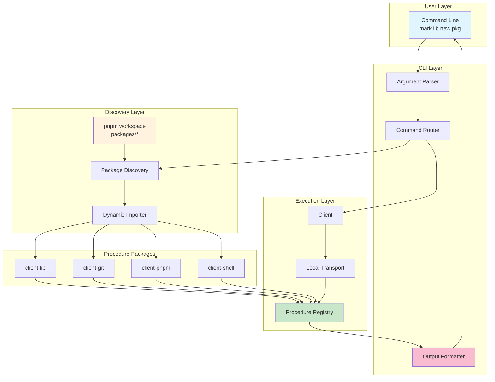
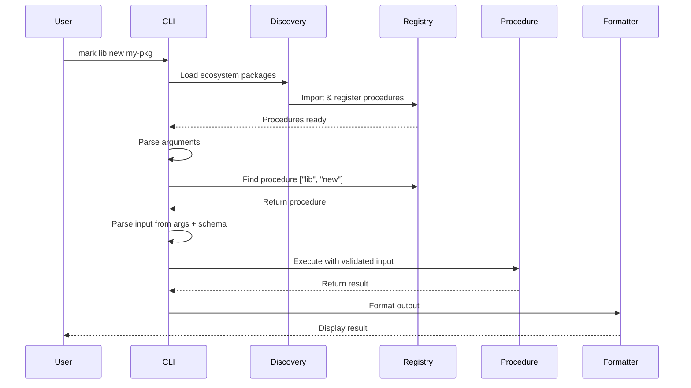
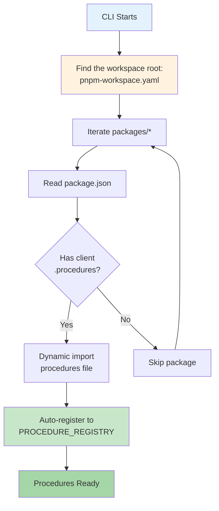
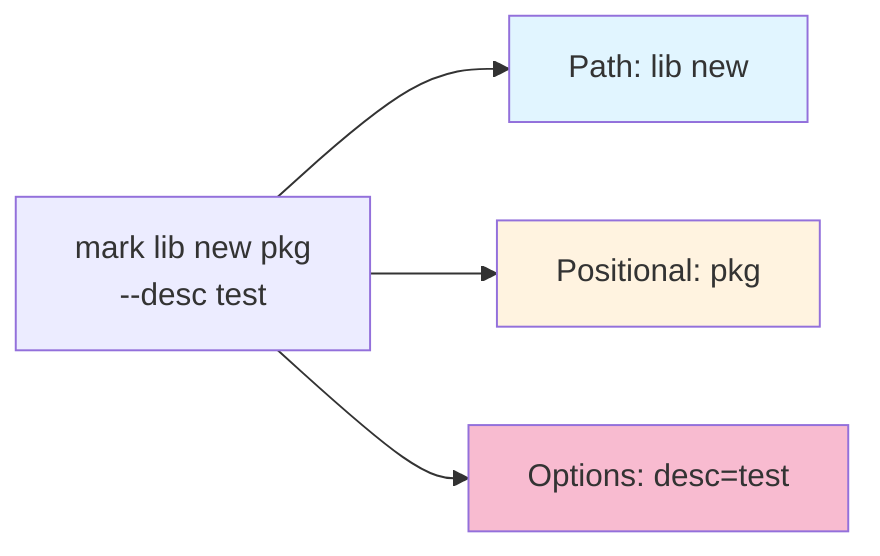
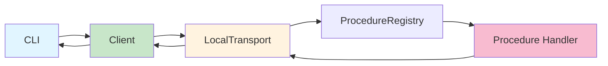

# @procedures/mark

[](https://www.npmjs.com/package/@procedures/mark)

```sh
npm install --global @procedures/mark
```

[](https://opensource.org/licenses/MIT)

> Mark CLI - Development workflow automation through dynamic procedure discovery

## Overview

`@procedures/mark` is a dynamic, extensible CLI that automatically discovers and executes procedures from ecosystem packages. It provides a unified interface for development workflows, package management, and automation tasks across the `@mark1russell7` ecosystem.

### Key Features

- **Dynamic Procedure Discovery**: Automatically loads procedures from ecosystem packages
- **Self-Documenting**: Generates help text from procedure schemas
- **Type-Safe**: Leverages Zod schemas for runtime validation
- **Multiple Output Formats**: text, json, table, streaming with spinners
- **Workspace-Aware**: Loads each package of its pnpm workspace that declares `client.procedures`
- **Extensible**: New commands added by installing procedure packages

## Architecture



## Installation

`mark` is the package `packages/mark` of the `client` monorepo. Build the workspace, then run the CLI:

```bash
pnpm install && pnpm build
node packages/mark/dist/cli.js --help
```

### Prerequisites

- Node.js >= 22.0.0
- pnpm (the version of the workspace `packageManager` field)

## Execution Flow



## API Reference

### CLI Binary

The package provides a `mark` binary for command-line usage.

#### Basic Syntax

```bash
mark [global options] <path...> [positional...] [--options]
mark serve [--procedures pkgs] [--port N] [--token T | --no-token] [--expose patterns] [--events topics] [--fs-root folder] [--probe-port N]
mark mcp [--bundles list] [--tool-timeout ms] [--read-only] [--http port] [--max-sessions n] [--fs-root folder] [--debug]
mark --server [--port N] [--host H] [--transport http|websocket|both] [--events topics] [--probe-port N]
mark -i
mark --fs-root <folder> <command | --server | -i | serve | mcp>
```

The bin is `dist/bin.js`. `node dist/cli.js` also runs the CLI. Importing `@procedures/mark` runs nothing.

#### The hosts

`mark` is the one command that a user needs. It starts each host of the ecosystem:

| Command | Host | Notes |
|---|---|---|
| `mark <command>` | This process | The registry has the module of each workspace package with `client.procedures`. |
| `mark --server` | The CLI server | The same registry, on `127.0.0.1`, with a token in the lockfile. A later `mark` command in the same folder uses it. |
| `mark serve` | The procedure server | The options of the `procedure-server` command. A package of `--procedures` resolves from the current folder, then from the folder of `mark`. A token is necessary by default. |
| `mark mcp` | The dev-tools MCP server, over stdio | The server of Claude Code's MCP configuration. stdout holds only protocol lines, and `mark mcp --help` writes to stderr. |

`mark mcp <procedure>` runs an `mcp.*` procedure (for example `mark mcp listTools`), not the server. Each host gets its policy from `hostPolicy()` of `@procedures/client`.

#### Remote events of the hosts

`mark --server` and `mark serve` always serve the procedure `events.subscribe` ([EVENTS.md](../documentation/EVENTS.md)):

- `--events <patterns>` gives the topics that a peer can subscribe to: exact names (`orders.created`), prefixes (`orders.*`) or `*`. Repeat the flag, or separate the patterns with commas.
- Without `--events`, the host serves no topic. Each subscription gets `TOPIC_NOT_FOUND`.
- The bus is the global bus of the process. The procedures get it as `ctx.bus`, so a procedure publishes with `ctx.bus.emit()`.
- The token of the host applies to a subscription. The hosts have no capability limits, so they permit each subscription to a topic of the rule.
- `mark mcp` serves no events: MCP carries only the tool calls, and `events.subscribe` is not a tool.

```bash
mark --server --transport both --events "orders.*"
mark serve --procedures ./my-procedures.js --events orders.created --events audit.created
```

#### The health probes of the hosts

`mark --server` and `mark serve` answer the probes of their service (CLI-9, decision D5). The probes give only the status, and they need no token.

- By default, each listener answers `GET /_probes/startup`, `/_probes/readiness` and `/_probes/liveness`. The answer is 200, or 503 with `Retry-After`. The probes stop when the listener closes at the stop of the intake.
- `--probe-port <port>` moves the probes to a port of their own, on the address of `--host`: `/startup`, `/readiness`, `/liveness` and `/report`. The listeners then answer no probes.
- The startup prints the URL of the probes.

```bash
curl http://127.0.0.1:3000/_probes/readiness
mark --server --probe-port 9090
```

#### The root of the files

`--fs-root <folder>` confines each procedure to the folder (roadmap R33). Each procedure keeps its paths in the folder, or `mark` refuses it. It applies to each mode and host of `mark`:

- A command in this process, the REPL (`-i`) and the CLI server (`--server`): the registry of `mark` gets the root (`confineToRoot()` of `@procedures/fs`).
- `mark serve` and `mark mcp`: the root goes to their servers. `mark mcp` also reads `MCP_FS_ROOT`.
- A path outside the folder gives `FORBIDDEN` with the reason `outside-root`. A relative path starts at the folder. A working folder without a value is the folder.
- The nested calls are confined too. For example, `mark --fs-root ./data lib scan` cannot list the packages of a workspace outside `./data`.
- A procedure that the folder cannot confine gives the same error, also for a path in the folder. Examples are `pnpm.*`, `docker.run`, `docker.compose.*`, `shell.run` and `vitest.run`.
- The `git.*` procedures are confined: git finds no repository above the folder, and the configuration of a repository starts no program.
- Give `--fs-root` before the command. After the command, it is an error, because the procedures loaded without it.
- A command uses a CLI server only when the server has the same root. The lockfile of the server records its root.

The rules and the table of the procedures are in [CAPABILITIES-2026-10.md](../documentation/CAPABILITIES-2026-10.md#the-root-of-the-files-roadmap-r33).

```bash
mark --fs-root ./data fs read notes.txt
mark --fs-root ./data sqlite tables --dbPath notes.db
mark --fs-root ./data --server
```

#### Global Options

A flag before the command path is a global flag. After the path, a flag is the command's flag when the command declares it. Otherwise it is a global flag. For example, `mark docker compose down -v` gives `-v` (volumes) to the command. To show the version, write `mark -v`. `mark lib audit` lists the command flags that hide a global flag.

| Option | Short | Description |
|--------|-------|-------------|
| `--help` | `-h` | Show help for command or group |
| `--version` | `-v` | Show CLI version |
| `--verbose` | `-V` | Enable verbose output during discovery |
| `--format <format>` | `-f` | Override output format (text, json, table, streaming) |
| `--local` | | Run the command in this process, not on the CLI server |
| `--json <json>` | | Execute raw procedure reference |
| `--fs-root <folder>` | | Keep each path of each procedure in the folder, also in the nested calls, and refuse the procedures that it cannot confine. Give it before the command. |
| `--server` | | Start the CLI server (with `--port`, `--host`, `--transport`, `--events`) |
| `--interactive` | `-i` | Start the REPL |

#### Exit Codes and Failures

`mark` exits with code 1 when:

- the command is unknown, or the command line has a problem (an unknown flag, a missing value, an extra argument);
- the input is not valid for the procedure;
- the procedure throws an error;
- the result reports a failure.

A procedure reports a failure in one of three ways:

1. It throws an error. This is the usual way.
2. It returns an object with `success: false`. Use this when the result has more to show, for example the problems that `lib audit` found.
3. It returns an object with an `exitCode` that is not 0. Use this for a procedure that runs an external command, for example `vitest run`.

For a streaming procedure, `mark` examines each item. One failed item makes the command fail.

#### Examples

```bash
# Show all available commands
mark

# Show help for a command group
mark lib --help

# Show help for specific command
mark lib new --help

# Execute command with options
mark lib new my-package --preset lib

# Override output format
mark git status --format json

# A global flag before the command (docker ps has its own --format)
mark --format json docker ps

# Verbose discovery
mark --verbose lib new my-pkg
```

### Programmatic API

#### `run(argv: string[]): Promise<void>`

Main CLI entry point.

```typescript
import { run } from "@procedures/mark";

// Execute CLI programmatically
await run(["lib", "new", "my-package"]);
```

#### `parseFromSchema(params, meta, schema?): Record<string, unknown>`

Parse CLI arguments based on procedure metadata. With the schema, each value is converted by the type of its field. `parseCommandLine(argv, procedures)` splits a whole command line: the global flags, the path and the input.

```typescript
import { parseFromSchema } from "@procedures/mark";

const params = {
  array: ["my-package"],
  options: { description: "My pkg" }
};

const meta = {
  args: ["name"],
  shorts: { description: "d" }
};

const input = parseFromSchema(params, meta);
// { name: "my-package", description: "My pkg" }
```

#### `generateHelp(path, meta, schema?): string`

Generate help text for a procedure.

```typescript
import { generateHelp } from "@procedures/mark";

const help = generateHelp(
  ["lib", "new"],
  {
    description: "Create a new library package",
    args: ["name"],
    shorts: { skipGit: "g" }
  },
  schema
);

console.log(help);
```

#### `formatOutput(print, result, format): void`

Format and print procedure results.

```typescript
import { formatOutput } from "@procedures/mark";

// print: an object with info, error, success, warning, table and spin (see format.ts)
formatOutput(print, { message: "Success!" }, "text");
formatOutput(print, { rows: [...] }, "table");
formatOutput(print, { data: {...} }, "json");
```

### CLI Metadata Interface

Procedures define CLI behavior via metadata:

```typescript
interface CLIMeta {
  /** Description for help text */
  description?: string;

  /** Field names that are positional args (in order) */
  args?: string[];

  /** Short flag mappings: { fieldName: "f" } */
  shorts?: Record<string, string>;

  /** Output format hint */
  output?: "text" | "json" | "table" | "streaming";

  /** Whether to prompt for missing required fields */
  interactive?: boolean;
}
```

### Questions for missing arguments

In a terminal, mark asks for each required argument that the command line does not give. The question shows the name, the type and the description of the field. mark does not ask in these cases:

- stdin or stdout is not a terminal;
- the environment variable `CI` is set;
- the command line has `--no-input` before the command;
- the procedure sets `interactive: false`.

Then a missing argument is an error of the input (exit code 1).

### Output Format Types

```typescript
type OutputFormat = "text" | "json" | "table" | "streaming";
```

## Ecosystem Discovery

### The command manifest

The build of mark writes `dist/manifest.json`. It holds the path, the CLI metadata, the input fields and the JSON Schema of each command. mark reads it first, so the help and a call to the CLI server do not load the procedures. The procedures load only when a command runs in this process.

- A fingerprint records the build of each package that has procedures (its `dist/.tsbuildinfo`). When a package is built again, added or removed, the manifest is stale. Then mark loads the procedures as before and writes the manifest again.
- mark depends on each package that has procedures, so `pnpm build` builds mark after them. A test fails when a package is missing from the dependencies of mark, or when the manifest after the build does not match the registry.

Measured on Windows with Node 24 (median of 5 runs, the same machine load):

| Command | Before | After |
|---|---:|---:|
| `mark --help` | 1127 ms | 164 ms |
| `mark git status` (CLI server) | 1170 ms | 352 ms |
| `mark git status --local` | 1141 ms | 1027 ms |

### Discovery of the procedures

The registry of `mark` is a registry of its own (`loadEcosystemRegistry()`). For each workspace package with `client.procedures`, `mark` imports its `./module` entry, which registers nothing, and puts its procedures in that registry with `createRegistry()`. A package without a `./module` entry still works: `mark` imports its procedures file and takes the procedures that the import adds to the global registry.

The CLI uses a multi-step discovery process to find and load procedures:

### Discovery Flow



### Package Structure

For a package to be discovered, it must:

1. Be a folder in `packages/` of the workspace that holds this CLI
2. Have a `client.procedures` field in package.json
3. Export procedure registrations from that file

A package that does not load gives one warning line. A package that is not built yet is reported only with `--verbose`.

**Example package.json:**
```json
{
  "name": "@procedures/lib",
  "client": {
    "procedures": "./dist/register.js"
  }
}
```

**Example register.js:**
```typescript
import { defineProcedure } from "@procedures/client";
import { z } from "zod";

const libNew = defineProcedure({
  path: ["lib", "new"],
  input: z.object({
    name: z.string(),
  }),
  handler: async (input, ctx) => {
    // Implementation
    return { message: "Created!" };
  },
  metadata: {
    description: "Create a new library",
    args: ["name"],
  },
});

// Auto-registers when imported
```

### Discovery Sources

| Source | Path | Description |
|--------|------|-------------|
| Workspace | `<root>/pnpm-workspace.yaml`, `<root>/packages/*` | The packages that `mark` examines |
| Package Metadata | `<pkg>/package.json` | Contains `client.procedures` path |
| Procedure Registry | `PROCEDURE_REGISTRY` | Global registry from `@procedures/client` |

## Argument Parsing

The CLI uses a smart parser that detects procedure paths and maps arguments correctly.

### Path Detection



### Parsing Rules

1. **Path Segments**: Consumed until a procedure match is found.
2. **Flags**: A flag is a field of the input schema (`--skip-git` or `--skipGit`), or the short letter of the metadata (`-m`). A flag that the procedure does not declare is a global flag. Otherwise it is an error.
3. **Types**: Each value is converted by the type of its field. A string field keeps its text: `mark fs exists 2024` gives the path `"2024"`, not a number. A number field needs a number. An object field, or a field with no type, takes JSON.
4. **Boolean Flags**: A boolean flag alone is `true`. It also takes `true` or `false` after it, `--flag=false`, or `--no-flag`.
5. **Arrays and Records**: A repeated array flag collects its values (`--tag a --tag b`). A record flag takes `key=value` and can be repeated (`--env A=1 --env B=2`). Both also take JSON.
6. **Positional Args**: The fields of `args` take the arguments in order. A last array field takes the rest. An argument that no field takes is an error.
7. **Values**: A negative number is a value (`--count -5`). `--` ends the flags: the tokens after it are arguments. Short boolean flags can be grouped (`-it`). A short flag can have its value attached (`-n5`).

### Examples

```bash
# Simple command
mark lib new my-package
# path: ["lib", "new"]
# input: { name: "my-package" }

# With options
mark lib new my-package --preset lib --dry-run
# input: { name: "my-package", preset: "lib", dryRun: true }

# A boolean flag with a value
mark git commit --message "message" --amend false
# input: { message: "message", amend: false }

# Short flags (the metadata of git push maps -f to force and -u to setUpstream)
mark git push -fu
# input: { force: true, setUpstream: true }

# Arguments that look like flags, after --
mark docker exec box -- ls -la /tmp
# input: { container: "box", command: ["ls", "-la", "/tmp"] }
```

### Metadata-Based Mapping

```typescript
// Procedure metadata
metadata: {
  args: ["name", "version"],     // Positional mapping
  shorts: { skipGit: "g" },      // Short flag mapping
}

// Command
// mark lib new my-pkg 1.0.0 -g

// Parsed input
{
  name: "my-pkg",
  version: "1.0.0",
  skipGit: true
}
```

## Output Formatting

The CLI supports multiple output formats for different use cases.

### Text Format

Default format for human-readable output.

```typescript
// Result with message
{ message: "Package created successfully!" }
// Output: Package created successfully!

// Result with output field
{ output: "file contents..." }
// Output: file contents...

// Result with error
{ success: false, message: "Failed to create" }
// Output: [ERROR] Failed to create
```

### JSON Format

Structured output for programmatic consumption.

```bash
mark lib scan --format json
```

```json
{
  "rootPath": "/path/to/client",
  "packages": { "@procedures/lib": { "name": "@procedures/lib" } }
}
```

### Table Format

Tabular data display.

```bash
mark procedure list --format table
```

```
path              description
fs read           Read file contents
fs write          Write content to file
```

### Streaming Format

Shows a spinner during execution, then displays the result.

```bash
mark lib audit --format streaming
# Running lib audit...
# lib audit complete
# Result displayed
```

## Integration with the Workspace

`mark` loads each package of its pnpm workspace that has a `client.procedures` field in its `package.json`. The field names the built module that registers the procedures.

### Procedure Packages

Each client package can export procedures:

```
packages/client-lib/
├── src/
│   ├── procedures/lib/new.ts
│   ├── procedures/lib/audit.ts
│   └── register.ts         # Registers all procedures
├── dist/
│   └── register.js         # Built procedures
└── package.json
    └── client.procedures: "./dist/register.js"
```

### Transport Layer



## Available Commands

Commands are discovered dynamically. Common procedure packages include:

### client-lib

Package management and scaffolding:
- `mark lib new <name>` - Create new package
- `mark lib scan` - List the workspace packages
- `mark lib audit` - Check the packages against the template

### client-git

Git operations:
- `mark git status` - Show git status
- `mark git commit` - Create commit
- `mark git push` - Push to remote

### client-pnpm

Package manager operations:
- `mark pnpm install` - Install dependencies
- `mark pnpm add <pkg>` - Add package
- `mark pnpm remove <pkg>` - Remove package

### client-shell

Shell command execution:
- `mark shell run <command>` - Run shell command
- `mark shell exec <command>` - Execute command
- `mark shell which <binary>` - Find binary in PATH

### client-procedure

Procedure management:
- `mark procedure new <path>` - Create new procedure
- `mark procedure list` - List all procedures

## Advanced Usage

### Procedure References

Execute procedures via JSON for advanced scripting:

```bash
# Execute procedure reference
mark --json '{
  "$proc": ["lib", "new"],
  "input": {
    "name": "my-package",
    "dryRun": true
  }
}'
```

### Chaining Commands

Use standard shell pipes. A failed command exits with code 1, so `&&` stops at it:

```bash
# Get package list and filter
mark --format json lib scan | jq '.packages | keys'

# Create a package, then audit the workspace
mark lib new my-pkg && mark lib audit
```

### Environment Variables

```bash
# The home folder holds the lockfiles of the CLI servers (~/.mark)
export HOME=/custom/path
```

## Development

### Building

```bash
pnpm --filter @procedures/mark build
```

### Testing

```bash
pnpm --filter @procedures/mark test       # unit tests (src/**/*.test.ts)
pnpm --filter @procedures/mark test:e2e   # end-to-end tests: they run dist/bin.js as a process
```

The end-to-end tests use a temporary home folder and a temporary workspace. They do not change the repository and do not use a running CLI server.

There is no container image of `mark`: the CLI server serves the workspace of the folder where it starts, on loopback, with a token in the lockfile of the user. A container cannot give that. To serve procedures over the network, use the `server` package.

### Project Structure

```
packages/mark/
├── src/
│   ├── bin.ts           # The mark executable
│   ├── cli.ts           # Main CLI implementation (also runnable as dist/cli.js)
│   ├── args.ts          # Command line splitting: global flags, path, procedure flags
│   ├── parse.ts         # Field types, value conversion and help text
│   ├── failure.ts       # Procedure-level failure and the exit code
│   ├── format.ts        # Output formatters
│   ├── ecosystem.ts     # Discovery system
│   └── index.ts         # Public API (importing it runs nothing)
├── e2e/                 # End-to-end tests
├── test/                # Test procedures for the unit tests
└── package.json
    └── bin: { "mark": "./dist/bin.js" }
```

### Key Modules

#### cli.ts

Main CLI implementation:
- Command routing
- Procedure execution
- Help generation
- Error handling

#### parse.ts

Argument parsing and schema introspection:
- `parseFromSchema()` - Parse args based on metadata
- `generateHelp()` - Generate help text
- `extractSchemaFields()` - Introspect Zod schemas

#### format.ts

Output formatting:
- `formatOutput()` - Format results based on type
- `formatText()` - Plain text output
- `formatTable()` - Tabular output

#### ecosystem.ts

Procedure discovery:
- `discoverFromEcosystem()` - Find procedure packages
- `loadEcosystemProcedures()` - Load and register procedures
- `listEcosystemProcedurePackages()` - List available packages

## Troubleshooting

### Procedure Not Found

```
Unknown command: mark foo bar
```

**Solution:**
1. Check that the package is in `packages/` of the workspace
2. Verify the package has `client.procedures` in package.json
3. Ensure the package is built (`pnpm build` in the workspace root)
4. Use `mark --verbose` to see which packages are being loaded

### Import Error

```
mark: the procedures of @procedures/foo did not load: <message>
```

**Solution:**
1. Check that the procedures file exists at the specified path
2. Verify the file is valid JavaScript (not TypeScript)
3. Build the workspace: `pnpm build`

### Help Not Showing Schema Fields

```
# Only shows basic help without field details
```

**Solution:** Ensure procedures have Zod schemas defined in the `input` field. The CLI introspects schemas to generate detailed help.

## Dependencies

The CLI depends on:

- `@procedures/client` - Client library and procedure system
- `@procedures/*` - Various procedure packages
- `chalk`, `ora`, `cli-table3` - Terminal output
- `zod` - Schema validation

## License

MIT

## Repository

https://github.com/mark1russell7/cli

## Author

Mark Russell <marktheprogrammer17@gmail.com>
