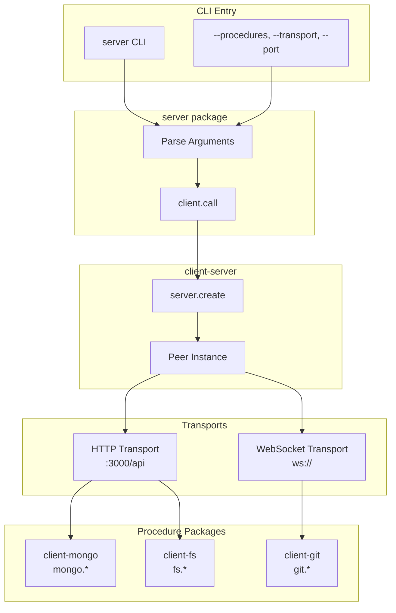
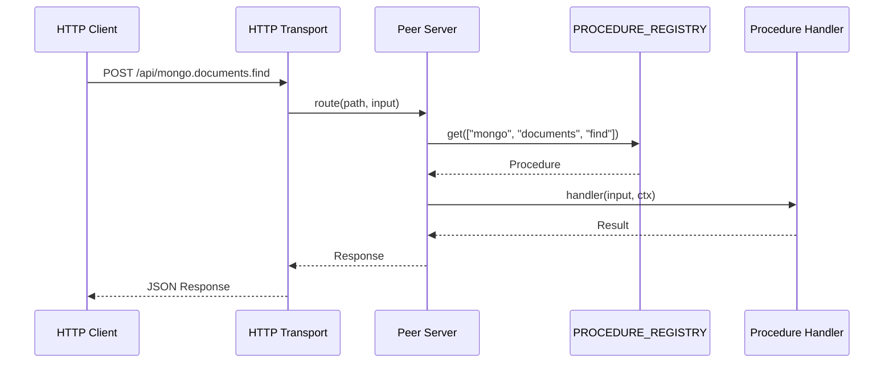
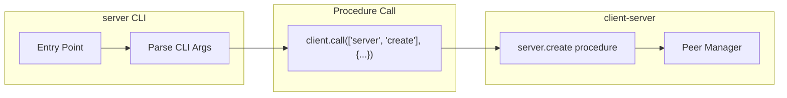
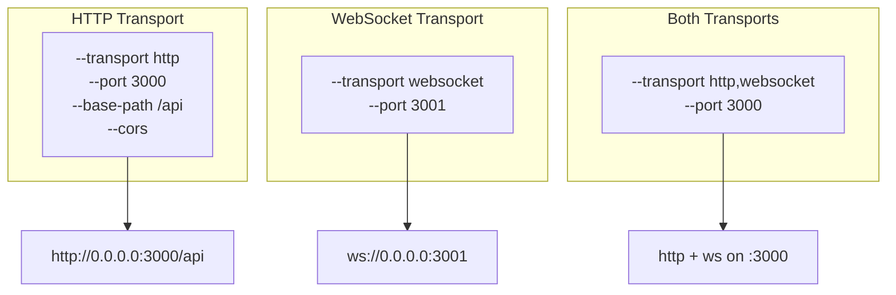
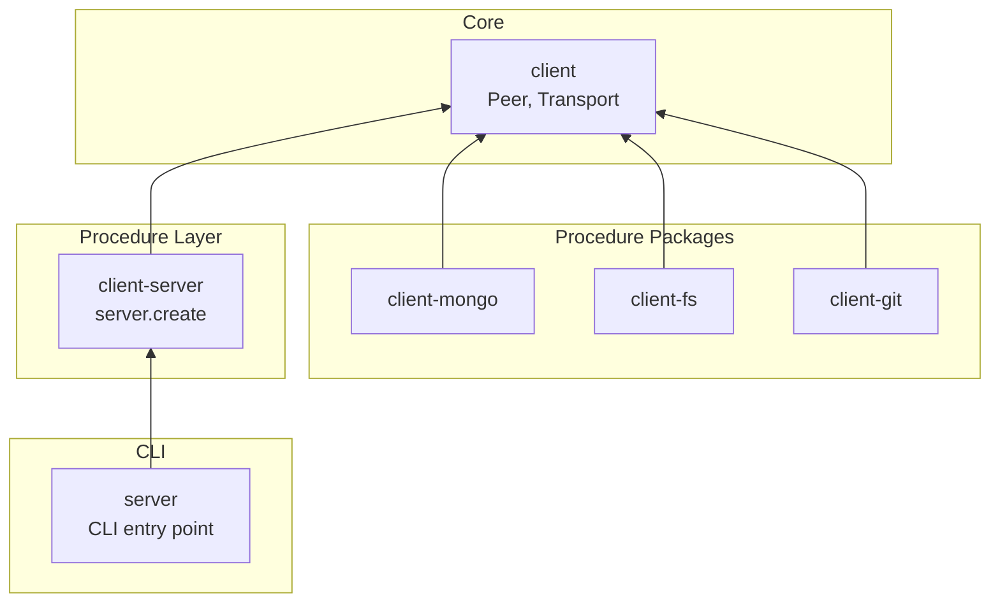

# @procedures/server

[](https://www.npmjs.com/package/@procedures/server)

[](https://opensource.org/licenses/MIT)
[](https://www.typescriptlang.org/)
[](https://nodejs.org/)

> General procedure server - run any procedure packages via HTTP or WebSocket transports.

## Table of Contents

- [Overview](#overview)
- [Installation](#installation)
- [Architecture](#architecture)
- [Quick Start](#quick-start)
- [CLI Reference](#cli-reference)
- [Procedures](#procedures)
- [Examples](#examples)
- [Integration](#integration)
- [Requirements](#requirements)
- [License](#license)

---

## Overview

**server** is a CLI tool that runs procedure packages as HTTP/WebSocket servers:

- **Universal** - Run any combination of procedure packages
- **Multi-Transport** - HTTP, WebSocket, or both simultaneously
- **Dogfooding** - Uses `server.create` procedure internally
- **Zero Config** - Sensible defaults, fully configurable

---

## Installation

```bash
npm install -g @procedures/server
```

---

## Architecture

### System Overview



### Request Flow



### Dogfooding Pattern



---

## Quick Start

```bash
# Start MongoDB procedure server
procedure-server --procedures @procedures/mongo/register --port 3000

# Start with multiple procedure packages
procedure-server -p @procedures/fs/register,@procedures/git/register

# Start with multiple transports
procedure-server -p @procedures/mongo/register -t http,websocket
```

---

## CLI Reference

### Options

| Option | Alias | Default | Description |
|--------|-------|---------|-------------|
| `--procedures` | `-p` | - | Comma-separated procedure packages to load |
| `--transport` | `-t` | `http` | Transports: http, websocket, local |
| `--port` | - | `3000` | Port for the primary transport |
| `--host` | - | `127.0.0.1` | Host to bind to. `0.0.0.0` serves every loaded procedure to the network |
| `--base-path` | - | `/api` | Base path for HTTP transport |
| `--cors` | - | off | Enable CORS |
| `--no-cors` | - | - | Disable CORS |
| `--token` | - | `SERVER_TOKEN`, or a random token that the server prints | The token that every request sends: `Authorization: Bearer <token>`, or `?token=` for WebSocket |
| `--no-token` | - | - | Serve without a token (only on a trusted host) |
| `--expose` | `-e` | every loaded procedure | Comma-separated procedures to serve: exact keys (`git.status`) or prefixes (`git.*`) |
| `--events` | - | no topics | The topics of the event bus that a peer can subscribe to. Exact names (`orders.created`), prefixes (`orders.*`) or `*`. Repeat the option, or separate the patterns with commas. |
| `--fs-root` | - | no root | The root of the files: each procedure keeps its paths in this folder, also in the nested calls, or the server refuses it |
| `--probe-port` | - | the probes answer on each listener under `/_probes` | The port of the health probes, on the address of `--host`. Refer to "The health probes". |
| `--verbose` | `-v` | - | Verbose output |
| `--help` | `-h` | - | Show help |

`mark serve` takes the same options and starts the same server. `mark --fs-root <folder> serve` gives the root to the server too.

### Remote events

The server always serves the procedure `events.subscribe` ([EVENTS.md](../documentation/EVENTS.md)). The `--events` patterns are its topic rule:

- Without `--events`, the rule is empty. Each subscription gets `TOPIC_NOT_FOUND`.
- The `--expose` list does not apply to `events.subscribe`. The topic rule is its expose rule.
- The bus is the global bus of the process. The procedures of the server get it as `ctx.bus`, so a procedure publishes with `ctx.bus.emit()`.
- The token applies to a subscription as to each call. The server has no capability, so it permits each subscription to a topic of the rule.
- A subscriber uses WebSocket (`transport.subscribe()`) or HTTP with NDJSON (`subscribeRemote()`).

```bash
procedure-server -p ./my-procedures.js -t http,websocket --events "orders.*" --events audit.created
```

### The health probes

The server answers the probes of its service (CLI-9, decision D5). The probes come from `@mark1russell7/service/http`. They give only the status, and they need no token.

- By default, each listener answers `GET /_probes/startup`, `/_probes/readiness` and `/_probes/liveness` (`probeHandler()`). The answer is 200, or 503 with `Retry-After` during the startup and the shutdown.
- The probes of a listener stop when the intake stops. Then the listener closes, and a new connection is refused, as before.
- With `--probe-port <port>`, a probe server on its own port answers `/startup`, `/readiness`, `/liveness` and `/report` (`probeServer()`). It starts first and closes last, thus the probes answer through the whole drain. The listeners then answer no probes.
- A listener does not answer `/_probes/report`, because the report names the checks and the dependencies. The probe server answers it: give it an address that only the platform reaches.
- The startup prints the URL of the probes.

```bash
procedure-server --port 3000 --probe-port 9090
curl -i http://127.0.0.1:9090/readiness
```

### The root of the files

With `--fs-root <folder>`, the server starts `confineToRoot()` of `@procedures/fs` after it builds its registry (roadmap R33):

- Each procedure refuses a path outside the folder with `FORBIDDEN` and the reason `outside-root`. A relative path starts at the folder. A working folder without a value is the folder.
- The `fs.*` procedures get the handlers of the root. A procedure with rules (`metadata.fsRoot`) gets each path of its rules examined. A nested call is confined too.
- The server refuses each procedure that the folder cannot confine, with the same error: `pnpm.*`, `docker.run`, a call of `shell.run`, and a procedure that reaches files without rules.
- The `git.*` procedures are confined: git finds no repository above the folder (tracker item O35).
- The folder refuses `server.start`, `server.stop` and `server.status` of this package. They read and write the lock files in the home folder (`~/.mark`), and `server.start` starts a server without the folder.
- The server does not start when the folder does not exist, or when it cannot load a version of `@procedures/fs` with `confineToRoot()`.

The rules and the table of the procedures are in [CAPABILITIES-2026-10.md](../documentation/CAPABILITIES-2026-10.md#the-root-of-the-files-roadmap-r33).

The server has a registry of its own (roadmap 3.1): the `server.*` procedures and the `./module` entry of each `--procedures` package. The `server.*` procedures come from two modules: the module of `@procedures/peer` (`server.create`, `server.call` and the others) and the module of this package. Two servers in one process serve only their own packages. `pkg/register`, the form of the old examples, gives the module of `pkg`. A package without a `./module` entry still works: the server takes the procedures that its import registers. The token, the `--expose` list and the browser checks come from `hostPolicy()` of `@procedures/client`.

### Transport Configuration



---

## Procedures

The package has three procedures. They manage the background server of the `mark` CLI (`mark --server`). In version 0.3.0 and before, they were in `@procedures/peer`. Their names did not change.

| Procedure | Function |
|---|---|
| `server.start` | Start the CLI server as a background process, and wait for its readiness. It writes `~/.mark/server.log`. |
| `server.stop` | Stop the CLI servers of the lockfiles, or the server of one port. A process that does not answer as the peer of its lockfile gets no signal. |
| `server.status` | Give the state of the CLI servers. It deletes the lockfile of a server that does not answer. |

- `import "@procedures/server/register"` registers them in the global registry. The package root and the `./module` entry register nothing.
- `mark` finds the package from its `client.procedures` field: `mark server start`, `mark server stop` and `mark server status` run them.
- The lockfiles stay in `@procedures/peer` (`@procedures/peer/lockfile`), because the peer of `mark --server` writes them.
- `server.start` waits for the readiness of the server (CLI-9). It reads the readiness probe of the listener (`/_probes/readiness`) until it answers 200. The probe has no identity, thus `host.info` must also answer the token of the new lockfile with its peer id. A listener without probes (a build of `mark` before CLI-9) answers 404, and then `host.info` alone tells the readiness.
- The wait stops as soon as the server is ready or its process exits. `timeout` (milliseconds, default 15000) sets the limit.
- At the timeout, `server.start` gives `success: false` with the PID of the process that still starts. Before CLI-9, it gave `success: true` with the message "still loading".

---

## Examples

### MongoDB Server

```bash
procedure-server --procedures @procedures/mongo/register --port 3000
```

**Output:**
```
Starting procedure server...
  Loading: @procedures/mongo/register

Server started!
  Server ID: server-1703694523456
  Procedures: 16

Endpoints:
  [http] http://0.0.0.0:3000/api

Press Ctrl+C to stop the server.
```

### Multi-Package Server

```bash
procedure-server -p @procedures/fs/register,@procedures/git/register \
       -t http,websocket \
       --port 3000
```

### Calling Procedures

```bash
# HTTP call
curl -X POST http://localhost:3000/api/mongo.documents.find \
  -H "Content-Type: application/json" \
  -d '{"collection": "users", "filter": {"active": true}}'

# Response
{"documents": [{"_id": "...", "name": "Alice"}], "count": 1}
```

---

## Integration

### Replacing Domain-Specific Servers

The `server` package replaces domain-specific server packages:

```bash
# OLD (deprecated)
npx @mark1russell7/server-mongo

# NEW (general)
npx procedure-server --procedures @procedures/mongo/register
```

### The runner entry

The server CLI, `mark serve` and `mark --server` start through `runProcedureHost()` (CLI-8). It declares the parts of `createProcedureHost()` of `@procedures/peer` in one service of `@mark1russell7/service`, and starts `run()`.

```typescript
import { runProcedureHost } from "@procedures/server";
import { peerHostOptions } from "@procedures/peer";

const { host, life } = await runProcedureHost({
  name: "procedure-server",
  mode: "foreground",
  host: peerHostOptions({ id, transports: [{ type: "http", port: 3000 }], registry, policy }),
});
await life.done; // the runner ends the process after the stop in stages
```

- **The signals.** The runner owns `SIGINT`, `SIGTERM` and `SIGQUIT`. The entry installs no signal handler and no hard-exit timer.
- **The profiles.** The mode `foreground` has the profile `localDev`: a second Ctrl-C exits at once. The mode `background` (`mark --server`) has the profile `daemon`: a repeat signal has no effect. The caps of the stages sum to 10 s.
- **The lockfile.** `lockfile` makes the lockfile a dependency of the service. The startup writes it before the listeners start, and the shutdown removes it after the listeners close.
- **The probes.** Each listener of the host answers the probes under `/_probes` (CLI-9). `probes: { port, host, prefix, retryAfter }` moves them to a probe server on a port of its own (decision D5). `probes()` of the result gives the base URL of each place that answers them.
- **The parts of the app.** `declare(svc, host)` gives the builder of the service to the app before `run()` (CLI-62). The app declares its transports, dependencies, checks and phase work with the methods of the builder. `describe()` shows them, and the runner starts and stops them with the host. The example follows this list.
- **Outside a service.** `startServer()` starts the same server as a peer, for a test or an app that has its own lifecycle.

```typescript
const { host, life } = await runProcedureHost({
  name: "app-dev",
  mode: "foreground",
  // The calls wait for the readiness of the dependency of the app (CLI-45)
  host: { name: "app", registry, policy, controller: { requires: ["mongo"] }, listen },
  declare: (svc) => {
    // A connection of the app: it connects before the listeners start, and it closes after them
    svc.dependency("mongo", { system: null, knobs: {}, operations: { find: { idempotent: true } } }, {
      connect: () => mongo.connect(),
      close: () => mongo.close(),
    });
    svc.check({ name: "mongo.ping", dependency: "mongo", step: "round-trip", ownConnection: true, gates: "readiness", poll }, ping);
    // A child process of the app, for example the Vite dev server: it starts after the host, and it stops in the stage "close transports"
    svc.server("app.vite", {}, viteTransport);
  },
});
```

- The parts of the app come after the parts of the host. Thus the server of the host starts before a transport of the app. A listener of the app can mount `host.handler`.
- The lockfile comes after the dependencies of the app. It connects last, and it closes first.
- Without `declare`, the service has only the parts of the host.

### Package Hierarchy



---

## Requirements

- **Node.js** >= 22
- **Dependencies:**
  - `@procedures/client`
  - `@procedures/peer`
  - One or more procedure packages

---

## License

MIT
